# 轻小说文库 (Wenku8) Android 客户端

[](https://app.fossa.com/projects/git%2Bgithub.com%2FMewX%2Flight-novel-library_Wenku8_Android?ref=badge_shield)
[](https://github.com/MewX/light-novel-library_Wenku8_Android/actions/workflows/android-ci.yml)
[](https://coveralls.io/github/MewX/light-novel-library_Wenku8_Android)

项目主页：[https://wenku8.app](https://wenku8.app)

[](https://play.google.com/store/apps/details?id=org.mewx.wenku8)

如果您想打赏我用爱发电的代码，可以点击这个链接帮我充电 ❤️：
[](https://www.buymeacoffee.com/mewx)

---

## <a id="toc"></a>目录 (Table of Contents)

- [2.0 版本简介（Vibe Coded 世代重构）](#v2-intro)
  - [核心特性亮点](#v2-highlights)
  - [Credits 与 Vibe Coding 致谢声明](#credits)
  - [2.0 版本主要视图（Pixel 8 实机截图）](#app-2.0-main-view)
  - [墨水屏高对比模式（E-Ink 专属适配）](#v2-eink)
  - [2.0 源代码结构与架构](#app-2.0-source)
  - [2.0 技术栈与开源依赖](#v2-libs)
  - [编译构建说明（`:api` 与 `api-stub`）](#build-guide)
- [仓库目录说明（`v0` / `v1` / `v2` 归档结构）](#dir-info)
- [1.x 与 0.5.2.1 历史版本归档](#v1-archive)
  - [1.x 写在前面（2015 开源手记）](#foreword)
  - [1.x 版本视图与源代码结构](#app-1.x-info)
    - [1.x 主要视图](#app-1.x-main-view)
    - [1.x 源代码结构](#app-1.x-source)
  - [0.5.2.1 典藏版](#app-0520)
    - [0.5.2.1 预览图](#app-0520-preview)
    - [0.5.2.1 源代码结构](#app-0520-source)
  - [历史 UMENG 统计数据](#umeng)
  - [1.x 版本存档文件结构（`.wk8`）](#saves)
  - [1.x 历史二次开发指引](#app-sec-dev)
  - [1.x 版本用到的开源库](#v1-libs)
  - [开发者的碎碎念（2015）](#mewx)
- [LICENSE 与 Contributors](#license)

---

## <a id="v2-intro"></a>2.0 版本简介（Vibe Coded 世代重构）

**轻小说文库 Android `2.0`（`:app-v2`）** 是在初代 Material Design 1 版本发布十余年后的一次彻底世代重构。新版本完全抛弃了旧版繁杂的 `Activity`/`Fragment`/`AsyncTask` 视图栈，采用 **100% Kotlin + Jetpack Compose（Material 3 Expressive）** 从零重写，同时严格保留了正式版包名 `org.mewx.wenku8`，支持从 Google Play 商店已发布的 `1.x` 版本**直接原位覆盖升级并自动无损迁移全部本地数据**。

> [!IMPORTANT]
> **Vibe Coding 声明**：本项目的 **`2.0` 版本通过 Vibe Coding 方式打造，从前期旧版功能盘点、Material 3 Expressive 设计规范、Kotlin / Compose 代码实现、阅读引擎、数据迁移与备份系统，到自动化测试套件与文档，均完全由 `Gemini Carbon (High)` 完成！**

### <a id="v2-highlights"></a>核心特性亮点

- **Material 3 Expressive 自适应界面架构**：精简为清晰直观的四栏主导航（`书架` · `最新` · `排行` · `我的`），自动适配手机底部导航栏与平板/折叠屏 `NavigationRail`；支持作品封面共享元素过渡动画、Android 12+ 动态壁纸取色、经典蓝/暖白/碳墨深色/纯黑 OLED 主题以及**全局墨水屏高对比模式**（1dp 实体描边 + 零过渡动画）。
- **六模式中文排版阅读引擎与插图灯箱**：
  - 基于原生 `StaticLayout` 深度定制的 CJK 排版分页引擎，内置 **覆盖翻页、仿真卷曲、平滑滑动、上下卷轴、日式竖排（从右至左）、墨水屏极速** 六种阅读模式。
  - **排版与纸张工作室**：半透明实时预览字号、行距、段距、页边距、繁简转换与自定义字体导入；章节目录面板默认聚焦**当前分卷**，告别数百章长列表翻找困扰。
  - **Artbook 插图画集灯箱**：一键抽离本卷全部插图，支持双指无级缩放、跨页彩插左右拼合、底部胶片缩略图速览与高清原图保存，并内置全文检索、章节书签与系统 TTS 语音朗读。
- **本地优先 Room 数据库（WAL）与智能云端同步**：
  - 采用 Room SQLite（WAL 并发模式）管理书架元数据、分卷目录、阅读进度、阅读时长热力图与离线缓存状态。
  - 本地书架支持**网格 / 列表 / 书脊**三视图切换、“继续阅读”轮播卡片、进入书架自动云端同步（带防抖 TTL 与任务互斥保护），以及将智能更新与强制刷新收纳合一的折叠式 `云端同步 | ▾` 按钮。
  - 离线缓存支持 **智能更新、仅下载未缓存章节、分卷选择下载、全本覆盖重下** 四种策略。
- **`1.x` 无损自动迁移与 `.wk8backup.zip` 便携备份**：首次启动自动检测并迁移 `1.x` 的本地书架、阅读进度、离线小说文本与插图以及登录凭据；同时提供全新的 `.wk8backup.zip` 一键导出与智能合并导入。
- **默认开启的自动网络中转优化与诊断中心**：内置 Cloudflare 中转连通性自动评估、故障无缝切换与单轴对比实验工具，显著提升不同网络环境下的访问成功率。
- **链接分享、App Links 与桌面小组件**：作品分享直接生成 `https://share.wenku8.app/book/<aid>` 链接并注册系统级深度链接，点击链接即可在应用内直达对应作品详情页；同时提供主屏幕“继续阅读”桌面小组件。

---

### <a id="credits"></a>Credits 与 Vibe Coding 致谢声明

- **`2.0` 版本全栈架构、UI 设计与代码实现（Vibe Coding）**：
  - **完全由 `Gemini Carbon (High)` 完成** —— 独立完成了 `v2.0` 的旧版代码考古、产品与视觉设计文档（[`docs/designs/v2/`](docs/designs/v2/README.md)）、`:app-v2` 全部 Kotlin / Jetpack Compose 源代码、Room 数据库与 `1.x` 迁移器、阅读与插图引擎、GitHub Actions CI 适配以及全套单元与 Robolectric UI 测试。
- **项目原作者、架构指导与基础设施维护**：
  - [**MewX**](https://www.mewx.org) —— 项目发起人、`0.5.x` 与 `1.x` 版本原作者、中转与分享服务端基础设施搭建，以及 `2.0` Vibe Coding 过程中的产品决策、体验把控与真机验收。
- **历史版本（`1.x` / `0.5.x`）贡献与特别致谢**：
  - **Yanix**（[SeraphRoy / Baby Pepper](https://github.com/SeraphRoy)）—— `1.x` 版本代码贡献
  - **Jack Liu**（[aaassseee](https://github.com/aaassseee)）—— `1.x` 版本代码贡献
  - **ZERO** —— `1.x` 版本 Material Design 界面设计（设计原稿见 [`docs/designs/v1/`](docs/designs/v1/)）
  - **妻兔姬** —— 早期版本测试与用户反馈协助

---

### <a id="app-2.0-main-view"></a>2.0 版本主要视图（Pixel 8 实机截图）

> 点击任意缩略图即可查看 `1080 × 2400` 高清原图（源文件位于 [`screenshots/v2/`](screenshots/v2/)）。

- **主导航与全站发现（本地书架 · 最新更新 · 二维排行榜 · 即时+全站搜索）**

[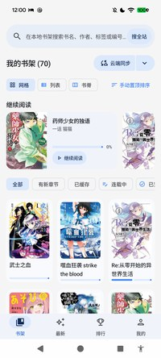](screenshots/v2/2.0-bookshelf.jpg)
[](screenshots/v2/2.0-latest.jpg)
[](screenshots/v2/2.0-rankings.jpg)
[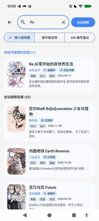](screenshots/v2/2.0-search.jpg)

- **作品详情、分卷目录、四模式离线缓存与书评社区**

[](screenshots/v2/2.0-novel-detail.jpg)
[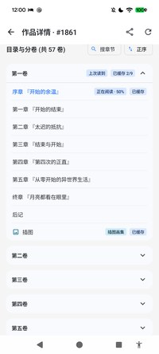](screenshots/v2/2.0-novel-toc.jpg)
[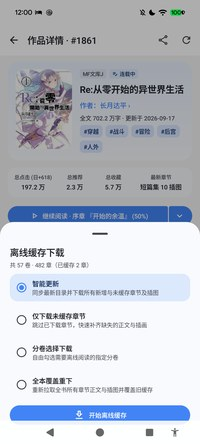](screenshots/v2/2.0-novel-download.jpg)
[](screenshots/v2/2.0-reviews.jpg)

- **六模式阅读引擎、本卷目录、实时排版工作室与插图画集灯箱**

[](screenshots/v2/2.0-reader-day.jpg)
[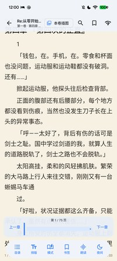](screenshots/v2/2.0-reader-hud.jpg)
[](screenshots/v2/2.0-reader-toc.jpg)
[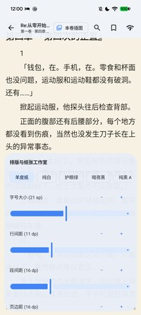](screenshots/v2/2.0-reader-typography.jpg)

[](screenshots/v2/2.0-reader-modes.jpg)
[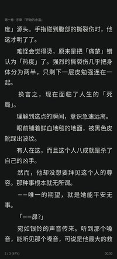](screenshots/v2/2.0-reader-night.jpg)
[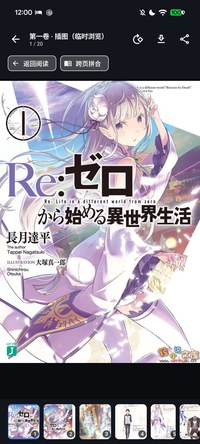](screenshots/v2/2.0-artbook.jpg)

- **“我的”中心（文库账号、阅读足迹与网络优化）、经典 Logo 登录面板、全局偏好与网络诊断**

[](screenshots/v2/2.0-profile.jpg)
[](screenshots/v2/2.0-login.jpg)
[](screenshots/v2/2.0-profile-settings.jpg)
[](screenshots/v2/2.0-network-diagnostics.jpg)

---

### <a id="v2-eink"></a>墨水屏高对比模式（E-Ink 专属适配）

针对文石（BOOX）、汉王、掌阅、墨案等开放式 Android 电子纸阅读器，`2.0` 内置了全局级的 **墨水屏高对比模式（E-Ink Mode）**，并非简单的黑白滤镜，而是从主题令牌、组件描边到动画曲线的深度定制：

- **纯白底色与纯黑油墨对比**：全局移除 Material 3 默认的灰阶阴影与半透明表面叠色，统一采用 `#FFFFFF` 纯白背景与 `#000000` 高对比文字/主按钮，彻底杜绝电子纸灰阶抖动发虚。
- **全局 `1dp` 实体描边**：所有卡片、搜索框、筛选标签、分卷面板、浮动工具栏与底部导航栏自动切换为锐利的 `1dp` 实体黑框，层级边界一目了然。
- **零残影无动画交互 + 墨水屏极速翻页**：全局关闭页面切换与弹窗过渡动画，配合阅读器内置的 **“墨水屏极速”** 无动画瞬切翻页模式与物理音量键翻页，最大限度减少电子墨水屏刷新残影与闪烁。

[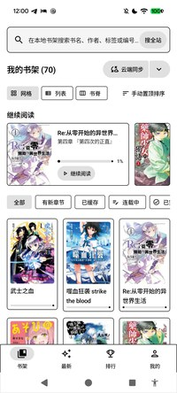](screenshots/v2/2.0-eink-bookshelf.jpg)
[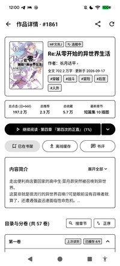](screenshots/v2/2.0-eink-novel-detail.jpg)
[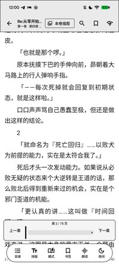](screenshots/v2/2.0-eink-reader.jpg)
[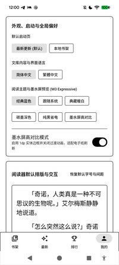](screenshots/v2/2.0-eink-profile.jpg)

---

### <a id="app-2.0-source"></a>2.0 源代码结构与架构

`2.0` 主工程位于 `studio-android/LightNovelLibrary/app-v2/`，采用清晰的 **UI (Compose) -> Domain / Repository -> Local (Room + DataStore) & Remote (OkHttp + Relay + `:api`)** 分层架构：

```text
studio-android/LightNovelLibrary/app-v2/src/main/java/org/mewx/wenku8
├── MainActivity.kt                      # 单 Activity 宿主、1.x 升级迁移引导与 App Links 入口
├── Wenku8Application.kt                 # 应用级依赖容器、Coil 图片管线与通知渠道初始化
├── data/
│   ├── local/
│   │   ├── db/                          # Room SQLite (WAL) 数据库、DAO 与实体定义
│   │   ├── migration/                   # 1.x 旧版书架、阅读进度、缓存与加密登录态无损迁移器
│   │   └── preferences/                 # Jetpack DataStore 全局偏好与加密凭据存储
│   ├── network/                         # OkHttp 客户端、Cloudflare 自动中转优化与网络诊断探针
│   └── repository/                      # 书架同步、目录缓存、发现排行、书评、公告与 .wk8backup.zip 备份仓库
├── domain/model/                        # 领域模型（作品、分卷章节、阅读会话、排版配置、网络报告等）
├── reader/                              # CJK StaticLayout 分页引擎、日式竖排渲染与章节内容解析器
├── tts/                                 # Android TextToSpeech 章节朗读控制器
├── ui/
│   ├── bookshelf/                       # 书架页（网格/列表/书脊、继续阅读轮播、云端同步折叠菜单）
│   ├── latest/                          # 最新页（最近更新 / 最新入库 / 完结精品）
│   ├── rankings/                        # 二维排行榜矩阵（点击/推荐/收藏/字数 × 日/周/月/总榜）
│   ├── search/                          # 即时本地书架匹配 + 全站搜索（标题/作者/AID 直达）
│   ├── detail/                          # 作品详情、分卷目录、四模式离线缓存面板
│   ├── review/                          # 书评列表、楼中楼详情、发表书评与回复
│   ├── reader/                          # 六模式统一阅读器、本卷目录、排版工作室与 Artbook 插图灯箱
│   ├── profile/                         # “我的”页面、文库公告、经典 Logo 登录面板、热力图历史与网络诊断
│   ├── migration/                       # 1.x 升级数据迁移进度界面
│   ├── navigation/                      # Material 3 自适应导航骨架、共享元素过渡与 share.wenku8.app 路由
│   └── theme/                           # M3 Expressive 色彩系统、字体排版与墨水屏高对比主题
└── widget/                              # 桌面“继续阅读” AppWidget 小组件
```

### <a id="v2-libs"></a>2.0 技术栈与开源依赖

- **Kotlin & Coroutines / Flow**（Apache-2.0）：全异步响应式数据流与结构化并发。
- **AndroidX Jetpack Compose & Material 3 Expressive**（Apache-2.0）：现代声明式 UI、自适应导航套件、`HorizontalFloatingToolbar` 与共享元素过渡。
- **AndroidX Room & SQLite WAL**（Apache-2.0）：本地优先结构化持久化数据库。
- **AndroidX DataStore & Security Crypto**（Apache-2.0）：类型安全偏好设置与加密会话存储。
- **AndroidX WorkManager**（Apache-2.0）：后台多章节离线缓存队列管理。
- **Square OkHttp**（Apache-2.0）：高性能 HTTP/TLS 网络传输与自动中转探测。
- **Coil 3 (`coil-compose`)**（Apache-2.0）：协程优先的封面与高清插图三级缓存加载管线。
- **Kotlinx Serialization**（Apache-2.0）：`.wk8backup.zip` 备份清单与结构化 JSON 序列化。
- **OpenCC (`android-opencc`)**（Apache-2.0）：离线简繁体中文双向排版转换。
- **JUnit 4 / Robolectric / MockWebServer / Compose UI Test**（EPL / MIT / Apache-2.0）：覆盖数据库迁移、书架双向同步边界、网络中转与全界面交互的本地 JVM 测试套件。

### <a id="build-guide"></a>编译构建说明（`:api` 与 `api-stub`）

出于接口密钥保护原因，官方签名协议模块 `:api` 为私有 Git 子模块；当外部贡献者在未拉取私有子模块的环境下克隆本仓库时，`settings.gradle` 会**自动无缝回退至开源桩模块 `api-stub/`**，因此无需任何私有密钥即可直接编译和运行测试：

```bash
cd studio-android/LightNovelLibrary

# 编译 2.0 调试版 APK
./gradlew :app-v2:assembleAlphaDebug

# 运行 2.0 单元测试与 Robolectric UI 测试
./gradlew :app-v2:testAlphaDebugUnitTest

# 编译保留归档的 1.x 旧版模块（可选）
./gradlew :app-v1:assembleAlphaDebug
```

---

## <a id="dir-info"></a>仓库目录说明（`v0` / `v1` / `v2` 归档结构）

1. **`studio-android/LightNovelLibrary/`** —— Android Studio 多模块主工程：
   - **`app-v2/`**：**`2.0` 正式版完整源码**（Kotlin + Jetpack Compose + Material 3 Expressive，包名 `org.mewx.wenku8`）。
   - **`app-v1/`**：**`1.x` 经典版完整源码归档**（Java + Material Design 1，Java 命名空间已隔离至 `org.mewx.wenku8.v1`，仍可独立编译）。
   - **`api/` & `api-stub/`**：文库协议加密签名子模块及面向开源构建自动启用的兼容桩模块。
2. **`docs/designs/`** —— 按世代划分的设计文档与视觉稿：
   - **`docs/designs/v2/`**：`2.0` 版本架构设计规范、旧版功能考古、数据库与备份协议说明及高分交互原型。
   - **`docs/designs/v1/`**：`1.x` 版本由设计师提供的 `PxCook` Material Design 1 标注稿（原根目录 `design-source/`）。
3. **`screenshots/`** —— 按世代划分的应用实机截图：
   - **`screenshots/v2/`**：`2.0` 版本 Google Pixel 8 实机高清截图与缩略图。
   - **`screenshots/v1/`**：`1.x`（Material Design 1）历史版本截图归档。
   - **`screenshots/v0/`**：`0.5.2.x` 早期典藏版历史截图归档。
4. **`graph-source/`** —— 品牌图标、轻小说文库高清重绘 Logo、Google Play 徽章及早期 Fireworks 制图源文件。
5. **`eclipse-android/` & `eclipse-android-old/`** —— 2014 年早期 `0.5.1`（Eclipse ADT）与 `0.5.2.1` 典藏版历史源码归档。

---

# <a id="v1-archive"></a>1.x 与 0.5.2.1 历史版本归档

> [!NOTE]
> 以下内容完整保留自 `1.x`（2015 Material Design 1 版）与 `0.5.2.1` 典藏版的原始开源文档，图片与设计稿路径已同步更新至 `screenshots/v1/`、`screenshots/v0/`、`docs/designs/v1/` 与 `app-v1/`，供查阅项目十年演进历程参考。


<a id="foreword"></a>写在前面
==========

Material Design风格的`轻小说文库`App**完全**开源了！想实践Material Design的可以参考本项目的源代码，不清楚的、以及各种相关话题都可以发`issue`交流~

这个项目是我第一次写安卓App，首先看了一本入门书籍，是chinapub写书评赠送的`《第一行代码 Android》`，然后便开始着手写这个app了。从2014年10月份开始动手写，都是些零零散散的时间，写到12月底也就是0.5.2.0版本，那时基本上是啥都不会，写的代码也是烂的不行。后来内测用户群里面有个设计师提出来设计Material Design（后面简称`MD`）风格的app，于是就打算重新开发。也是拖啊拖，到7月底才完成新的app，如果满打满算的话，应该是历时一整个月，手写代码量2W行以上。

本app完全是出于兴趣以及作为一个项目经历，所以`完全无偿`开发、源代码也是`完全开源`！欢迎大家交流。之前迟迟不开源新的`MD`，**一方面**是觉得写得太不容易了，各种谷歌查资料，还为红杏插件贡献了好几十 \_(:3」∠)\_ **另一方面**是正式用git管理，Wenku8的站长也禁止将API公开，所以分来两个版本管理也很麻烦，**还有一方面**是因为代码非常乱，没有整理。

**注：**1.x版本源代码有部分是拷贝0520的，而0520的风格非常糟糕，比如`AsyncTask`的`isLoading`定义在类外这样。所以编码风格会有不统一，新写的代码我还是比较满意的，老的代码也是因为修改的需求不大，所以也就没有重构了。编码风格的建议也欢迎发issue~

----

**为什么App里面说要尽快缓存感兴趣的小说？为什么现在这么紧急地开放源代码？**

请参阅文档末尾的[`开发者的碎碎念`](#mewx)。


----


<a id="app-info"></a>1.x 与 0.5.2.1 程序结构简明
==========

## <a id="app-1.x-info"></a>1.x 版本

经典的 `Material Design 1` 风格 App，设计图纸已归档至 `docs/designs/v1/`，工程模块位于 `studio-android/LightNovelLibrary/app-v1/`。

三方库的引用全部采用Gradle dependency，在混淆方面会直接忽略，加密强度低，不过开发起来各种方便~


### <a id="app-1.x-main-view"></a>主要视图

- App启动界面

[](screenshots/v1/1.x-cover-sc.jpg)

    Model & Controller: activity/WelcomeActivity.java
    View: layout/layout_welcome.xml

- 侧栏菜单栏

[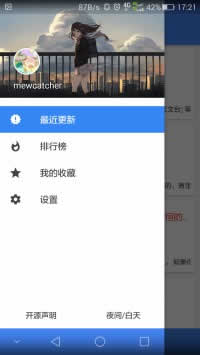](screenshots/v1/1.x-custom-menu.jpg)

    Model & Controller: fragment/NavigationDrawerFragment.java
    View: layout/layout_main_menu.xml

- 最近更新列表

[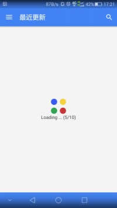](screenshots/v1/1.x-list-loading.jpg)
[](screenshots/v1/1.x-list.jpg)

    Model & Controller: fragment/FavFragment.java
    Adapter: adapter/NovelItemAdapter.java
    View: layout/fragment_latest.xml

- 搜索界面

[](screenshots/v1/1.x-search.jpg)
[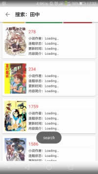](screenshots/v1/1.x-searching.jpg)
[](screenshots/v1/1.x-search-result.jpg)

    搜索界面
      Model & Controller: activity/SearchActivity.java
      Adapter: adapter/SearchHistoryAdapter.java
      View: layout/layout_search.xml
    搜索结果界面
      Model & Controller: activity/SearchResultActivity.java
      Adapter: adapter/NovelItemAdapterUpdate.java
      View: layout/layout_search_result.xml

- 排行榜列表

[](screenshots/v1/1.x-rank-list.jpg)
[](screenshots/v1/1.x-rank-list2.jpg)

    Model & Controller: fragment/RKListFragment.java
    Adapter: adapter/NovelItemAdapterUpdate.java
    View: layout/fragment_rklist.xml + (layout/fragment_novel_item_list.xml)s

- 本地书架（收藏）列表

[](screenshots/v1/1.x-fav.jpg)

    Model & Controller: fragment/FavFragment.java
    Adapter: adapter/NovelItemAdapterUpdate.java
    View: layout/fragment_novel_item_list.xml

- 小说详细信息

[](screenshots/v1/1.x-info.jpg)
[](screenshots/v1/1.x-info-menu.jpg)
[](screenshots/v1/1.x-info-hotspot.jpg)

    Model & Controller: activity/NovolInfoActivity.java
    View: layout/layout_novel_info.xml

- 小说章节选择

[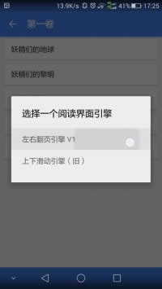](screenshots/v1/1.x-chapter.jpg)

    Model & Controller: activity/NovolChapterActivity.java
    View: layout/layout_novel_chapter.xml

- 左右滑动阅读引擎

[](screenshots/v1/1.x-reader.jpg)
[](screenshots/v1/1.x-reader-swipe.jpg)
[](screenshots/v1/1.x-reader-menu.jpg)
[](screenshots/v1/1.x-reader-dark.jpg)
[](screenshots/v1/1.x-reader-vertical.jpg)
[](screenshots/v1/1.x-image-view.jpg)
[](screenshots/v1/1.x-reader-jump.jpg)
[](screenshots/v1/1.x-reader-jump-show.jpg)
[](screenshots/v1/1.x-reader-setting.jpg)
[](screenshots/v1/1.x-font-custom.jpg)
[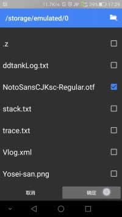](screenshots/v1/1.x-font-seek.jpg)

    Model & Controller: reader/activity/Wenku8ReaderActivityV1.java
    View: layout/layout_reader_swipe_temp.xml + (layout/layout_reader_swipe_page.xml)s

- 上下滑动阅读引擎

[](screenshots/v1/1.x-reader-horizental.jpg)

    Model & Controller: activity/VerticalReaderActivity.java
    View: layout/layout_vertical_reader_temp.xml

- 设置界面

[](screenshots/v1/1.x-config.jpg)
[](screenshots/v1/1.x-switch-tc.jpg)
[](screenshots/v1/1.x-cover-tc.jpg)
[](screenshots/v1/1.x-config-tc.jpg)

    Model & Controller: fragment/ConfigFragment.java
    View: layout/fragment_config.xml


### <a id="app-1.x-source"></a>源代码结构

    studio-android/LightNovelLibrary/app/src/main
    |   AndroidManifest.xml
    |
    +---assets/fonts
    |       fzss-gbk.ttf 方正书宋GBK字体
    |
    +---java/org/mewx/wenku8
    |       |   MyApp.java 自定义Application为了全局获取Context
    |       |
    |       +---activity
    |       |       AboutActivity.java 关于界面
    |       |       MainActivity.java 主界面
    |       |       MenuBackgroundSelectorActivity.java 侧栏菜单背景选择界面
    |       |       NovelChapterActivity.java 章节选择界面
    |       |       NovelInfoActivity.java 小说信息界面
    |       |       SearchActivity.java 搜索界面
    |       |       SearchResultActivity.java 搜索结果框架界面
    |       |       UserInfoActivity.java 用户信息界面
    |       |       UserLoginActivity.java 用户登录界面
    |       |       VerticalReaderActivity.java 上下滑动界面
    |       |       ViewImageDetailActivity.java 查看大图界面
    |       |       WelcomeActivity.java 启动界面
    |       |
    |       +---adapter
    |       |       NovelItemAdapter.java 老版的小说项Adapter，每10项更新一次
    |       |       NovelItemAdapterUpdate.java 更新的小说项Adapter，动态更新每一项
    |       |       SearchHistoryAdapter.java 搜索历史Adapter
    |       |
    |       +---component
    |       |       PagerSlidingTabStrip.java 排行榜自定义的标签类
    |       |       ScrollViewNoFling.java 可控滑动阻尼的ScrollView
    |       |
    |       +---fragment
    |       |       ConfigFragment.java 设置界面
    |       |       FavFragment.java 本地书架框架
    |       |       LatestFragment.java 最近更新
    |       |       NavigationDrawerFragment.java 侧栏菜单
    |       |       NovelItemListFragment.java 通用的小说列表界面（嵌入框架中）
    |       |       RKListFragment.java 排行榜框架
    |       |
    |       +---global
    |       |   |   GlobalConfig.java 全局设置（糟糕向），其中inAlphaBuild控制内测版/正式版
    |       |   |
    |       |   \---api
    |       |           ChapterInfo.java 章节信息类
    |       |           NovelItemInfo.java 小说信息类
    |       |           NovelItemInfoUpdate.java 更新的小说信息类
    |       |           NovelItemList.java 小说项列表类
    |       |           NovelItemMeta.java 小说完整信息类
    |       |           OldNovelContentParser.java 旧的小说内容解析器，解析成text和image
    |       |           UserInfo.java 用户信息类
    |       |           VolumeList.java 卷信息类
    |       |           Wenku8API.java API类
    |       |           Wenku8Error.java 错误信息类，后期的编码中定义的
    |       |           Wenku8Parser.java 通用项目解析器
    |       |
    |       +---listener
    |       |       MyItemClickListener.java RecyclerView的单击监听接口
    |       |       MyItemLongClickListener.java RecyclerView的长按监听接口
    |       |
    |       +---reader 这边准备封装成的UniversalReaderActivity库的
    |       |   +---activity
    |       |   |       Wenku8ReaderActivityV1.java 左右滑动阅读界面
    |       |   |
    |       |   +---loader
    |       |   |       WenkuReaderLoader.java 小说载入类的抽象类
    |       |   |       WenkuReaderLoaderXML.java XML格式小说载入类
    |       |   |
    |       |   +---setting
    |       |   |       WenkuReaderSettingV1.java 阅读设置类V1
    |       |   |
    |       |   +---slider 三方划屏库
    |       |   |   |   SlidingAdapter.java
    |       |   |   |   SlidingLayout.java
    |       |   |   |
    |       |   |   \---base
    |       |   |           BaseSlider.java
    |       |   |           OverlappedSlider.java
    |       |   |           PageSlider.java
    |       |   |           Slider.java
    |       |   |
    |       |   \---view
    |       |           WenkuReaderPageBatteryView.java 电池View（未使用）
    |       |           WenkuReaderPageView.java 单页小说View（效率低）
    |       |
    |       +---service
    |       |       HeartbeatSessionKeeper.java 心跳包保持session类（未使用）
    |       |
    |       \---util
    |               LightBase64.java 轻量级base64封装库
    |               LightCache.java 轻量级文件操作库（容易OOM）
    |               LightNetwork.java 轻量级网络通信库（容易OOM）
    |               LightTool.java 轻量级工具集合类
    |               LightUserSession.java 轻量级用户Session管理（包括账号密码加解密）
    |               Logger.java 轻量级日志类（未使用）
    |
    \---res/
        |    ... 略
        \


----


## <a id="app-0520"></a>0.5.2.1 典藏版

老版的App，启动和运行方面都比`MD`版本流畅，针对旧机型维护。`Eclipse`版本源码见`eclipse-android/`目录（非最新），`Android Studio`版本源码见`eclipse-android-old/`目录（典藏版最新），老版的图片资源都是用Fireworks做的，源文件见`graph-source/`目录。

### <a id="app-0520-preview"></a>预览图

[](screenshots/v0/0520-cover.jpg)
[](screenshots/v0/0520-menu.jpg)
[](screenshots/v0/0520-list.jpg)
[](screenshots/v0/0520-info.jpg)
[](screenshots/v0/0520-reader.jpg)


### <a id="app-0520-source"></a>源代码结构

这边引入了不少三方库，但是方法笨拙，主要采用复制、合并源代码的方式，所以文件目录会比较乱。但是加密强度高 \_(:3」∠)\_ 以后做商业软件还是建议这样操作，虽然麻烦，但是混淆之后烦的要命~

    eclipse-android-old\LightNovelLibrary\src
    +---com
    |   +---davemorrissey
    |   |   \---labs
    |   |       \---subscaleview 分部加载图片的库，查看大图防止OOM
    |   |               ImageViewState.java
    |   |               ScaleImageView.java
    |   |               SubsamplingScaleImageView.java
    |   |
    |   +---ecloud
    |   |   \---pulltozoomview 下拉放大的视图，设置界面用的小苹果~
    |   |           IPullToZoom.java
    |   |           PullToZoomBase.java
    |   |           PullToZoomListView.java
    |   |           PullToZoomListViewEx.java
    |   |           PullToZoomScrollView.java
    |   |           PullToZoomScrollViewEx.java
    |   |
    |   +---facebook
    |   |   \---rebound 物理、动画库，用途忘记了 =。= 大半年没动了，好像是侧栏菜单用的
    |   |       |   AndroidSpringLooperFactory.java
    |   |       |   BaseSpringSystem.java
    |   |       |   OrigamiValueConverter.java
    |   |       |   SimpleSpringListener.java
    |   |       |   Spring.java
    |   |       |   SpringConfig.java
    |   |       |   SpringConfigRegistry.java
    |   |       |   SpringListener.java
    |   |       |   SpringLooper.java
    |   |       |   SpringSystem.java
    |   |       |   SpringSystemListener.java
    |   |       |   SpringUtil.java
    |   |       |   SteppingLooper.java
    |   |       |   SynchronousLooper.java
    |   |       |
    |   |       \---ui
    |   |               SpringConfiguratorView.java
    |   |               Util.java
    |   |
    |   +---special
    |   |   \---ResideMenu 侧边滑动菜单iOS风格的
    |   |           ResideMenu.java
    |   |           ResideMenuItem.java
    |   |           TouchDisableView.java
    |   |
    |   \---zcw
    |       \---togglebutton iOS风格的切换按钮
    |               ToggleButton.java
    |
    +---me
    |   \---imid
    |       \---swipebacklayout 右滑返回layout
    |           \---lib
    |               |   SwipeBackLayout.java
    |               |   Utils.java
    |               |   ViewDragHelper.java
    |               |
    |               \---app
    |                       SwipeBackActivity.java
    |                       SwipeBackActivityBase.java
    |                       SwipeBackActivityHelper.java
    |                       SwipeBackPreferenceActivity.java
    |
    +---org
    |   \---mewx
    |       \---lightnovellibrary
    |           +---activity
    |           |       AboutActivity.java 关于界面
    |           |       BookshelfFragment.java 本地书架
    |           |       LibraryFragment.java 小说库（主界面入口）
    |           |       MainActivity.java 主界面
    |           |       NovelImageActivity.java 看大图界面
    |           |       NovelInfoActivity.java 小说信息界面
    |           |       NovelListActivity.java 小说列表界面
    |           |       NovelReaderActivity.java 阅读器界面（上下滑动）
    |           |       NovelSearchActivity.java 搜索界面
    |           |       SettingFragment.java 设置
    |           |       StartActivity.java 启动界面
    |           |       Wenku8Fragment.java （未完成）
    |           |
    |           +---api
    |           |       Wenku8Interface.java 你懂的
    |           |
    |           +---component
    |           |   |   GlobalConfig.java 全局设置界面
    |           |   |   MyApp.java 用于获取Context的全局Application
    |           |   |   NovelContentParser.java 小说内容解析器
    |           |   |   XMLParser.java XML解析器
    |           |   |
    |           |   \---adapter
    |           |           EntryElement.java 书库分类项
    |           |           EntryElementAdapter.java 书库分类项Adapter
    |           |           NovelContentAdapter.java 小说内容Adapter
    |           |           NovelElement.java 小说项
    |           |           NovelElementAdapter.java 小说项Adapter
    |           |           NovelElementSearch.java 小说搜索项
    |           |           NovelElementSearchAdapter.java 小说搜索项Adapter
    |           |           NovelIcon.java 小说封面
    |           |           NovelIconAdapter.java 小说封面Adapter
    |           |
    |           \---util
    |                   LightBase64.java 轻量级Base64库
    |                   LightCache.java 轻量级文件操作库
    |                   LightNetwork.java 轻量级网络通信库
    |
    \---uk
        \---co
            \---senab
                \---photoview 轻量级看图的View
                    |   Compat.java
                    |   DefaultOnDoubleTapListener.java
                    |   IPhotoView.java
                    |   PhotoView.java
                    |   PhotoViewAttacher.java
                    |
                    +---gestures
                    |       CupcakeGestureDetector.java
                    |       EclairGestureDetector.java
                    |       FroyoGestureDetector.java
                    |       GestureDetector.java
                    |       OnGestureListener.java
                    |       VersionedGestureDetector.java
                    |
                    +---log
                    |       Logger.java
                    |       LoggerDefault.java
                    |       LogManager.java
                    |
                    \---scrollerproxy
                            GingerScroller.java
                            IcsScroller.java
                            PreGingerScroller.java
                            ScrollerProxy.java


----


## <a id="umeng"></a>UMENG统计数据（2015/10/01残念）

[](screenshots/v1/1.x-statistic-20151001.jpg)
[](screenshots/v0/0520-statistic-20151001.jpg)

新版的app用户量10天增长到了1W用户量，全是托wenku8的福。照现在的增长速度速度估计用户量峰值是3W左右。

还有几个有趣的统计图分享一下：

[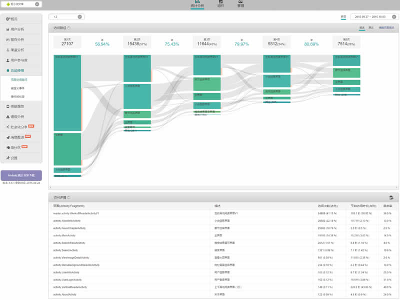](screenshots/v1/1.x-statistic-entry.jpg)

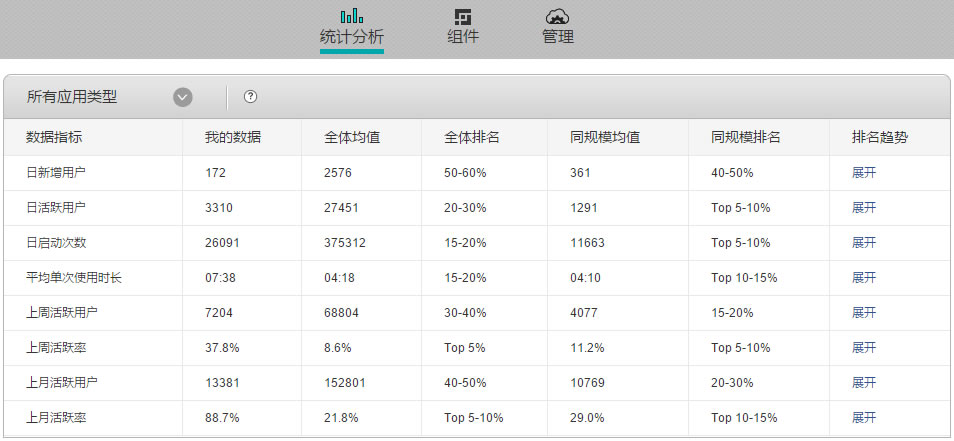


----


<a id="saves"></a>1.x 版本存档文件结构
==========

存档文件示例可以到[`release`](https://github.com/MewX/light-novel-library_Wenku8_Android/releases/tag/save-sample-v1.2)区下载查看~

## <a id="saves-dir"></a>总览

    sdcard/wenku8
    +---cache 完全由UIL接管的图片缓存文件夹
    +---custom 用户自定义文件夹，可以放入自定义侧栏壁纸、自定义阅读字体、自定义阅读背景
    |       .nomedia
    |
    +---imgs 小说封面
    |       .nomedia
    |       *.jpg
    |
    \---saves 存档文件夹
        |   avatar.jpg 登陆后的头像
        |   bookshelf_local.wk8 本地书架
        |   cert.wk8 简单加密的登陆用户名和密码
        |   read_saves.wk8 旧版的上下滑动阅读进度存档
        |   read_saves_v1.wk8 新版的左右滑动阅读进度存档
        |   search_history.wk8 搜索历史存档
        |   settings.wk8 设置存档
        |
        +---imgs 小说插图
        |       .nomedia
        |       *.jpg
        |
        +---intro 小说信息
        |       *.xml
        |
        \---novel 小说正文
                *.xml


## <a id="saves-procedure"></a>存档流程

- App开启后初始化UIL，接下来所有的图片都使用UIL载入，每次加载一个图片都会自动生成`cache目录`下的以CRC32为文件名缓存文件；
- App启动即读取`settings.wk8`，每次设置被改变了也会立即保存设置；
- 进入小说信息界面，会自动保存当前小说的封面于`imgs目录`；
- 小说的`收藏`功能会将aid写入`saves/bookshelf_local.wk8`，取消收藏会取消写入并删除本地的相关xml内容（图片不会删除）；
- 小说的下载功能分为4种：
  - 检查更新：仅更新当前小说在`saves/intro`中的文件，每个小说3个文件，更新后刷新Activity。
    - aid-intro.xml 小说信息摘要
    - aid-introfull.xml 小说完整介绍
    - aid-volume.xml 小说卷信息
  - 更新下载：先更新当前小说在`saves/intro`中的文件，然后按照`aid-volume.xml`中的信息，下载小说具体内容（存在`saves/novel`中），每次下载完毕后检查xml中是否含有图片，如果有图片则插入下载图片的任务**（这就是为什么下载的时候进度条会跳变了 2331）**；
  - 覆盖下载：与更新下载不同的是，这种方式是强制覆盖所有文件，而更新下载会跳过已下载的同名文件；
  - 分卷下载：更新下载的分卷版；
- 小说在章节长按章节可以选择以下两种阅读引擎：
  - 左右翻页引擎V1：进入时读取`saves/read_saves_v1.wk8`，退出时保存进度；
  - 上下滑动引擎（旧）：进入时读取`saves/read_saves.wk8`，退出时保存进度；
- 调用搜索记录时会自动读取`saves/search_history.wk8`，每次搜索一次即保存最新搜索记录；
- 用户登录后会生成`saves/cert.wk8`和`saves/avatar.jpg`，每次启动app时自动登陆；若未联网，点击头像或有访问请求时会自动登录；若登陆失败，会删除这两个凭据文件；


## <a id="saves-tech"></a>技术细节

主要是存档的实现和兼容存档的规范。

### saves/bookshelf_local.wk8

文件内容示例：

    1098||1939||1924||1749||278

文件保存规则：

1. 收藏只保存aid，aid之间用`||`分隔，读取时调用`str.split("\\|\\|");`；
2. 每个aid对应`saves/intro`目录下3个文件：`aid-intro.xml`、`aid-introfull.xml`、`aid-volume.xml`，如果缺少一个文件的话则会忽略该aid对应的书，可以通过`检查更新`（下拉书架、小说信息界面的检查更新）来修复该错误；

### saves/read_saves.wk8

文件内容示例：

    66761,,23799,,25575||66752,,134,,15090||63125,,1139,,3059||
    63126,,904,,2824||63127,,11299,,157217

文件保存规则：

1. 上下滑动阅读存档基本元素是`cid,,position,,height`：
  - cid: chapter id，对应`saves/novel`里面的文件名；
  - position: 滚动的位置，当前屏幕顶部的位置(px)；
  - height: ScrollView的总高度(px)；
2. 每个基本元素之间用`||`分隔，读取时调用`str.split("\\|\\|");`；
3. 每次记录阅读的最底部位置，往下翻再上翻只记录最底下位置；
4. 一个误判区是100px，如果不小心点进去再退出，则不会记录，只有翻过100px才会记录进度；
5. 每一章一个记录，只添加不删除 =。=

### saves/read_saves_v1.wk8

文件内容示例：

    1863:65378:65380:10:0||1922:67426:67427:0:0||1656:56193:56194:38:0||
    1244:38825:38827:0:0||1163:35537:35538:0:0||1151:35126:35128:0:0||
    1247:38920:38922:230:0||1759:60160:60161:159:0||1886:66259:66261:0:0||
    1016:51951:51952:0:0||1749:59813:59814:0:0||1575:52853:52855:0:0||
    278:10165:10166:36:0||1213:37499:37503:0:0||1928:67584:67585:0:0||
    1446:47586:47588:90:0||1755:60043:60044:0:0||1519:50813:50814:0:0||
    1932:67774:67782:255:55||1701:57929:57935:0:0

文件保存规则：

1. 基本元素是`aid:cid:vid:paraid:wordid`：
  - aid: 小说id
  - cid: 卷id
  - vid: 章id
  - paraid: 段id（从0开始）
  - wordid: 字在段中的id（从0开始）
2. 每个基本元素之间用`||`分隔，读取时调用`str.split("\\|\\|");`；
3. 每一本书一条记录，卷末自动删除记录，相当于阅读完毕；
4. 记录的原理和分页算法相关的，分页算法是通过指定`一个段落(paraid)`的`一个起始字符(wordid)`，然后动态分页；

### saves/search_history.wk8

文件内容示例：

    [田中][1到][音][刀剑][1日日日][进击的巨人][光还在][人类衰退][古][寒蝉]

文件保存规则：

1. 每一项通过`[]`分开，UTF-8无BOM编码；
2. `0520`版本会在开头加一个数字：
  - 0: 搜索作者，例如：`[0田中]`
  - 1: 搜索小说名，例如：`[1到]`
3. 默认保存10条，在`GlobalConfig.java`中记录；

### saves/settings.wk8

文件内容示例：

    reader_line_distance::::10||||
    menu_bg_path::::/storage/emulated/0/tencent/QQ_Images/5699e514d0bb9779.png||||
    reader_background_path::::0||||
    version::::1||||
    reader_paragraph_distance::::14||||
    language::::SC||||
    menu_bg_id::::0||||
    reader_font_size::::18||||
    reader_font_path::::0

键的代码片段：

    public enum SettingItems {
        version, // (int) 1
        language,
        menu_bg_id, // (int) 1-5 by system, 0 for user
        menu_bg_path, // (String) for user custom
        reader_font_path, // (String) path to ttf, "0" means default
        reader_font_size, // (int) sp (8 - 32)
        reader_line_distance, // (int) dp (0 - 32)
        reader_paragraph_distance, // (int) dp (0 - 48)
        reader_paragraph_edge_distance, // (int) dp (0 - 16)
        reader_background_path, // (String) path to an image, day mode only, "0" means default
    }

文件保存规则：

1. 采用键值对的形式，代码中使用`ContentValue`存储；
2. 存储文件时，键与值用`::::`分隔，键值对与键值对用`||||`分隔；
3. 存键的时候使用的是`enum.toString()`方法获取，避免硬编码产生的低级错误；

### saves/cert.wk8

文件内容示例：

    Z0M5a0daRXBsZG5SMFZpaFhlPT0K
    |b1FQOUVXYjFja1d1SlRkazVtV3BSWGI9Cg==

文件保存规则：`用户名|密码`，换行是系统函数自动产生的，不影响读取。

    加密流程：
        1. 原文: str
        2. 一遍加密: base64(str)
        3. 大小写互转: switch(base64(str))
        4. 两遍加密: base64(switch(base64(str)))
        5. 除了等号外，前后字符交换: swap(base64(switch(base64(str))))
        6. 三次加密: base64(swap(base64(switch(base64(str)))))

    解密流程：
        同理


----


<a id="app-sec-dev"></a>1.x 历史二次开发指引
==========

本App目前决定暂停维护了……

原因一方面是开发者自己要准备年底的研究生考试；另一方面也是**最主要**的方面，鹅厂大规模购置轻小说版权，这边有一些暂时不能公开的原因，总之本三方app得告一段落了，具体可以阅读[`开发者的碎碎念`](#mewx)。

前几天我用HTTrack抓取了`lknovel.cn`的数据库，总共20G，太过于庞大，文件数20W，我的xp爬虫机已卡死。但是由于服务器在国内，速度还不错，用1~2天扒完。

后来我又尝试抓取`wenku8.com`，服务器在美国，这边**速度太慢**了，抓了一整天才1G，我估计wenku8的数据量大约有30G，实在hold不住。

    所以尽管API开源了，但是因为内陆速度实在太慢，我都没有兴趣抓取了，所以劝大家去抓其他站：
    linovel.com 可以用HTTrack设置总目录页面为入口，深度5，然后设定MAX 10000000，图片采用探索模式即可（一般的扒站工具抓不下来图片），服务器没有防护；
    lknovel.cn  可以用HTTrack设置章节页面及小说信息界面为入口（excel生成url即可），深度2，设定MAX 10000000，服务器没有防护。
    wenku8.com  速度太慢了，数据量还大，插图还在文末，没啥性价比，别抓了。

也就是说以后本app将没有数据源了，如果想继续做app的话那就只能通过抓取html提纯的方式，如果有开发者感兴趣，想通过抓取的方式继续本app（比如说：可以同时抓取lknovel、linovel、wenku8的数据展示给用户），可以阅读下面的部分：

## <a id="saves-compat"></a>如何用其他文库的文档兼容本app

目前`wenku8`的书目2000不到，也就是说aid是4位数；`linovel`、`lknovel`的aid也都是4位数，而且都没有`wenku8`的大，所以：

    在aid方面，可以采取aid+10000000的方式，比如linovel的aid是+1000万，lknovel的aid是+2000万，这样本地书架的内容就错开了。

在存档方面：

    aid-intro.xml 可以采取两种文件格式：
        最小文件体：
        <?xml version="1.0" encoding="utf-8"?>
        <metadata>
        <data name="Title" aid="1749"><![CDATA[残酷童话]]></data>
        <data name="Author" value="仓桥由美子"/>
        <data name="BookStatus" value="已完成"/>
        <data name="LastUpdate" value="2015-08-01"/>
        <data name="IntroPreview"><![CDATA[　　现实残酷，童话幻灭
        　　在现实生活中，王子与...]]></data>
        </metadata>

        扩展文件体（可以自定义字段）但是已定义的字段有这些：
        <?xml version="1.0" encoding="utf-8"?>
        <metadata>
        <data name="Title" aid="5"><![CDATA[狼与香辛料(狼与辛香料)]]></data>
        <data name="Author" value="支仓冻砂"/>
        <data name="DayHitsCount" value="14"/>
        <data name="TotalHitsCount" value="394148"/>
        <data name="PushCount" value="22940"/>
        <data name="FavCount" value="6003"/>
        <data name="PressId" value="电击文库" sid="1"/>
        <data name="BookStatus" value="已完成"/>
        <data name="BookLength" value="2004567"/>
        <data name="LastUpdate" value="2012-02-08"/>
        <data name="LatestSection" cid="36097"><![CDATA[第十七卷 插图]]></data>
        </metadata>

    aid-introfull.xml 的文件内容示例：
        旅行于各地贩卖并收购物品的商人克拉福·罗伦斯，拜访帕斯罗村并离开后，在自己的马车上发现了不知从哪里跑来的东西。
        拨开从帕斯罗村购买的小麦束后，竟然发现一位拥有兽耳与尾巴的美少女。
        少女自称为贤狼赫萝，是带给帕斯罗村长期丰收的少女。
        “虽然咱长久以来被尊为神，不过，咱就是咱，咱是赫萝。”见到少女的一只手变化成狼脚的罗伦斯，虽然一边怀疑赫萝的身份，但一边也答应让想回到出生遥远北方的少女一同旅行。

    aid-volume.xml 文件内容示例：
        <?xml version="1.0" encoding="utf-8"?>
        <package>
        <volume vid="55995"><![CDATA[第一卷]]>
        <chapter cid="55996"><![CDATA[序章 Prologue]]></chapter>
        <chapter cid="55997"><![CDATA[第一话 A-part 死与不死]]></chapter>
        <chapter cid="55998"><![CDATA[第一话 B-part 死与不死]]></chapter>
        <chapter cid="55999"><![CDATA[第二话 A-part 杀人与异能]]></chapter>
        <chapter cid="56000"><![CDATA[第二话 B-part 杀人与异能]]></chapter>
        <chapter cid="56001"><![CDATA[第三话 A-part 命与心]]></chapter>
        <chapter cid="56002"><![CDATA[第三话 B-part 命与心]]></chapter>
        <chapter cid="56003"><![CDATA[插曲 Interlude]]></chapter>
        <chapter cid="56004"><![CDATA[终章 Epilogue]]></chapter>
        <chapter cid="56005"><![CDATA[后记]]></chapter>
        <chapter cid="56006"><![CDATA[插图]]></chapter>
        </volume>
        <volume vid="68031"><![CDATA[第二卷]]>
        <chapter cid="68032"><![CDATA[【序章】Prologue]]></chapter>
        <chapter cid="68033"><![CDATA[【第一话】First Story 别墅与杀人事件]]></chapter>
        <chapter cid="68034"><![CDATA[【插曲】～Interlude～ 梦与心的夹缝间]]></chapter>
        <chapter cid="68035"><![CDATA[【第二话】Second Story 内心与创伤]]></chapter>
        <chapter cid="68036"><![CDATA[【插曲】～Interlude～ 某人的黑暗]]></chapter>
        <chapter cid="68037"><![CDATA[【第三话】Third Story 紧张局势与众人目的]]></chapter>
        <chapter cid="68038"><![CDATA[【插曲】～Interlude～ 黑暗之中]]></chapter>
        <chapter cid="68039"><![CDATA[【第四话】Fourth Story 白天与夜晚]]></chapter>
        <chapter cid="68040"><![CDATA[【插曲】～Interlude～ 黑夜与白昼的夹缝间]]></chapter>
        <chapter cid="68041"><![CDATA[【终章】Epilogue]]></chapter>
        <chapter cid="68042"><![CDATA[后记]]></chapter>
        <chapter cid="68255"><![CDATA[插图]]></chapter>
        </volume>
        <volume vid="68043"><![CDATA[第三卷]]>
        <chapter cid="68044"><![CDATA[【序章】Prologue]]></chapter>
        <chapter cid="68045"><![CDATA[【第一话·前篇】First Story*First part 妹妹和传说]]></chapter>
        <chapter cid="68046"><![CDATA[【第一话·后篇】First Story*Latter part 妹妹和传说]]></chapter>
        <chapter cid="68047"><![CDATA[【插曲】～Interlude～ 她所身处的黑暗]]></chapter>
        <chapter cid="68048"><![CDATA[【第二话·前篇】Second Story*First part 真实与冒牌货]]></chapter>
        <chapter cid="68049"><![CDATA[【第二话·后篇】Second Story*Latter part 真实与冒牌货]]></chapter>
        <chapter cid="68050"><![CDATA[【插曲】～Interlude～ 她所身处的黑暗]]></chapter>
        <chapter cid="68051"><![CDATA[【终章】～Story of End～ 于是来到她的生日]]></chapter>
        <chapter cid="68052"><![CDATA[【章外篇】～Epilogue～]]></chapter>
        <chapter cid="68053"><![CDATA[后记]]></chapter>
        <chapter cid="68256"><![CDATA[插图]]></chapter>
        </volume>
        </package>

    vid.xml 小说内容示例（目前版本支持图文混排，自动提纯多余换行和前导空格）：
        一场死亡游戏
        即将揭开序幕
        SAO玩家·桐人，以完全攻略为目标，
        在游戏舞台「艾恩葛朗特」城堡里展开一连串严酷的冒险。
        途中与女剑士·亚丝娜的相遇，也为桐人带来命中注定的契机——
        川原砾
        出身于光之国度，居住在亚兹罗斯。人生就是独行剑士。
        虽然嘴里一直逞强说自己不需要一起组队的伙伴，但是最近因为许多任务的难易度提高而感到相当棘手。虽然一辈子都没办法单独去唱KTV，但希望至少能升级到独自去吃烧肉的等级。
        <!--image-->http://pic.wenku8.com/pictures/0/471/17513/3213.jpg<!--image-->
        <!--image-->http://pic.wenku8.com/pictures/0/471/17513/3214.jpg<!--image-->
        <!--image-->http://pic.wenku8.com/pictures/0/471/17513/3215.jpg<!--image-->
        <!--image-->http://pic.wenku8.com/pictures/0/471/17513/3216.jpg<!--image-->

只要将抓取的内容通过`正则表达式`或者可更新的`lua`脚本，就可以实现抓包了，那么文库主界面可以换成这样：

    文库入口(Material Card)：
        轻国文库
        轻之文库
        轻小说文库
        etc

点进去是搜索界面，然后搜索、下载、转换成可以识别的格式这样。**目前我打听到的是国内文库还是会免费维持下去的！**

如果有学生党or开发者有兴趣，可以和我联系~


----


<a id="v1-libs"></a>1.x 版本用到的开源库
==========

    - jgilfelt / SystemBarTint (Apache License 2.0)
        用于设置Kitkat以上版本StatusBar和NavigationBar颜色透明度等。
    - nostra13 / Android-Universal-Image-Loader (Apache License 2.0)
        著名的UIL，用于管理图片缓存和加载的库，非常方便，不会OOM。
    - astuetz / PagerSlidingTabStrip (Apache License 2.0)
        -> branch: jpardogo / PagerSlidingTabStrip
        Material风格的标签及页面库，jpardogo的分支在自定制方面功能更强。
    - jpardogo / GoogleProgressBar (Apache License 2.0)
        -> branch: MewX / google-progress-bar
        谷歌风格的加载动画，我的分支添加了Google Doodle-notifier的样式。
        原版的样式是圆角矩形，这边间距细节什么的模仿的不是很完美。
    - Google / Volley (Apache License 2.0)
        Google发布的大规模并发加载库。原版不支持byte返回值，我这边稍加修改了。
    - afollestad / material-dialogs (MIT License)
        完美的Material Dialog兼容库！
    - futuresimple / android-floating-action-button (Apache License 2.0)
        可以展开的FAB，动画效果很自然，但是不支持ripple比较遗憾，而且阴影会截断。
    - vinc3m1 / RoundedImageView (Apache License 2.0)
        圆形ImageView，显示头像用的。
    - chrisbanes / SmoothProgressBar (BEER-WARE LICENSE)
        平滑进度条，这里用在小说信息、搜索结果页面的ActionBar下部。
    - davemorrissey / subsampling-scale-image-view (Apache License 2.0)
        支持局部加载的ImageView，用于小说查看大图，用一般的ImageView容易OOM。
    - martiansutdio / SlidingLayout (Unknown License)
        针对电子书的划屏库，非常省内存，只有3页，自由度不高，但是毕竟拿来主义 =。=
    - AnderWeb / discreteSeekBar (Apache License 2.0)
        动画效果不错的SeekBar，用在小说阅读的设置和跳转页面中。


----


<a id="mewx"></a>开发者的碎碎念
==========

本来app是不打算开源的，比如说代码写得不好，开源的话还要维护两个版本之类的理由……

主要还是学习Material走了很多弯路，很多尝试也都在历史push里面能看到，谷歌这边推出系统的Design，而且官方的app也开发的很好了，但是开发者真正要用的除了support-design库，就只有三方库了。不过各方面还是没有Google Play Store这款app做得好啊。我各种舍不得代码呢，不希望app被复制这种心态=。= 然而事实证明是我想多了……

不过，最近又接到各种`死亡预告`，于是这个app也快要`寿终正寝`了 233 现在完全开源，包括APPKEY啊、API啥的都开放了~**欢迎大家交流学习~**

分享一下这次开发app的`经验教训`吧：

- 依赖于网站的app，一定要确保网站不会左右app发展。

  目前的情况是网站战略变化，导致本app的接口服务会停止，取而代之的是另一个合作的app（非三方）。之前说大家`抓紧缓存`的意思是，趁目前还能用，抓紧下载，指不定以后要付费啥的呢，照鹅厂这动作！

  所以我觉得，自己做app最好顺便把服务网站给一套做掉，就像`空之文库`那样有一份服务器镜像，这样LK出问题不会殃及空文。

- 开发app类型要慎重。

  这边[博文](http://www.mewx.org/blog/201507/about-app-markets/)也写了，`版权敏感的软件`市场是不轻易收的，要提供版权证明。所以这边一直上不了架，`轻文`因为有原创的成分在，所以可以上架。现在国内审查越来越严了哎……

- 用户操作指引很重要。

  这个app里面隐藏了很多小功能，比如：用户找不到搜索功能，长按章节可以选择`左右翻页`或者`上下滑动`阅读，长按历史搜索可以删除某条记录。又比如：音量键可以翻页、单击也可以翻页，还可以切换章节etc。就包括看图用户也不会，这边看图把按钮放在ActionBar上是为了避免与翻页操作冲突，但是用户说找不到图 =。= 也比方说自定义字体、图片什么的说了不能在外置SD卡，但是用户还是不能按照要求的操作。

  所以进入界面的时候应该用户友好，弹出一个操作提示，所以这方面是在下输了！

- 原有的用户黏着性需要很强大的优势才能打破。

  本来轻小说有个app叫`空之文库`，我这边app出来之后，用户量确实增加了不少，但是插图在文末这点确实是最大的软肋，因为轻小说有不少的用户是中学生，这部分用户说难听点就是比较叽歪，但是为了用户量，作为`替代品`目标的app，确实需要在功能上满足绝大多数用户的需求。所以`轻文`出来之后，这边用户量确实流失了不少。


----


<a id="license"></a>LICENSE
==========

    GNU GENERAL PUBLIC LICENSE

                         Version 2, June 1991

    Copyright (C) 1989, 1991 Free Software Foundation, Inc., <http://fsf.org/>
    51 Franklin Street, Fifth Floor, Boston, MA 02110-1301 USA
    Everyone is permitted to copy and distribute verbatim copies
    of this license document, but changing it is not allowed.

    ......

## Contributors

Thanks goes to these wonderful people ([emoji key](https://allcontributors.org/docs/en/emoji-key)):

<!-- ALL-CONTRIBUTORS-LIST:START - Do not remove or modify this section -->
<!-- prettier-ignore-start -->
<!-- markdownlint-disable -->
<table>
  <tr>
    <td align="center"><a href="https://www.gaeblogx.com"><br /><sub><b>Baby Pepper</b></sub></a><br /><a href="https://github.com/MewX/light-novel-library_Wenku8_Android/commits?author=SeraphRoy" title="Code">💻</a></td>
    <td align="center"><a href="https://github.com/aaassseee"><br /><sub><b>Jack Liu</b></sub></a><br /><a href="https://github.com/MewX/light-novel-library_Wenku8_Android/commits?author=aaassseee" title="Code">💻</a></td>
  </tr>
</table>

<!-- markdownlint-restore -->
<!-- prettier-ignore-end -->

<!-- ALL-CONTRIBUTORS-LIST:END -->

This project follows the [all-contributors](https://github.com/all-contributors/all-contributors) specification. Contributions of any kind welcome!
