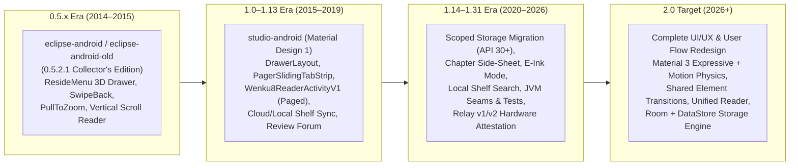
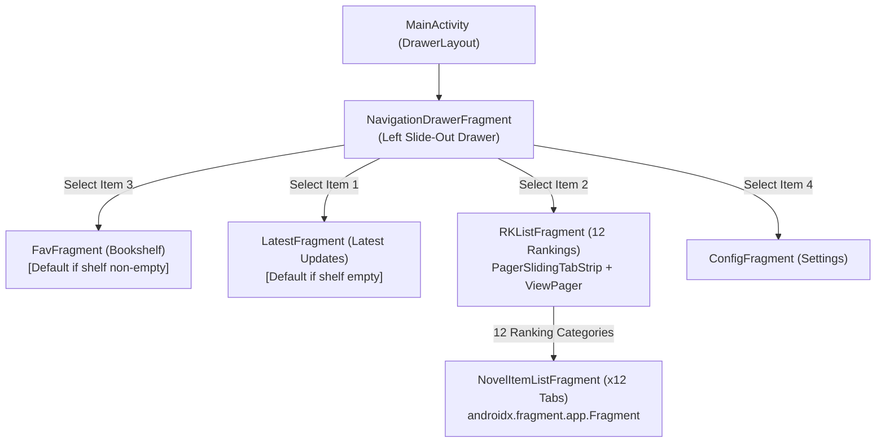

# 01 — `studio-android` (v1.x) Codebase, Feature & Architecture Investigation

**Status:** Completed Investigation  
**Baseline Branch:** `v1.31` (`3160d57`)  
**Target Evolution:** Wenku8 Android `v2.0` (Complete Material 3 Expressive UI/UX & Flow Redesign)

---

## 1. Executive Summary & Historical Evolution

`light-novel-library_Wenku8_Android` is the long-standing unofficial Android client for `wenku8.com` (轻小说文库), originally started in October 2014 by MewX. Across twelve years of continuous evolution, the repository preserves three distinct eras of Android development:

### 1.1 Repository Directory Map

| Path | Description |
| :--- | :--- |
| `studio-android/LightNovelLibrary/` | Active `1.x` Gradle project (`:app`, `:api` private submodule, `:api-stub` public CI fallback). Currently at `v1.31` (`versionCode 74`, `minSdk 21`, `targetSdk 37`, `compileSdk 37`, Java 17). |
| `studio-android/LightNovelLibrary/STABILITY_PLAN.md` | 1,877-line engineering diagnosis & refactoring log addressing the 4 systemic root causes of `1.x` crashes and extracting pure-JVM testable seams (`ChapterNavigator`, `ChapterContentLoader`, `WenkuReaderPaginator`, `AccountInfoLoader`, `BookshelfSync`, `NovelDownloader`). |
| `studio-android/LightNovelLibrary/STORAGE_MIGRATION_PLAN.md` | Proposal to replace hand-rolled `.wk8` delimiter files and direct `LightCache` calls (~104 call sites) with **Preferences DataStore** (settings) and **Room SQLite** (bookshelf, reading positions, search history, volume index, chapter completeness rows) while keeping chapter XML and images on disk. |
| `studio-android/LightNovelLibrary/api/docs/` | Relay v1/v2 architecture (`relay-versioning-and-reuse.md`), hardware key attestation (`hardware-key-attestation-design.md`), client hardening, and Chinese OEM compatibility plans. |
| `design-source/` & `screenshots/` | 2015 Material Design 1 UI mockups (`PxCook` specs) and historical `0.5.2.0` / `1.x` screenshots. |
| `eclipse-android/` & `eclipse-android-old/` | Historical `0.5.1` and `0.5.2.1` ("典藏版") sources preserved for reference. |
| `studio-android/pending-to-do.txt` | Historical developer backlog (in-book text search, TTS reading, EPUB export, download pause/cancel, per-volume cache management, auto-page turn). |

### 1.2 Prior Material 3 & Jetpack Compose Experiments in Git Branches

Three experimental branches in the repository already explored migrating the Novel Review screens (`NovelReviewListActivity`, `NovelReviewReplyListActivity`, `NovelReviewNewPostActivity`):

1. **`v1.26-md3exp-reviewlist` (`1472793`)**:
   - Introduced `AppTheme.MD3` (`Theme.Material3.Light.NoActionBar`) in `res/values/theme.xml` with window content transitions enabled.
   - Migrated `view_review_post_item.xml` from legacy `CardView` + `RelativeLayout` to `MaterialCardView` with MD3 semantic color attributes (`?attr/colorOnSurfaceVariant`).
2. **`origin/update-activities-to-md3-9287677485743856791` (`f5571ac`)**:
   - Java-based MD3 + ViewModel refactor of the 3 review activities.
   - Added `BaseMD3Activity.java` with edge-to-edge (`WindowCompat.setDecorFitsSystemWindows(getWindow(), false)`) and `DynamicColors.applyToActivityIfAvailable(this)`.
   - Added `CoordinatorLayout` + `AppBarLayout` + `CollapsingToolbarLayout` (Medium title) + `MaterialToolbar` and `LiveData`/`ViewModel` classes replacing `AsyncTask`.
3. **`origin/migrate-to-compose-md3-8282850043110690021` (`5014761`)**:
   - Full Kotlin + Jetpack Compose + Material 3 migration of the 3 review activities (`ReviewListScreen.kt`, `ReviewReplyListScreen.kt`, `ReviewNewPostScreen.kt`) backed by Kotlin Coroutines & `StateFlow` ViewModels (`ReviewListViewModel.kt`, etc.) and `PullToRefreshBox`.

---

## 2. Complete Screen & Feature Inventory (`studio-android` v1.31)

### 2.1 Activity Inventory (15 Active Activities + 1 Base Class)

| # | Class (`org.mewx.wenku8...`) | Layout XML | Core Responsibilities & User Interactions |
| :- | :--- | :--- | :--- |
| 0 | `activity/BaseMaterialActivity.java` | *(Base class)* | Extends `AppCompatActivity`. Wires `Toolbar` (`R.id.toolbar_actionbar`), navigation icon (`BACK`, `CLOSE`, `DEFAULT`), `StatusBarTintManager`, `FirebaseAnalytics`, and `CrashReporter` lifecycle breadcrumbs. |
| 1 | `activity/MainActivity.java` | `layout_main.xml`, `toolbar_main.xml` | **App Shell & Drawer Host**. Hosts `NavigationDrawerFragment` (`R.id.fragment_drawer`) and a single `FrameLayout` (`R.id.container`) swapping 4 top-level fragments (`FavFragment`, `LatestFragment`, `RKListFragment`, `ConfigFragment`). Runs startup tasks: `LightUserSession.AsyncInitUserInfo` (auto-login), `CheckAppNewVersion`, `UpdateNotificationMessage`, and API 30+ `SaveFileMigration` (`/sdcard/wenku8/` → internal `getFilesDir()`). Double-back within 2s exits; if not on `FavFragment`, Back returns to `FavFragment` first. |
| 2 | `activity/NovelInfoActivity.java` | `layout_novel_info.xml`, `layout_novel_chapter_sidesheet.xml` | **Novel Details, Chapter Side-Sheet & Offline Downloader**. Displays novel metadata card (`view_novel_item`), expandable full synopsis, and volume rows (`view_novel_chapter_item`) with per-volume local cache delete button (`ib_delete`). Tapping a volume opens a right-side `DrawerLayout` side-sheet (`GravityCompat.END`) listing chapters in that volume (highlighting saved `ReadSavesV1.cid` chapter). Long-pressing a chapter lets the user pick between **Standard Paged Reader (`Wenku8ReaderActivityV1`)** and **Vertical Reader (`VerticalReaderActivity`)**. Toolbar actions: **Continue Reading** (jumps to saved `vid`/`cid`/`lineId`/`wordId` or Vol 1 Ch 1), **Recommend/Vote** (`getVoteNovelParams`), and **Reviews** (`NovelReviewListActivity`). Bottom-right speed-dial FAB expands into **Favorite Add/Remove** and **4-Mode Download/Update**. |
| 3 | `activity/SearchActivity.java` | `layout_search.xml`, `toolbar_search.xml` | **Online Search Entry & History**. Custom search input (`toolbar_search_box`) with a toggle icon (`search_option_btn`) switching between **Novel Title** (red tint) and **Author Name** (gray tint) search modes. Lists up to 20 saved search queries (`SearchHistoryAdapter`); tap to execute, long-press to delete single item, menu action to clear all. Launches `SearchResultActivity`. |
| 4 | `activity/BookshelfSearchActivity.java` | `layout_bookshelf_search.xml`, `toolbar_search.xml` | **Instant Local Bookshelf Search** (Added in `v1.30`). Real-time keystroke filtering of local bookshelf items via `BookshelfFilter.filter(shelf, query)` matching title, author, or latest chapter name. |
| 5 | `activity/SearchResultActivity.java` | `layout_search_result.xml`, `toolbar_search_result.xml` | **Online Search Results Host**. Embeds `NovelItemListFragment` configured with `type="search"` and `filter=searchKey`. |
| 6 | `activity/NovelReviewListActivity.java` | `layout_novel_review_list.xml`, `view_review_post_item.xml` | **Book Review Threads List**. Paginated `RecyclerView` (`ReviewItemAdapter`) + `SwipeRefreshLayout` for `Wenku8API.getCommentListParams(aid, page)`. FAB/menu opens `NovelReviewNewPostActivity` (enforcing login check). |
| 7 | `activity/NovelReviewReplyListActivity.java` | `layout_novel_review_reply_list.xml`, `view_review_reply_item.xml` | **Review Thread Floors & Inline Reply**. Paginated floor replies (`getCommentContentParams(rid, page)`). Long-pressing a floor opens a dialog to copy floor text. Bottom inline reply box (`etReplyText` + send button) validates login, minimum length (`>= 7` chars), and `Wenku8API.searchBadWords()`, then submits GBK Base64-encoded reply. |
| 8 | `activity/NovelReviewNewPostActivity.java` | `layout_novel_review_new_post.xml` | **New Review Composer**. Title + body fields; validates non-empty title, body `>= 7` chars, and `Wenku8API.searchBadWords()`; posts thread in GBK Base64 (`getCommentNewThreadParams`) and returns `RESULT_OK`. |
| 9 | `activity/UserLoginActivity.java` | `layout_user_login.xml` | **Account Login**. Username/email + password login (`LightUserSession.doLoginFromGiven`), saving encrypted credentials to `saves/cert.wk8`. Includes a "Register" button redirecting to `https://www.wenku8.com/register.php`. |
| 10 | `activity/UserInfoActivity.java` | `layout_account_info.xml`, `menu_user_info.xml` | **User Profile & Daily Check-In**. Uses `AccountInfoLoader` to display avatar (`saves/avatar.jpg`), username, nickname, UID, rank, score (`积分`), and experience (`经验`). Tapping "点击签到" triggers daily check-in (`getUserSignParams`) and refreshes profile. Toolbar menu provides Logout (`action_logout`). |
| 11 | `activity/ViewImageDetailActivity.java` | `layout_view_image_detail.xml` | **Full-Screen Illustration Viewer**. Renders local illustration in `SubsamplingScaleImageView` (`maxScale = 4.0f`). Tap toggles system bars and bottom controls: **Rotate 90°** (`btn_rotate`) and **Save Image** (`btn_download` via SAF `ACTION_CREATE_DOCUMENT`). |
| 12 | `activity/MenuBackgroundSelectorActivity.java` | `layout_menu_background_selector.xml` | **Drawer Header Wallpaper Picker**. Lets user choose from 5 built-in anime wallpapers (`bg_avatar_01..05`) or pick a custom image via SAF (`ACTION_OPEN_DOCUMENT`), saved to `saves/custom/menu_bg`. |
| 13 | `activity/AboutActivity.java` | `layout_about.xml` | **About & Open-Source Credits**. Version info, links to Wenku8, MewX blog, GitHub repo, open-source licenses, and a 5-tap Easter egg on the app header card. |
| 14 | `reader/activity/Wenku8ReaderActivityV1.java` | `layout_reader_swipe_temp.xml` | **Primary Paginated Reader Engine (V1)**. Horizontal sliding canvas reader with typography controls, custom font/background, day/night/E-Ink modes, progress slider, chapter navigation, and illustration inspection. |
| 15 | `activity/VerticalReaderActivity.java` | `layout_vertical_reader_temp.xml` | **Legacy Vertical Scroll Reader Engine (V0)**. Continuous vertical `ScrollView` (`ScrollViewNoFling`) rendering chapter paragraphs and inline images, with volume-key scrolling and pixel-offset progress persistence. |

### 2.2 Fragment Inventory & Navigation Topology (6 Fragments)

1. **`NavigationDrawerFragment`**:
   - Displays customizable header wallpaper, circular user avatar (`RoundedImageView`), username/login prompt, 4 main navigation rows (`Latest`, `RKList`, `Fav`, `Config`), and 2 bottom actions (`Statement/Disclaimer` and `Dark Mode Switcher` — note: the dark mode button is an unimplemented placeholder that only toasts `"All hail the dark mode!"`).
2. **`FavFragment` (Local & Cloud Bookshelf)**:
   - Displays local bookshelf novels (`NovelItemAdapterUpdate`) with `SwipeRefreshLayout`.
   - Toolbar actions: **Search Bookshelf** (`BookshelfSearchActivity`), **Force Cloud Sync** (`AsyncLoadAllFromCloud`), **Batch Download/Update** (4 modes: *Check Updates*, *Download All*, *Force Update*, *Smart Update*).
   - Per-book 3-dot menu (`ibNovelOption`): **Delete Cached Volumes** or **Remove from Bookshelf** (local + cloud).
   - Also supports a local bookshelf text filter bar (`a83881c`).
3. **`LatestFragment` (Recently Updated Novels)**:
   - Paginated list of `NovelSortedBy.lastUpdate` via `Wenku8API.getNovelListWithInfo()`, with an embedded AdMob `NativeAdView` header and a floating search button (`btn_search`) that transitions into `SearchActivity`.
4. **`RKListFragment` (12 Ranking Lists)**:
   - Uses `PagerSlidingTabStrip` + `ViewPager` to host 12 `NovelItemListFragment` tabs:
     - `dayVisit` (日排行榜), `dayVote` (日推荐榜), `weekVisit` (周排行榜), `weekVote` (周推荐榜), `monthVisit` (月排行榜), `monthVote` (月推荐榜), `allVisit` (总排行榜), `allVote` (总推荐榜), `postDate` (最新入库), `goodNum` (总收藏榜), `size` (字数排行), `fullFlag` (完结列表).
5. **`NovelItemListFragment` (Reusable Paginated Novel Feed)**:
   - Shared across all 12 ranking tabs in `RKListFragment` and `SearchResultActivity`.
6. **`ConfigFragment` (Settings & Maintenance)**:
   - Server Notice card (`Wenku8API.NoticeString`), Language toggle (Simplified `SC` vs Traditional `TC`), Cache Cleaner (*Fast Mode* = UIL image cache; *Slow Mode* = deletes cached novel XMLs/images not in local bookshelf), Drawer Wallpaper selector, **E-Ink Mode** switch (`switch_eink_mode`), App Update check, and About link.

---

## 3. Reader Engine Deep Dive

### 3.1 Paginated Reader (`Wenku8ReaderActivityV1`)

- **Content Loading (`ChapterContentLoader`)**:
  - Receives `aid`, `vid`, `cid`, and `forcejump` via `Intent` extras.
  - Reconstructs `VolumeList` from cached `saves/intro/<aid>-volume.xml` (`GlobalConfig.loadCachedVolume(aid, vid)`).
  - Loads chapter XML from `saves/novel/<cid>.xml` (falling back to network `Wenku8API.getNovelContent` if missing, empty, or truncated) and parses it via `OldNovelContentParser` into `TEXT` and `IMAGE` elements.
- **Pagination Algorithm (`WenkuReaderPaginator` + `WenkuReaderPageView`)**:
  - Calculates drawable area accounting for `DisplayCutout` (API 28+), status bar height, `pxPageEdgeDistance` margins, and a bottom status footer (`1.5 * widgetFontHeight` displaying chapter title on the left and page/total percentage on the right).
  - Supports **Forward Pagination (`calcFromFirst`)** and **Backward Pagination (`calcFromLast`)** starting from any `(lineIndex, wordIndex)` pair.
  - Prepends two full-width ideographic spaces (`"　　"`) at the start of every paragraph (`wordIndex == 0`).
  - Isolates each illustration (`ElementType.IMAGE_DEPENDENT`) onto its own dedicated full page, downloading and scaling the bitmap asynchronously (`AsyncLoadImage`).
- **Page-Turn Slider (`SlidingLayout` + `OverlappedSlider`)**:
  - Uses a 3-view circular ring buffer (`prev`, `current`, `next` `WenkuReaderPageView` instances).
  - `OverlappedSlider` translates the upper page horizontally with finger drag and completes animations via `Scroller` (`500ms` normal, `200–250ms` fling, `0ms` instant jump when `isEinkModeEnabled()` is true).
- **Controls, Tap Zones & Settings**:
  - **Tap Zones**: Center 50% vertical band toggles the top/bottom toolbars (`rlToolbars`); left half turns to previous page; right half turns to next page.
  - **Hardware Volume Keys**: `VOLUME_UP` → previous page; `VOLUME_DOWN` → next page.
  - **Typography Sliders (`reader_bot_settings`)**:
    - Font Size: `8–32 sp` (`reader_font_size`)
    - Line Spacing: `0–32 dp` (`reader_line_distance`)
    - Paragraph Spacing: `0–48 dp` (`reader_paragraph_distance`)
    - Page Edge Margin: `0–32 dp` (`reader_paragraph_edge_distance`)
    - Custom `.ttf` Font picker (`btn_custom_font`) & Custom Day-Mode Background image picker (`btn_custom_background`).
  - **Lighting Modes**: Day mode (parchment texture `#444444` text), Night mode (`#090C13` background, `#32414E` text), E-Ink mode (pure `#FFFFFF` background, `#444444` text, zero animation).
  - **Chapter Jump & Boundary Navigation (`ChapterNavigator`)**:
    - Bottom jump slider (`reader_bot_seeker`) scrubs across paragraph indices (`1..elementCount`) and offers "上一章" / "下一章" buttons.
    - Paging past the start/end of a chapter prompts to open the previous/next chapter within the current `VolumeList`.
  - **Reading Progress Persistence (`ReadSavesV1`)**:
    - Saved in `onPause()` to `saves/read_saves_v1.wk8` as `aid:vid:cid:lineId:wordId||...`.

### 3.2 Vertical Scroll Reader (`VerticalReaderActivity`)

- Inflates a `TextView` (`18sp`) for each text paragraph and an `ImageView` for each illustration inside a `LinearLayout` hosted in `ScrollViewNoFling`.
- Supports volume-key scrolling (`±80dp`), tapping cached illustrations to open `ViewImageDetailActivity`, and pixel-offset progress saving (`saves/read_saves.wk8` as `cid,,scrollY,,totalHeight||...`).

---

## 4. Data, API, Relay & Storage Architecture

### 4.1 Relay Protocol & `:api` Module (`relay-versioning-and-reuse.md`)

- **Current Transport**: HTTP POST (`gzip`, `Cookie: PHPSESSID=...`) to `https://wenku8-relay.mewx.org/` (`Client API v1`) and `https://wenku8-android.mewx.org/` (`Client API v2`).
- **Split Architecture**:
  - `Client API v1` (`https://wenku8-relay.mewx.org` `POST /`): Legacy form/Base64/HMAC envelope (`libcpp.so` `getMagicVersionCpp`), transitioning to list-only operations (`articlelist`, `novellist`, `mewx_articlelist`).
  - `Client API v2` (`https://wenku8-android.mewx.org` `POST /v2/api` & `POST /v2/auth/*`): Attested installation envelope (`WK8-AUTH-1`) for non-list operations, backed by Android hardware key attestation and Chinese OEM compatibility handling.
- **Encoding Quirks**:
  - Review thread creation (`getCommentNewThreadParams`) and replies (`getCommentReplyParams`) require **GBK URL-encoding** wrapped in Base64, plus client-side `Wenku8API.searchBadWords()` validation.
  - Simplified/Traditional Chinese (`AppLanguage.SC` `t=0` vs `TC` `t=1`) is requested directly from the server API.

### 4.2 Bookshelf Sync & 4-Mode Offline Download Engine

- **Two-Way Safe Bookshelf Sync (`BookshelfSync` + `NovelDownloader`)**:
  - Fetches cloud bookcase (`action=bookcase` via `BookshelfListParser`), compares with local `bookshelf_local.wk8`.
  - **Non-Destructive Guarantee**: Books on the device that are missing from the cloud (`plan.localOnly`) are **never deleted**; they are pushed up to the cloud (`getAddToBookshelfParams`).
  - Books in the cloud missing locally (`plan.toDownload`) or whose `LastUpdate` / `LatestSection cid` is newer than the cached local copy (`BookshelfSync.staleNovels`) are downloaded concurrently on a 3-thread pool via `NovelDownloader.syncOne()`, committing only when all 3 metadata files (`volume.xml`, `introfull.xml`, `intro.xml`) parse and save cleanly.
- **4 Offline Download Modes**:
  1. **Check for Updates (检查更新)**: Refreshes the 3 `intro/` XML files to detect new chapters.
  2. **Download All / Select Volumes (更新下载 / 分卷下载)**: Downloads missing chapter XMLs (`novel/<cid>.xml`) and optional illustrations (`imgs/*.jpg`) without overwriting existing files (`overwrite = false`).
  3. **Force Update (覆盖下载)**: Re-downloads and overwrites all selected chapter XMLs and illustrations (`overwrite = true`).
  4. **Smart Update (智能更新 / 仅更新缓存分卷)**: Inspects each volume; if at least one chapter in a volume is already cached locally, downloads any new/missing chapters in that volume while skipping uncached volumes.

---

## 5. Audit of UX, Visual & Architectural Pain Points in `v1.x`

### 5.1 Visual & User-Flow Deficiencies
1. **2015 Material 1 Layouts Under a Nominal MD3 Theme**:
   - Hardcoded hex colors (`#FFFFFF`, `#F5F5F5`, `#4284F5`), rigid `TableLayout`/`RelativeLayout` XMLs, static toolbars, and zero Dynamic Color (Monet) or book-cover palette adaptation.
2. **No App-Wide Dark Mode**:
   - The navigation drawer's dark mode button (`main_menu_dark_mode_switcher`) is a stub that toasts `"All hail the dark mode!"` without switching themes. Outside the reader canvas, the entire app is blindingly white at night.
3. **Outdated Hamburger Drawer Navigation**:
   - Primary destinations (`Bookshelf`, `Latest`, `Rankings`, `Settings`) are hidden inside a 2015-style left `DrawerLayout` instead of an ergonomic Material 3 bottom navigation bar / floating pill dock / adaptive navigation rail.
4. **Blocking Modal Progress Dialogs**:
   - Syncing the bookshelf, downloading chapters, logging in, or fetching novel info traps the user behind modal `ProgressDialogHelper` popups instead of non-blocking background workers with sleek inline/wavy progress indicators.
5. **Fragmented Search & Discovery**:
   - Online Search (`SearchActivity` → `SearchResultActivity`), Local Bookshelf Search (`BookshelfSearchActivity`), Latest Updates (`LatestFragment`), and Rankings (`RKListFragment`) live in disconnected screens with no tag filtering, no press/imprint browsing, and no unified search experience.
6. **Undiscoverable "Hidden" Interactions**:
   - As noted in `README.md`, users frequently miss key features because they rely on hidden gestures: long-pressing a chapter to switch reader engines, long-pressing search history to delete, or finding the toolbar illustration zoom action (`action_watch_image`).
7. **Sparse Transitions & Animations**:
   - Aside from a basic cover shared-element transition into `NovelInfoActivity` and a fade on search, screen transitions are abrupt Activity cuts with no container transforms, no spring physics, no staggered list cascades, and no predictive back peeking.

### 5.2 Technical & Engine Limitations
1. **Deprecated `android.app.Fragment` Mix & `AsyncTask` Proliferation**:
   - 5 of 6 fragments still extend `android.app.Fragment`, and ~24 `AsyncTask` subclasses perform network/disk I/O tied to manual lifecycle guards.
2. **Main-Thread View Inflation in `ScrollView`s**:
   - `NovelInfoActivity` inflates all volume and chapter rows in a `for` loop inside a `ScrollView`, and `VerticalReaderActivity` inflates a `TextView` per paragraph inside a `ScrollView`, causing frame drops on long light novels.
3. **Reader Engine Gaps**:
   - `WenkuReaderPageView` relies on `static` mutable fields (`mLoader`, `mSetting`, `textPaint`), measures characters one `char` at a time without CJK line-breaking rules (*kinsoku shori*), has an unimplemented "Find in Page" stub (`btn_find`), lacks cross-volume auto-navigation, and offers only basic horizontal slide or raw vertical scroll (no 3D page peel, no vertical right-to-left CJK typesetting, no TTS, no text selection/annotations).
4. **Legacy Storage & Image Stack**:
   - `.wk8` delimiter files and 104 direct `LightCache` calls remain pending the `STORAGE_MIGRATION_PLAN.md` transition to Room + DataStore, and `Universal-Image-Loader 1.9.5` (unmaintained since 2015) handles bitmap caching.
