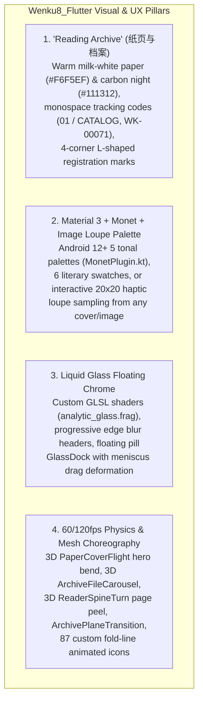

# 02 — `mikufoxxx/Wenku8_Flutter` Deep-Dive & Comparative Benchmark Analysis

**Status:** Completed Investigation  
**Reference Repository:** `https://github.com/mikufoxxx/Wenku8_Flutter` (`v0.5.6+2277`)  
**Target Evolution:** Translating and surpassing `Wenku8_Flutter`'s best UI/UX innovations in Native Android (`v2.0`)

---

## 1. Design Philosophy & Visual Language of `Wenku8_Flutter`

`Wenku8_Flutter` reimagines a light novel reader not as a generic list-and-text utility, but as a **tactile, atmospheric literary archive**. Its design system rests on four pillars:

### 1.1 Theme & Color Architecture (`lib/app_ui.dart`, `lib/app_palette.dart`, `lib/archive_design.dart`)
- **Three Palette Modes**:
  1. **Original (`原色`)**: Sage-ink archival seed (`#607D71` / `#4A665B` light, `#A7C2B6` dark) over warm low-glare reading paper (`#F6F5EF` light, `#111312` dark).
  2. **System Monet (`系统取色`)**: Reads Android 12+ (`API 31+`) `system_accent1..3` and `system_neutral1..2` tonal palettes via `MonetPlugin.kt`, plus supports Android 13+ themed launcher icon switching.
  3. **Custom & Image Loupe (`自选配色 & 图片取色`)**: Offers 6 curated literary palettes (`雾松 #607D71`, `浅海 #547D98`, `鸢尾 #887AA5`, `胭脂 #A06A77`, `麦穗 #9B8452`, `石墨 #72767D`), an HSV/Hex picker, and an interactive **Image Color Sampler (`PaletteImagePickerPage`)** where dragging a magnifier loupe across any imported image extracts seed colors with haptic detents.
- **Strict Reader Surface Isolation**:
  - Customizing the app's UI theme or Monet accent **never** overrides the Reader's paper background unless the user explicitly selects `跟随外观 (system)` in Reader Appearance.

### 1.2 "Archive Design" Micro-Details (`lib/archive_design.dart`, `lib/archive_icons.dart`)
- **Contrast of Geometry**:
  - Content cards and book covers use crisp, editorial corners (`panelRadius = 4dp`, `coverRadius = 3dp`) with 7px L-shaped corner registration marks (`ArchiveRegistration`), while floating navigation bars, action docks, and chips use full-pill liquid-glass geometry (`radius = 22–28dp`).
- **Editorial Mastheads & Tabular Codes**:
  - Top headers display monospace section codes (`01 / CATALOG`, `02 / PERSONAL ARCHIVE`, `DETAIL / WK-00071`, `01 / ORIGINAL POST`) above bold serif/sans titles.
- **Custom Animated Icon System (`lib/archive_icons.dart`)**:
  - 87 bespoke vector icons drawn on a `24×24` grid with primary (`1.75px`) and secondary (`1.22px` @ 62% alpha) strokes, folded page corners, and ink node dots.
  - **Spring Contact Micro-Animations (`ArchiveIconContact`)**: Tapping any icon compresses it (`scale 0.92` in `90ms`) and plays a `520ms` semantic keyframe animation (sun rays rotate, moon rocks, bookmark ribbon waves, refresh ring spins `160°`, shelf books lean).

---

## 2. Screen-by-Screen UX & Feature Breakdown

### 2.1 Adaptive Main Shell (`HomeShell` & `LibraryWorkspace`)
- **Floating `GlassDock` Navigation (`lib/glass_dock.dart`)**:
  - Up to 4 tabs: **发现 (`DiscoverPage`)**, **书架 (`ShelfPage` online)**, **书库 (`ShelfPage` local imports)**, and **我的 (`MyPage`)**.
  - Supports horizontal finger scrubbing across the dock with spring indicator tracking and meniscus lens stretch.
  - **Adaptive Modes**: Users can merge "书架" and "书库" into a single unified shelf (3 tabs), or enable Pure Local / Auto-Offline mode.
- **Widescreen Split-Pane (`LibraryWorkspace` in `lib/library_workspace.dart`)**:
  - On foldables and tablets (`width >= 1000dp`), tapping any book opens `DetailPage` in a right-hand detail pane alongside the master list, while the Reader opens full-screen.
- **Progressive Edge Blur (`FrostedHeader` & `DockUnderlay`)**:
  - Top and bottom bars fade smoothly into scrolling lists using a gradient-masked blur (`ProgressiveBlur`) instead of hard divider lines.

### 2.2 Unified Discovery & Inline `#Tag` Search (`DiscoverPage`)
- **Consolidated Discovery Engine (`lib/discovery_filters.dart`)**:
  - Combines **13 Wenku8 Rankings/Sorts** (`lastupdate`, `postdate`, `allvisit`, `allvote`, `monthvisit`, `monthvote`, `weekvisit`, `weekvote`, `dayvisit`, `dayvote`, `goodnum`, `size`, `fullflag`), **Multi-Tag Intersection Filtering** (books matching *all* selected tags), **Publication Imprint Browsing** (电击文库, MF文库J, 角川文库, GA文库, etc.), and **Global Blocked Tags**.
- **Switchable Feed Layouts**:
  - One-tap toggle between **Editorial List (`NovelRow`)** and **3-Column Cover Grid (`NovelGridCard`)**, with shimmer skeleton placeholders (`NovelCardSkeleton`) and staggered entrance cascades (`LoadedContentSequence`).
- **Inline Multi-Scope Search (`InlineSearchResults`)**:
  - Searches inline by `全部`, `书名`, `作者`, `标签`, `简介`, or `编号 (AID)`.
  - Supports `#标签` syntax (e.g., `#校园 #恋爱 刀剑`) to combine multi-tag intersection with keyword search.

### 2.3 Bookshelf & 3D Archive Carousel (`ShelfPage`)
- **Three Switchable Views**:
  1. **3D Archive Carousel (`ArchiveFileCarousel` in `lib/archive_wave.dart`)**: Interactive 3D perspective book-spine shelf (`Matrix4` perspective). Dragging horizontally scrubs through spines with detent haptics; the focused book pulls forward and rotates open with spine thickness, page edges, and an inspection card (`继续阅读`, `作品详情`).
  2. **Responsive Cover Grid (`2–4` columns)**: Cover + unread/cached badges + reading progress bar.
  3. **Editorial List (`NovelRow`)**: Cover + `WK-xxxxx` code + author/tags + progress/cache pills.
- **Organization & Batch Operations**:
  - Sort by `Manual`, `Recent Read`, `Recent Update`, or `Title Pinyin`.
  - Filter by `All`, `Reading`, `Unread`, `Cached`, or `Local`.
  - Custom user categories/folders (`ShelfCategoryBar`), series compendium merging (`合并同系列`), and multi-select batch actions.

### 2.4 Novel Detail Screen (`DetailPage`)
- **Hero Cover & Ambient Glow**:
  - Cover transitions from the list via `PaperCoverFlight` (an `8×10` 3D triangle mesh that bends aerodynamically like a paper card along an arc) and rests over an ambient colored shadow (`CoverGlow`) sampled from the cover image.
  - Tapping the cover opens `CoverPreviewPage` (pinch-to-zoom + save to gallery).
- **Interactive Metadata & Community Bar**:
  - Tapping the **Author** opens `AuthorNovelsPage`; tapping any **Tag Chip** opens `TagNovelsPage` (or long-press to block the tag).
  - **`BookCommunityActions`**: Pill bar for `云端收藏` (Cloud Shelf), `推荐作品` (Daily Vote), `评论` (`WenkuReviewsPage`), and `分享` (System Share).
- **Primary Reading CTA & Collapsible Volumes**:
  - Prominent **"继续阅读 · 第X章 (XX%)"** + **"从头阅读"** action bar.
  - Collapsible volume sections (`_VolumeSection`) with chapter count, current-reading badge, per-chapter cache status (`已缓存`), inline chapter search filter, and ascending/descending sort toggle.

### 2.5 Next-Gen Reader Engine (`ReaderPage`)
- **3 Layout Modes**:
  1. **Continuous Vertical Scroll Stream (`ReaderScrollStream`)**: Streams adjacent chapters seamlessly into one continuous scroll viewport without breaking fling momentum.
  2. **Horizontal Paged (`ReaderPagedView`)**: Single-page on phones and automatic/manual **Dual-Page Spread (`ReaderSpreadFrame`)** with central book-spine shading on foldables/tablets.
  3. **Vertical Right-to-Left CJK (`RenderReaderVerticalText`)**: Traditional vertical Chinese/Japanese layout with rotated punctuation, Ruby furigana (`ReaderRubySpan`), emphasis dots (`着重号`), and configurable Latin orientation.
- **6 Page-Turn Animations**:
  1. **3D Curved Page Peel (`ReaderSpineTurn`)**: Captures a single GPU texture snapshot per turn and deforms a 3D mesh following `touchY` with front ink, mirrored back-of-page bleed-through, lift shadow, and spine hinge.
  2. **Staggered Paragraph Cascade (`staggered`)**: Paragraphs animate in/out with staggered offset.
  3. **Slide (`slide`)**, **Cover (`cover`)**, **Fade (`fade`)**, and **Instant Cut (`none` for E-Ink)**.
- **Live Transparent Typography Sheet (`showJellySheet`)**:
  - When the user drags any slider (font size, line height, letter spacing, paragraph gap, 4-edge margins, night brightness), the bottom sheet turns transparent and hides non-active controls so the user watches the live chapter text reflow underneath in real time.
  - Supports **Global vs. Per-Book Independent Style** overrides and custom `TTF`/`OTF` fonts.
- **Rich Reading Tools (6-Item Bottom Liquid Dock)**:
  - `目录` (Collapsible volume/chapter TOC), `书签` (Bookmarks & notes), `外观` (5 paper presets + custom background + typography), `操作` (Mode, turn effect, tap zones, auto-scroll, volume keys), `查找` (In-chapter & full-book regex/keyword search with 8s match highlight), `夜读/日间` (1-tap animated toggle).
- **Selection, Annotations, Dictionary, Illustrations & TTS**:
  - Custom cross-paragraph selection handles with **5-color Highlighter / Underline / Wavy-line + Markdown Notes**, **Dictionary Lookup**, **Inline Illustration Gallery + Local EPUB Auto-Matching**, and **System TTS Listening** with real-time paragraph highlight and sleep timer.

### 2.6 Reviews, Profile, Reading Statistics & Widgets
- **Reviews (`WenkuReviewsPage` & `ReviewComposerPage`)**:
  - Paginated reviews and floor replies (`01 / ORIGINAL POST`, `02 / REPLY`) with rich BBCode/quote rendering and **400ms debounced auto-saved drafts**.
- **5-Tab Reading Statistics & Shareable Posters (`ReadingStatisticsPage` & `ReadingReportPage`)**:
  - Tracks reading duration, speed, calendar heatmaps, hourly rhythm, streaks, and annotation timelines; generates high-DPI shareable poster cards in 8 visual themes.
- **5 Native Android Home Screen Widgets (`ReadingAppWidget.kt`)**:
  - `今日阅读`, `最近在读`, `阅读热力`, `书摘便签`, `目标进度`.

---

## 3. Animation & Transition Catalog in `Wenku8_Flutter`

| Transition / Effect | Implementation in `Wenku8_Flutter` | Visual Impact |
| :--- | :--- | :--- |
| **3D Paper-Bend Cover Hero** | `PaperCoverFlight` (`lib/motion_ui.dart`) — `8×10` `ui.Vertices` mesh with aerodynamic bend, roll, and specular highlight along a curved arc. | Book cover physically lifts off the shelf/list and bends through 3D space into the Detail header. |
| **Architectural Plane Wipe** | `ArchivePlaneTransition` (`lib/archive_motion.dart`) — Diagonal `26px`-slanted polygon clip wipe with parallax under-layer and staggered `ArchivePart` child reveals. | Screen transitions feel like sliding archival plates rather than generic fade/slide cuts. |
| **3D Spine-Turn Page Peel** | `ReaderSpineTurn` (`lib/reader_spine_turn.dart`) — Single-snapshot GPU mesh curl tracking finger `touchY` with back-page bleed-through and cast shadows. | Realistic physical book page turning at 60/120fps. |
| **Jelly Sheet & Glass Menu Morph** | `showJellySheet` & `GlassMenuStretch` (`lib/app_ui.dart`, `lib/motion_ui.dart`) — Sheets and menus stretch out of the source button's screen `Rect` with spring physics. | Controls feel physically tethered to the button that summoned them. |
| **Staggered Feed Cascade** | `LoadedContentSequence` (`lib/motion_ui.dart`) — `38ms` per-item stagger over a `460ms` ease-out curve. | Newly loaded novel lists, chapters, and reviews cascade smoothly into view. |
| **9-Cue Semantic Haptics** | `AppHaptics` (`lib/app_interactions.dart`) — `selection`, `detent`, `action`, `toggle`, `pageTurn`, `boundary`, `longPress`, `success`, `warning`. | Every slider tick, 3D spine scrub, and page turn has crisp tactile confirmation. |

---

## 4. Feature & UX Parity Matrix: `studio-android v1.31` vs `Wenku8_Flutter v0.5.6` vs `Wenku8 Android v2.0 Target`

| Capability | `studio-android v1.31` | `Wenku8_Flutter v0.5.6` | `Wenku8 Android v2.0` (Redesign Target) |
| :--- | :--- | :--- | :--- |
| **Design System** | Legacy Material 1 XML + partial MD3 theme | Custom "Reading Archive" + Liquid Glass + M3 Monet | **Material 3 Expressive + "Reading Archive" Editorial Aesthetic + Native AGSL Glass** |
| **Dynamic Color** | None (fixed blue `#3487f4`) | Android 12+ Monet + 6 swatches + Image Loupe | **Monet + Curated Literary Palettes + Automatic Per-Book Cover Palette Extraction** |
| **Dark & E-Ink Modes** | Reader-only dark mode; broken drawer toggle; basic E-Ink mode | Full Light/Dark theme + 5 reader papers | **Full App Light / Dark / Pure AMOLED / First-Class Zero-Animation E-Ink Mode** |
| **Primary Navigation** | 2015 Left Hamburger `DrawerLayout` | Bottom `GlassDock` (2–4 tabs) + Widescreen Split-Pane | **Adaptive `NavigationSuiteScaffold` + Floating M3 Expressive Pill Dock + Foldable `ListDetailPaneScaffold`** |
| **Bookshelf Views** | Single vertical card list | 3D Spine Carousel, 2–4 Col Grid, Editorial List | **3D Perspective Spine Carousel + Responsive Cover Grid + Editorial List + Category Tabs** |
| **Bookshelf Sync & Download** | Non-destructive 2-way sync + **4 granular download modes** (blocking dialog) | Background cloud sync + 1-tap full book cache | **Non-destructive 2-way sync + 4 granular download modes + Per-Volume selection via non-blocking WorkManager & Wavy Progress** |
| **Discovery & Rankings** | Separate `LatestFragment` + 12-tab `RKListFragment` | Unified `DiscoverPage` (13 rankings, multi-tag intersection, imprints, blocked tags) | **Unified Explore Hub with 1-tap horizontal Ranking/Imprint chips + Multi-Tag Intersection Sheet** |
| **Search Flow** | Separate `SearchActivity` (online) & `BookshelfSearchActivity` (local) | Inline search with `#tag` syntax & 6 scopes | **Unified Container-Transform Search Bar searching Local Shelf + Online (`Title`, `Author`, `#Tag`, `AID`) simultaneously** |
| **Author & Tag Drill-down** | Not clickable in Detail | Clickable Author & Tag chips open filtered feeds | **Clickable Author, Press/Imprint & Tag chips with shared-bounds transitions** |
| **Reader Layout Modes** | Separate `Wenku8ReaderActivityV1` (paged) & `VerticalReaderActivity` (scroll) | Unified Reader: Paged (1/2-page), Continuous Scroll Stream, Vertical R-to-L CJK | **Single Unified Reader 2.0: Horizontal Paged, Dual-Page Foldable Spread, Continuous Multi-Chapter Scroll Stream, Vertical R-to-L CJK** |
| **Page-Turn Animations** | Overlapped slide & E-Ink instant cut | 3D Curved Peel, Staggered, Slide, Cover, Fade, None | **AGSL/Mesh 3D Curved Page Peel, Overlapped Slide, Curl, Cover, Staggered, Fade, E-Ink Instant Cut** |
| **Reader Typography UI** | Opaque bottom overlay with 4 sliders | Live transparent sheet preview + per-book styles | **Live Transparent M3 Sheet Preview + Global/Per-Book styles + CJK Kinsoku Shori line breaking** |
| **In-Book Search** | Unimplemented stub (`Toast`) | In-chapter & full-book search with match highlight | **Full-book & in-chapter instant search with context snippets & highlight jump** |
| **Reader Annotations & TTS** | None | Cross-paragraph selection, 5-color highlights/notes, dictionary, system TTS | **Native Text Selection, Highlights/Bookmarks, Dictionary lookup & Android `TextToSpeech` + MediaSession** |
| **Reviews & Forum** | Full thread list, floor list, new post & reply with GBK + bad-word check | Clean review list, floor replies & auto-saved drafts | **Rich M3 Expressive Review Cards, Floor Drawer/Thread, Live Bad-Word Check & Auto-Saved Drafts** |
| **Wenku8 Relay & Attestation** | **Full native `:api` (`libcpp.so`, v1/v2 attested relay)** | Public repo has stub `online_component.dart` | **100% Native `:api` Submodule Integration (`v1` list + `v2` `WK8-AUTH-1` hardware attestation)** |
| **Predictive Back** | None | iOS swipe-back / custom Android route | **Native Android 15/16 Predictive Back Gesture (`SharedTransitionLayout` + route peeking)** |
| **Reading Stats & Widgets** | None | 5-tab Statistics + 8-theme shareable posters + 5 widgets | **Reading Activity Dashboard + Shareable Reading Cards + Jetpack Glance Home Widgets** |

---

## 5. Key Takeaways for `studio-android` v2.0

1. **Adopt `Wenku8_Flutter`'s Editorial & Tactile Soul, Powered by Native Android Capabilities**:
   - Bring over the warm archival paper palette (`#F6F5EF` / `#111312`), editorial metadata badges, 3D cover/carousel interactions, unified discovery (`#tag` + imprints + rankings), live transparent reader typography preview, and unified multi-mode reader.
2. **Leverage Native Android Advantages Where Flutter Had to Emulate**:
   - Instead of custom Dart/Impeller workarounds, use **Jetpack Compose `SharedTransitionLayout`**, **Material 3 Expressive `MotionScheme` springs**, **`HorizontalFloatingToolbar` / `SplitButtonLayout` / `MaterialShapes` morphing**, **Android 15/16 Predictive Back**, and **RenderEffect / AGSL `RuntimeShader`** for zero-overhead blur and page-curl effects.
3. **Preserve `studio-android`'s Unique Strengths**:
   - Keep the battle-tested `:api` submodule (with `v2` hardware key attestation and GBK review encoding), the 4 granular offline download/update modes (*Check Updates*, *Select Volumes*, *Force Update*, *Smart Update*), and first-class E-Ink hardware support.
