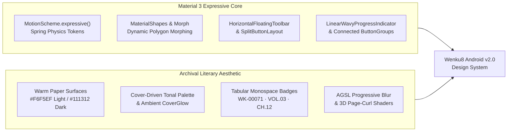
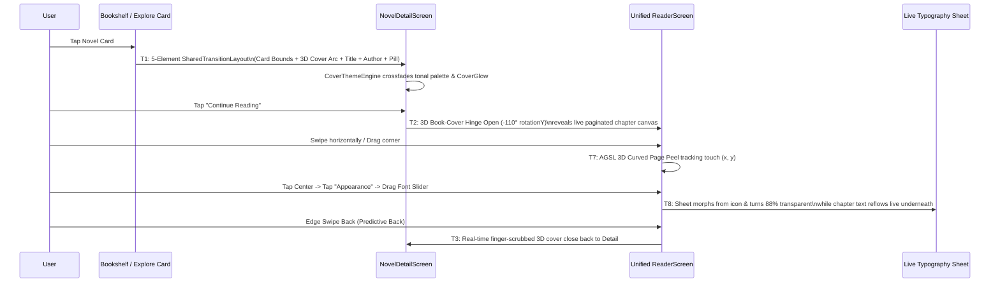

# 03 — Material 3 Expressive, Motion Physics & Transition Standards for Wenku8 `v2.0`

**Status:** Design Specification  
**Target Stack:** Jetpack Compose + Material 3 Expressive (`1.4+`/`1.5+`) + Navigation Compose (`2.8+`) + Android 13–16 AGSL `RuntimeShader` & `RenderEffect`

---

## 1. Visual Identity: Material 3 Expressive Meets "Archival Light Novel Studio"

Wenku8 `v2.0` fuses **Google's Material 3 Expressive** design language (physics-driven springs, morphing shapes, floating toolbars, connected button groups, wavy progress indicators) with the warm, literary **"Reading Archive" (纸页与档案)** aesthetic explored in `Wenku8_Flutter`.

---

## 2. Dynamic Color, Cover-Seed Extraction & 4-Tier Lighting System

### 2.1 Three-Layer Color Source Hierarchy

1. **System Dynamic Color (Monet — Android 12+)**:
   - Uses `dynamicLightColorScheme(context)` / `dynamicDarkColorScheme(context)` when "Follow System Wallpaper (Monet)" is enabled.
2. **Curated Literary Seed Palettes**:
   - When Monet is off (or on Android < 12), users can pick from 6 literary seed palettes or sample any color from an image:
     - **Wenku Classic Azure (`#3487F4`)** — Heritage Wenku8 blue modernized into full M3 tonal roles.
     - **Archival Sage (`#607D71`)** — Calm, low-glare botanical ink (inspired by `Wenku8_Flutter`).
     - **Crimson Bookmark (`#A04858`)** — Warm editorial carmine.
     - **Amber Parchment (`#9B7842`)** — Vintage gold & warm sepia.
     - **Iris Twilight (`#7C6AA6`)** — Soft literary violet.
     - **Graphite Press (`#6E737B`)** — Neutral monochrome ink.
3. **Per-Book Cover Dynamic Theme (`CoverThemeEngine`)**:
   - On `NovelDetailScreen` and `ReviewListScreen`, the app extracts the novel cover's dominant, vibrant, and muted seed colors asynchronously via `androidx.palette:palette-ktx` + Material Color Utilities (`QuantizerCelebi` + `SchemeTonalSpot`).
   - All `SurfaceContainer`, `SecondaryContainer`, `Primary`, tag chips, and the top radial `CoverGlow` backdrop smoothly animate (`animateColorAsState` using `motionScheme.defaultEffectsSpec()`) to match the current book's cover art!

### 2.2 Four Lighting Modes (Finally Retiring `"All hail the dark mode!"`)

| Mode | Background / Surface | Primary Text | Use Case & Behavior |
| :--- | :--- | :--- | :--- |
| **1. Archival Day (日间纸页)** | `#F6F5EF` (Warm Milk Paper) / `#EFECE4` (`surfaceContainer`) | `#1C1D1B` (Deep Charcoal Ink) | Default daytime mode; eliminates harsh `#FFFFFF` glare across all lists and cards. |
| **2. Carbon Night (夜间墨色)** | `#111312` (Carbon Night) / `#1A1D1B` (`surfaceContainer`) | `#E2E3DF` (Soft Warm Gray) | App-wide dark mode synchronized with system Night Mode or toggled via 1-tap sun/moon morph. |
| **3. Pure AMOLED (纯黑省电)** | `#000000` (True Black) / `#0D0F0E` (`surfaceContainer`) | `#CCCCCC` (Adjustable contrast) | Zero-backlight OLED reading & browsing in pitch-dark rooms. |
| **4. E-Ink High-Contrast (墨水屏专享)** | `#FFFFFF` (Pure White) with `1.dp` `#111111` crisp borders | `#000000` (Pure Black) | Disables all blurs, elevation shadows, and animations (`SnapSpec(0)`), optimizing for Onyx Boox / Kindle / Hisense E-Ink devices. |

> [!IMPORTANT]
> **Strict Reader Paper Isolation:** Changing the global app theme or Monet wallpaper never overrides the Reader's chosen paper preset (`奶白 #F6F5EF`, `羊皮纸 #EDE2CA`, `浅苔 #E4EBDD`, `夜读 #111312`, `纯黑 #000000`, `墨水屏 #FFFFFF`, or custom image) unless the user explicitly selects `跟随应用主题 (Follow App Theme)`.

---

## 3. Material 3 Expressive Component Vocabulary

Wenku8 `v2.0` adopts the newest `@OptIn(ExperimentalMaterial3ExpressiveApi::class)` components across the entire app:

### 3.1 `HorizontalFloatingToolbar` & Progressive Backdrop Blur
- Replaces rigid full-width bottom bars on `MainScaffold` (compact phones) and `ReaderScreen`.
- Floats `16.dp` above the navigation bar inset as a pill container (`ShapeDefaults.Full`), paired with an adjacent contextual `FloatingActionButton` or `FloatingActionButtonMenu`.
- Uses Android 12+ `RenderEffect.createBlurEffect(24f, 24f, Shader.TileMode.CLAMP)` combined with a vertical alpha gradient mask (`ProgressiveBlur`) so scrolling book covers melt softly behind the floating dock without a hard horizontal border.

### 3.2 `SplitButtonLayout` for Primary Multi-Mode Actions
- **`NovelDetailScreen` Primary Reading CTA**:
  - **Leading Button**: `"继续阅读 · 第3卷 第2话 (42%)"` (or `"开始阅读 · 第一卷 序章"`).
  - **Trailing Split Menu Button**: Opens a spring-morphed menu to `"从头开始阅读"`, `"选择阅读模式 (仿真翻页 / 平移翻页 / 连续卷轴 / 竖排右翻)"`, or `"加入听书队列 (TTS)"`.
- **`NovelDetailScreen` & `BookshelfScreen` Offline Download CTA**:
  - **Leading Button**: Executes the user's preferred default mode (e.g., `"智能更新缓存"`).
  - **Trailing Split Menu Button**: Exposes all 4 classic Wenku8 download modes (*检查更新 Check Updates*, *选择分卷下载 Select Volumes*, *智能更新 Smart Update*, *强制覆盖下载 Force Overwrite*).

### 3.3 Connected `ButtonGroup` & Width-Morphing `ToggleButton`s
- Used for switching **Bookshelf View Modes** (`网格 Grid` / `列表 List` / `3D书脊 Carousel`), **Search Scopes** (`书名 Title` / `作者 Author` / `#标签 Tag` / `AID`), and **Reader Modes**.
- When tapped, the active `ToggleButton` physically widens with a horizontal spring (`fastSpatialSpec`) while neighboring buttons compress slightly and morph their inner corner radii between `4.dp` (connected edge) and `24.dp` (active pill).

### 3.4 `FloatingActionButtonMenu`
- Replaces the legacy manual `ObjectAnimator` speed-dial FAB in `NovelInfoActivity`.
- Tapping the primary FAB morphs its shape and fans out hierarchical pill items (`收藏/取消收藏`, `分卷缓存管理`, `投推荐票`, `书评广场 (128)`, `分享卡片`) with staggered `30ms` spring entrances.

### 3.5 `LinearWavyProgressIndicator` & `CircularWavyProgressIndicator`
- Replaces all blocking modal `ProgressDialogHelper` dialogs!
- Active bookshelf cloud sync, multi-volume chapter downloads, and TTS speech synthesis display a living, undulating **Wavy Progress Indicator** inside a non-blocking docked status pill or inside the volume card itself, allowing the user to keep browsing or reading while chapters download in the background.

### 3.6 `MaterialShapes` & `Morph` (`androidx.graphics:graphics-shapes`)
- Uses `MaterialShapes` presets (`Circle`, `Square`, `Pill`, `Sunny`, `Cookie9Sided`, `Clover4Leaf`, `Arch`, `Slanted`) and `Morph(startPolygon, endPolygon)` for expressive micro-states:
  - **Ranking Badges (`#1`, `#2`, `#3`)**: Rendered inside rotating/morphing `Cookie9Sided` and `Sunny` polygons with gold/silver/bronze tonal fills.
  - **Book Favorite / Selection State**: Tapping the Favorite heart or multi-select checkbox morphs its container polygon from a soft rounded square (`RoundedPolygon.rectangle`) into a `Sunny` burst and settles into a `Cookie9Sided` badge.
  - **User Avatar Frame**: Morphs between a `Circle` and a `Clover` or `Cookie9Sided` frame during Daily Check-in (`每日签到`) celebration.

---

## 4. Motion Physics System (`MotionScheme.expressive()`)

All animations in Wenku8 `v2.0` outlaw linear or arbitrary duration-based tweens in favor of **Material 3 Expressive Spring Physics** (`MaterialTheme.motionScheme`). Because springs are velocity-continuous, any animation interrupted mid-flight (such as reversing a swipe or rapidly switching tabs) redirects smoothly using its current velocity vector.

| Token | Damping Ratio ($\zeta$) | Stiffness ($k$) | Approx. Settling | Primary Usage in Wenku8 `v2.0` |
| :--- | :--- | :--- | :--- | :--- |
| **`fastSpatialSpec()`** | `0.6f` (Underdamped / Bouncy) | `800f` | `~220ms` | Icon contact bounce, `ButtonGroup` width expansion, chip selection, switch toggles, tap-zone feedback. |
| **`defaultSpatialSpec()`** | `0.65f` (Expressive Bounce) | `500f` | `~350ms` | `SharedTransitionLayout` cover/card flight, `FloatingActionButtonMenu` fan-out, bottom sheet morphs, volume accordion expand. |
| **`slowSpatialSpec()`** | `0.7f` (Gentle Overshoot) | `300f` | `~500ms` | 3D Book-Cover opening into Reader, full-screen Container Transforms, 3D Archive Carousel focal pull. |
| **`fastEffectsSpec()`** | `1.0f` (Critically Damped) | `1400f` | `~120ms` | Ripple/scrim opacity, press-state elevation/color shifts, live slider transparency fade. |
| **`defaultEffectsSpec()`** | `1.0f` (Critically Damped) | `800f` | `~250ms` | Cover-driven dynamic palette crossfades (`CoverThemeEngine`), skeleton-to-content crossfades. |
| **`slowEffectsSpec()`** | `1.0f` (Critically Damped) | `400f` | `~450ms` | Ambient background `CoverGlow` breathing and day/night surface transitions. |

*(Note: effects specs for color/alpha ALWAYS use $\zeta = 1.0f$ critically damped springs so colors and opacities never overshoot past `0.0` or `1.0`, while spatial specs use $\zeta = 0.6f–0.7f$ for tangible physical elasticity.)*

---

## 5. The 12 Signature Transitions & Animation Choreography of Wenku8 `v2.0`

### T1 — 5-Element Synchronized `SharedTransitionLayout` (List/Grid Card ↔ `NovelDetailScreen`)
When tapping any novel in `BookshelfScreen`, `ExploreScreen`, `Rankings`, or `SearchScreen`:
1. **`card-bounds-{aid}` (`Modifier.sharedBounds`)**: The card surface expands smoothly into the `NovelDetailScreen` header container while interpolating corner radius (`16.dp` → `0.dp`).
2. **`cover-image-{aid}` (`Modifier.sharedElement` + Arc Path + 3D Tilt)**: The book cover flies along a curved `ArcMode.ArcBelow` trajectory while applying a subtle 3D aerodynamic pitch/roll (`rotationX`, `rotationY` peaking at `t = 0.45`) and landing with an ambient `CoverGlow` drop shadow.
3. **`novel-title-{aid}` (`Modifier.sharedBounds` + `scaleToBounds()`)**: Title text scales smoothly from `titleMedium` to `headlineSmall`.
4. **`novel-author-{aid}` (`Modifier.sharedElement`)**: Author pill glides into the clickable author header link.
5. **`novel-badge-{aid}` (`Modifier.sharedElement`)**: Status/imprint badge (`电击文库 · 连载中`) docks into the metadata row.

### T2 — 3D Book-Cover Opening Transition (Shelf / Detail → `ReaderScreen`)
When opening the Reader (either from `NovelDetailScreen`'s "Continue Reading" button or directly from `BookshelfScreen` when "Direct Read on Tap" is enabled):
- The book cover expands via `sharedBounds` to fill the viewport's aspect ratio while the newly loaded `ReaderScreen` canvas is rendered directly behind it.
- Using `Modifier.graphicsLayer`, the cover pivots around its left spine (`transformOrigin = TransformOrigin(0f, 0.5f)`, `cameraDistance = 18f * density`) from `rotationY = 0f` to `-115f` using `slowSpatialSpec()`, casting a moving spine shadow across Page 1 of the chapter as the book opens!

### T3 — Android 15/16 Predictive Back with Live Shared-Element & 3D Scrubbing
- Every destination in Wenku8 `v2.0` is wired into Navigation Compose's predictive back (`OnBackInvokedCallback`).
- Dragging from the left or right screen edge **scrubs the transition progress (`0.0f..1.0f`) in real time**:
  - In `ReaderScreen`: Swiping back peels the reader viewport down to `90%` scale with rounded `28.dp` corners and begins folding the 3D book cover back over the page, peeking `NovelDetailScreen` or `BookshelfScreen` behind it.
  - In `NovelDetailScreen`: Swiping back detaches the header card and glides the cover, title, and author halfway back toward their exact grid/list slot on the underlying screen.
  - Releasing before the threshold springs the screen back open (`defaultSpatialSpec()`); completing the gesture lands the shared elements seamlessly into their origin card.

### T4 — Container Transform Search Studio (`sharedBounds` Pill ↔ Full-Screen Search)
- Tapping the top/floating Search pill morphs its pill bounds (`cornerRadius = 28.dp`) into the full-screen `SearchScreen` header (`cornerRadius = 0.dp`).
- As the container expands, the search icon slides to the leading edge, the keyboard rises with `WindowInsetsAnimationCompat` frame-synced padding (smoothly pushing bottom filter chips upward at 120fps), and recent search chips cascade in with a `25ms` stagger.

### T5 — 3D Perspective Bookshelf Carousel (`ArchiveSpineCarousel`)
- In `BookshelfScreen`'s 3D Carousel mode, books are arranged along a horizontal perspective rail using `graphicsLayer`:
  - Unfocused books stand as angled 3D book spines (`rotationY = ±58°`, `scale = 0.86f`) showing their spine title, volume count, and cover edge.
  - Scrubbing horizontally fires `HapticFeedbackConstants.SEGMENT_FREQUENT_TICK` on each spine crossing.
  - The centered book pulls forward along the Z-axis (`translationZ`, `rotationY = 0°`, `scale = 1.0f`) with a spring, unfolding its full front cover, 3D paper-edge thickness, and a floating glass inspection card (`阅读进度 68% · 继续阅读 · 详情`).

### T6 — Collapsible Volume Accordion & Staggered Chapter Cascade
- On `NovelDetailScreen`, volumes are rendered as Material 3 Expressive expandable cards:
  - Tapping a volume rotates its chevron `180°` with `fastSpatialSpec()`, morphs the volume header corner radii (`16.dp` bottom corners → `4.dp` connected corners), and expands the chapter list using `AnimatedVisibility` with `expandVertically(springSpec = defaultSpatialSpec())`.
  - Individual chapters cascade in with a `20ms` staggered slide-and-fade, displaying an animated checkmark or `CircularWavyProgressIndicator` for offline cache status.

### T7 — AGSL `RuntimeShader` & 3D Mesh Page-Turn Suite in `ReaderScreen`
The Unified Reader offers **6 physics-driven page transition modes**:
1. **3D Curved Page Peel (`AGSL RuntimeShader` / 3D Triangle Mesh)**:
   - Tracks the user's live finger `(touchX, touchY)` across the page, curling the page around a dynamic cylinder/cone axis with realistic paper curvature, back-of-page mirrored text bleed-through (`12%` alpha), specular highlight along the fold crest, and soft cast shadow onto the next page.
2. **Overlapped Card Slide (经典覆盖滑动)**:
   - Current page slides horizontally with finger velocity, casting an elevation drop shadow over the incoming page, which translates with a `25%` parallax offset (`translationX = -0.25f * offset`).
3. **3D Book-Spine Dual-Page Flip (双页仿真翻书 — Foldables & Tablets)**:
   - On unfolded devices (e.g., Pixel Pro Fold) or landscape tablets, renders a left/right two-page spread with a central spine shadow; turning pages pivots the right-hand leaf `180°` across the central spine onto the left-hand side.
4. **Staggered Paragraph Cascade (段落接续流)**:
   - When switching pages or chapters, paragraphs cascade in vertically with a `30ms` per-paragraph spring stagger.
5. **Continuous Multi-Chapter Scroll Stream (无缝卷轴流)**:
   - Zero-interruption vertical `LazyColumn` stream that automatically preloads and appends the next/previous chapter (`ChapterNavigator`) as the user scrolls, displaying a subtle editorial chapter-divider masthead (`VOL.02 / CH.05`) inline without breaking fling momentum.
6. **E-Ink Instant Cut (墨水屏极速无动画)**:
   - `0ms` instant frame swap with zero intermediate frames to prevent E-Ink ghosting.

### T8 — Live Transparent Jelly Sheet Preview (`ReaderTypographySheet`)
- Tapping `外观 (Appearance)` on the Reader's `HorizontalFloatingToolbar` morphs the toolbar button into a bottom sheet (`Modifier.sharedBounds`).
- **Live Reflow Preview**: The instant the user starts dragging any `Slider` (Font Size `8–32sp`, Line Spacing, Paragraph Spacing, Margin, or Night Contrast), the sheet animates its background alpha from `0.96f` to `0.10f` and fades out non-active rows (`fastEffectsSpec()`), allowing the user to watch the actual novel page reflow and repaginate live underneath their thumb! Releasing the slider smoothly restores the sheet surface.

### T9 — Shared-Element Illustration Lightbox & Gesture Dismiss
- Tapping any inline illustration in `ReaderScreen` or the book cover in `NovelDetailScreen` triggers a `sharedElement` transition into `ImageDetailScreen`.
- Supports double-tap smart zoom (`1x` ↔ `2.5x` ↔ `4x` with spring interpolation), two-finger pinch-to-zoom, `90°` spring rotation, and **vertical drag-to-dismiss** (dragging the image up/down scales it down proportionally, reveals the underlying reader/detail screen through a fading scrim, and snaps back into its inline slot on release).

### T10 — Review Card → Thread Floor Container Transform & Composer Morph
- In `ReviewListScreen`, tapping any review card morphs its `MaterialCardView` bounds (`sharedBounds`) into the top `01 / ORIGINAL POST` pinned header of `ReviewThreadScreen`, while floor replies (`02 / REPLY`, `03 / REPLY`...) cascade in below.
- Tapping the bottom-right `"写回复 (Reply)"` extended FAB morphs it (`sharedBounds`) directly into the docked bottom reply input bar with live character counter (`>= 7 chars`), live bad-word highlight chip, and auto-saved draft indicator.

### T11 — Semantic Animated Icons & Celebratory Micro-Animations
- **Sun ↔ Moon Theme Morph**: Toggling Day/Night mode rotates the sun rays `180°` while morphing the center disc into a crescent moon.
- **Favorite Ribbon & Particle Burst**: Adding a book to the Bookshelf drops a crimson bookmark ribbon down the top-right corner of the book cover with an elastic bounce and a subtle radial burst.
- **Daily Check-In (`每日签到`) Celebration**: Tapping `"每日签到"` in `ProfileScreen` morphs the button into a checkmark badge, plays a confetti/sparkle particle burst around the user avatar, and animates the `积分 (Score)` counter rolling upward (`AnimatedContent` vertical digit roll `+1`).

### T12 — Staggered Feed Cascades & Morphing Skeleton Shimmers
- Network lists (`Explore`, `Rankings`, `Reviews`) never show a blank white screen or a lone spinning circle:
  - **Phase 1 (Loading)**: Renders archival skeleton cards with a diagonal warm shimmer wave.
  - **Phase 2 (Loaded)**: Skeleton cards morph their bounds (`animateContentSize`) and crossfade into real novel cards with a `35ms` per-item vertical spring entrance (`translationY: 24.dp -> 0.dp`, `alpha: 0f -> 1f`).
