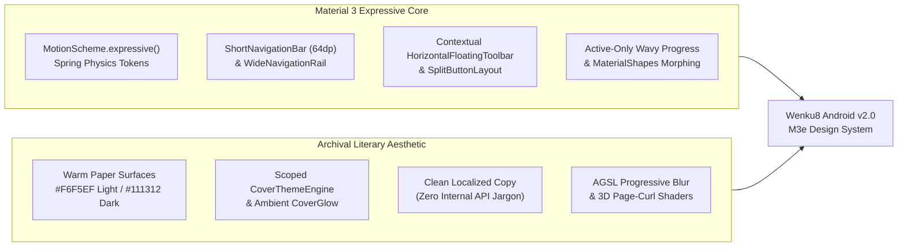

# 03 — Material 3 Expressive (`M3e`), Motion Physics & Transition Standards for Wenku8 `v2.0`

**Status:** Design Specification  
**Target Stack:** `minSdk = 23` · Jetpack Compose + **Material 3 Expressive (`material3:1.4+`)** + Navigation Compose (`2.8+`) + Android 12–16 `RenderEffect` & AGSL `RuntimeShader`

---

## 1. Visual Identity & Official Google AndroidX Policy

> [!IMPORTANT]
> **100% Official Material 3 Expressive (`M3e`) — Zero Third-Party UI Libraries**: Every navigation component, motion spring, adaptive layout, and polygon morph in Wenku8 `v2.0` comes **exclusively from official Google `androidx.*` Maven artifacts**. We target **Material 3 Expressive (`M3e`)** rather than baseline Material 3 (`MD3`), strictly adhering to M3e component semantics (`ShortNavigationBar` & `WideNavigationRail` for top-level destinations vs. `HorizontalFloatingToolbar` for screen-level contextual actions).

| Official Google Maven Artifact | Official M3 Expressive Classes & APIs Used in `v2.0` |
| :--- | :--- |
| `androidx.compose.material3:material3:1.4.0+` | `MaterialExpressiveTheme`, `MotionScheme.expressive()`, `ShortNavigationBar`, `ShortNavigationBarItem`, `WideNavigationRail`, `WideNavigationRailItem`, `HorizontalMultiBrowseCarousel`, `SplitButtonLayout`, `ButtonGroup`, `ToggleButton`, `HorizontalFloatingToolbar`, `FloatingActionButtonMenu`, `LinearWavyProgressIndicator`, `CircularWavyProgressIndicator`, `SearchBar`, `ModalBottomSheet`, `Slider`, `MaterialShapes` |
| `androidx.compose.material3.adaptive:adaptive-layout` & `adaptive-navigation` | `ListDetailPaneScaffold`, `SupportingPaneScaffold`, `NavigableListDetailPaneScaffold` |
| `androidx.compose.material3:material3-adaptive-navigation-suite` | `NavigationSuiteScaffold` (automatic `ShortNavigationBarCompact` ↔ `ShortNavigationBarMedium` ↔ `WideNavigationRail` switching) |
| `androidx.compose.animation:animation` | `SharedTransitionLayout`, `Modifier.sharedBounds()`, `Modifier.sharedElement()`, `spring()` |
| `androidx.graphics:graphics-shapes:1.0.1` | Official AndroidX `RoundedPolygon`, `Morph`, `CornerRounding` |
| `androidx.palette:palette-ktx:1.0.0` & `com.google.android.material:material:1.13.0+` | Cover seed extraction & Material Color Utilities (`QuantizerCelebi` + `SchemeTonalSpot`) |

---

## 2. Dynamic Color, Scoped Cover Palette & 4-Tier Lighting System

### 2.1 Three-Layer Color Source Hierarchy

1. **System Dynamic Color (Monet — Android 12+)**:
   - Uses `dynamicLightColorScheme(context)` / `dynamicDarkColorScheme(context)` when *"跟随系统壁纸动态取色 (Monet)"* is enabled.
2. **Curated Literary Seed Palettes (Default When Monet Is Off or API 23–30)**:
   - **Wenku Classic Azure (`#3487F4`)** — Heritage Wenku8 blue modernized into full M3 HCT tonal roles.
   - **Archival Sage (`#607D71`)** — Calm, low-glare botanical ink.
   - **Crimson Bookmark (`#A04858`)** — Warm editorial carmine.
   - **Amber Parchment (`#9B7842`)** — Vintage gold & warm sepia.
   - **Iris Twilight (`#7C6AA6`)** — Soft literary violet.
   - **Graphite Press (`#6E737B`)** — Neutral monochrome ink.
3. **Scoped Per-Book Cover Dynamic Theme (`CoverThemeEngine` — Content-Based Color)**:
   - On **`NovelDetailScreen` and `ReviewListScreen` only**, the app extracts the novel cover's seed color asynchronously via `palette-ktx` + `SchemeTonalSpot` and crossfades (`motionScheme.defaultEffectsSpec()`) local tonal containers and the radial `CoverGlow` header backdrop.
   - **Strict Scope Rule**: Per M3 Content-Based Color guidelines, `CoverThemeEngine` **never mutates global app chrome** across `Bookshelf`, `Latest`, `Rankings`, or `Profile`, avoiding jarring app-wide color flashes when inspecting books.

### 2.2 Four Lighting Modes (Retiring `"All hail the dark mode!"`)

| Mode | Background / Surface | Primary Text | Use Case & Behavior |
| :--- | :--- | :--- | :--- |
| **1. Archival Day (日间纸页)** | `#F6F5EF` (Warm Milk Paper) / `#EFECE4` (`surfaceContainer`) | `#1C1D1B` (Deep Charcoal Ink) | Default non-Monet daytime surface; eliminates harsh `#FFFFFF` glare across lists and cards. |
| **2. Carbon Night (夜间墨色)** | `#111312` (Carbon Night) / `#1A1D1B` (`surfaceContainer`) | `#E2E3DF` (Soft Warm Gray) | App-wide dark mode synchronized with system Night Mode or toggled via 1-tap sun/moon morph. |
| **3. Pure AMOLED (纯黑省电)** | `#000000` (True Black) / `#0D0F0E` (`surfaceContainer`) | `#CCCCCC` (Adjustable contrast) | Zero-backlight OLED reading & browsing in pitch-dark rooms. |
| **4. E-Ink High-Contrast (墨水屏专享)** | `#FFFFFF` (Pure White) + **`1.dp` `#111111` crisp outlines** | `#000000` (Pure Black) | Overrides borderless filled cards/chips/sheets to `1.dp` solid borders (preventing 16-grayscale tonal crushing), swaps wavy progress bars to static flat bars, disables all blurs/shadows, and enforces `SnapSpec(0)`. |

> [!IMPORTANT]
> **Strict Reader Paper Isolation:** Changing the global app theme or Monet wallpaper never overrides the Reader's chosen paper preset (`奶白 #F6F5EF`, `羊皮纸 #EDE2CA`, `浅苔 #E4EBDD`, `夜读 #111312`, `纯黑 #000000`, `墨水屏 #FFFFFF`, or custom image) unless the user explicitly selects `跟随应用主题`.

---

## 3. Material 3 Expressive (`M3e`) Component Vocabulary & Guardrails

### 3.1 `ShortNavigationBar` & `WideNavigationRail` (Top-Level App Navigation)
- Per official M3 Expressive guidelines (`NavigationSuiteScaffold`), Wenku8 `v2.0` preserves `v1.31`'s familiar **4 top-level destinations** (`书架`, `最新`, `排行`, `我的`):
  - **Compact Phones (`< 600.dp`)**: Uses `ShortNavigationBar` (`64.dp` height, replacing MD3's bulky `80.dp` bar) with vertical `ShortNavigationBarItem` pills (`56×32.dp` active indicator).
  - **Medium Windows (`600–840.dp`)**: Automatically adapts to `ShortNavigationBarMedium` (horizontal icon-beside-label `40.dp` pills) or collapsed `WideNavigationRail`.
  - **Expanded Windows (`>= 840.dp`)**: Uses spring-expandable `WideNavigationRail` (`rememberWideNavigationRailState()`), eliminating legacy `DrawerLayout` swipe conflicts.

### 3.2 `HorizontalFloatingToolbar` (Contextual Screen Actions Only)
- Reserved strictly for **screen-specific contextual actions**, never top-level app navigation (and never stacked with duplicate FABs):
  1. **`UnifiedReaderScreen` HUD**: Floats `16.dp` above the navigation bar inset with `Modifier.floatingToolbarVerticalNestedScroll()` and Android 12+ `RenderEffect` progressive blur (graceful translucent surface fallback on API 23–30).
  2. **`BookshelfScreen` Batch-Select Mode**: Morphs into view when multi-selecting novels (`全选` · `智能更新` · `清理缓存` · `移出书架`).

### 3.3 `SplitButtonLayout` (Same-Action Variants Rule)
- Per M3e semantics, the leading button and trailing `▾` menu button **must represent variants of the same primary action** (never mixing unrelated actions like Read + Offline Download):
  - **`NovelDetailScreen` Reading CTA**: Leading `"▶ 继续阅读 · 第3卷 (42%)"` + Trailing `▾` menu (`"从头开始阅读"`, `"选择阅读模式"`, `"朗读本章 TTS"`). Offline caching (`↓ 离线缓存`), Bookshelf membership (`✓ 已在书架`), and Reviews (`💬 书评`) sit in their own dedicated secondary tonal button strip below so touch targets never crowd on `360.dp` widths.
  - **`BookshelfScreen` Batch Update CTA**: Leading `"智能更新"` + Trailing `▾` menu exposing all 4 Wenku8 download modes (*智能更新*, *检查并下载更新*, *分卷自由勾选*, *全量覆盖重下*).

### 3.4 Connected `ButtonGroup` & Width-Morphing `ToggleButton`s
- Used for switching **Bookshelf View Modes** (`网格` / `列表` / `3D书脊`), **`排行` Metric Row** (`点击榜` / `推荐榜` / `总收藏` / `字数榜`), **Online Search Scopes** (`书名` / `作者` / `AID直达`), and **Reader Page-Turn Modes**.
- Tapping a `ToggleButton` widens it horizontally via `fastSpatialSpec()` while morphing inner connected corners (`4.dp` ↔ `24.dp`). Every interactive chip/button enforces `Modifier.minimumInteractiveComponentSize()` (`48×48.dp`).

### 3.5 Active-Only `LinearWavyProgressIndicator` & `CircularWavyProgressIndicator`
- Replaces all blocking modal `ProgressDialogHelper` popups!
- **Strict M3e Usage Rule**: Wavy indicators signify **active, in-flight work** (active `WorkManager` chapter download, active cloud bookshelf sync, active manual `网络检测` benchmark, or live TTS playback). **Static resting reading progress** (`已读 68%`) always uses a standard flat M3 `LinearProgressIndicator` (with track gap and stop dot) so resting lists stay calm and unambiguous. In E-Ink mode, all wavy indicators automatically degrade to static flat bars.

### 3.6 `MaterialShapes` & `Morph` (`androidx.graphics:graphics-shapes`)
- **Ranking Badges (`#1`, `#2`, `#3`)**: Rendered inside `Sunny` and `Cookie9Sided` polygons with gold/silver/bronze tonal fills.
- **Book Multi-Select & Check-In**: Morphs between rounded square, `Sunny` burst, and `Cookie9Sided` badge during selection and `每日签到` celebration.

---

## 4. Motion Physics System (`MotionScheme.expressive()`)

All animations use velocity-continuous **Material 3 Expressive Spring Physics** (`MaterialTheme.motionScheme`):

| Token | Damping Ratio ($\zeta$) | Stiffness ($k$) | Approx. Settling | Primary Usage in Wenku8 `v2.0` |
| :--- | :--- | :--- | :--- | :--- |
| **`fastSpatialSpec()`** | `0.6f` (Underdamped / Bouncy) | `800f` | `~220ms` | Icon contact bounce, `ButtonGroup` width morph, chip selection, switch toggles, tap-zone feedback. |
| **`defaultSpatialSpec()`** | `0.65f` (Expressive Bounce) | `500f` | `~350ms` | `SharedTransitionLayout` cover/card flight, `FloatingActionButtonMenu` fan-out, bottom sheet morphs, volume accordion expand. |
| **`slowSpatialSpec()`** | `0.7f` (Gentle Overshoot) | `300f` | `~500ms` | 3D Book-Cover opening into Reader, full-screen Container Transforms, 3D Archive Carousel focal pull. |
| **`fastEffectsSpec()`** | `1.0f` (Critically Damped) | `1400f` | `~120ms` | Ripple/scrim opacity, press-state elevation/color shifts, active-slider capsule isolation fade. |
| **`defaultEffectsSpec()`** | `1.0f` (Critically Damped) | `800f` | `~250ms` | Scoped `CoverThemeEngine` palette crossfades, skeleton-to-content crossfades. |
| **`slowEffectsSpec()`** | `1.0f` (Critically Damped) | `400f` | `~450ms` | Ambient `CoverGlow` transitions and day/night surface shifts. |

---

## 5. The 12 Signature Transitions & Animation Choreography of Wenku8 `v2.0`

### T1 — 5-Element Synchronized `SharedTransitionLayout` (List/Grid Card ↔ `NovelDetailScreen`)
1. **`card-bounds-{aid}` (`Modifier.sharedBounds`)**: Expands card surface smoothly into `NovelDetailScreen` header container (`16.dp` → `0.dp`).
2. **`cover-image-{aid}` (`Modifier.sharedElement` + Arc Path + 3D Tilt)**: Flies along `ArcMode.ArcBelow` with subtle 3D pitch/roll and lands over an ambient `CoverGlow`.
3. **`novel-title-{aid}` (`Modifier.sharedBounds`)**: Scales smoothly from `titleMedium` to `headlineSmall`.
4. **`novel-author-{aid}` (`Modifier.sharedElement`)**: Glides into the clickable author search link.
5. **`novel-badge-{aid}` (`Modifier.sharedElement`)**: Status/imprint badge docks into the metadata row.

### T2 — 3D Book-Cover Opening Transition (Shelf / Detail → `ReaderScreen`)
- Book cover expands via `sharedBounds` and pivots around its left spine (`transformOrigin = TransformOrigin(0f, 0.5f)`, `cameraDistance = 18f * density`, `rotationY: 0f -> -115f` via `slowSpatialSpec()`), casting a moving spine shadow across Page 1.

### T3 — Android 15/16 Predictive Back with Live Shared-Element & 3D Scrubbing
- Wired into `OnBackInvokedCallback` across all Compose routes. Swiping from the outer `24.dp` bezel scrubs `ReaderScreen` or `NovelDetailScreen` progress (`0.0f..1.0f`) in real time (edge brightness drag inside the Reader is inset to `24.dp..72.dp` when enabled so Predictive Back never collides with brightness adjustment).

### T4 — Container Transform Search Studio (`sharedBounds` Pill ↔ Full-Screen Search)
- Top `SearchBar` pill (`28.dp`) morphs into fullscreen `UnifiedSearchScreen` (`0.dp`) with `WindowInsetsAnimationCompat` 120fps IME-synced chip padding.

### T5 — 3D Perspective Bookshelf Carousel (`ArchiveSpineCarousel`)
- Horizontal 3D spine shelf (`rotationY = ±58°`) with `SEGMENT_FREQUENT_TICK` haptics; centered spine unfolds forward (`rotationY = 0°`) with an inspection card.

### T6 — Collapsible Volume Accordion & Staggered Chapter Cascade
- Inline expandable volume cards (`fastSpatialSpec()` chevron + `defaultSpatialSpec()` vertical expand) with `20ms` staggered chapter rows and active-download `CircularWavyProgressIndicator`.

### T7 — 6-Mode Official-AndroidX Page-Turn Suite in `ReaderScreen`
- Supports **Cover Slide** (default), **3D Curved Page Peel** (Android 13+ AGSL `RuntimeShader` + API 23–32 2D Bezier fallback), **M3e Spring Slide**, **Dual-Page Foldable Spread**, **Continuous Multi-Chapter Scroll Stream**, **Vertical Right-to-Left Bunkobon**, and **E-Ink `0ms` Instant Cut**.

### T8 — Live Opaque-Capsule Reflow Preview (`ReaderTypographySheet`)
- When dragging any typography `Slider` (Font Size `8–32sp`, Spacing, Margins), **non-active rows and the sheet backdrop fade to `0%` opacity while the active slider row stays encased in a crisp `92%`-opaque `surfaceContainerHighest` floating pill capsule** (`fastEffectsSpec()`). This eliminates text-on-text overlap while exposing 90% of the live reflowing chapter page underneath!

### T9 — Shared-Element Illustration Artbook Lightbox & Gesture Dismiss
- Inline `<!--image-->` cards expand via `sharedBounds` into the Artbook overlay (`BitmapRegionDecoder` tiling zoom, `跨页拼合` spread stitching, `90°` spring rotate, vertical drag-to-dismiss).

### T10 — Review Card → Thread Floor Container Transform & Composer Morph
- Review cards morph (`sharedBounds`) into `01 / 楼主` pinned headers; the reply FAB morphs into the bottom composer with live `>= 7` char counter, `10s` cooldown pill, and `api-stub`-safe bad-word check.

### T11 — Semantic Animated Icons & Celebratory Micro-Animations
- Sun ↔ Moon rotation morph, favorite bookmark ribbon bounce, and `每日签到` `MaterialShapes` avatar burst + rolling `+1` score counter.

### T12 — Staggered Feed Cascades & Morphing Skeleton Shimmers
- Diagonal warm skeleton shimmers crossfading into loaded cards with a `35ms` per-item spring cascade.
