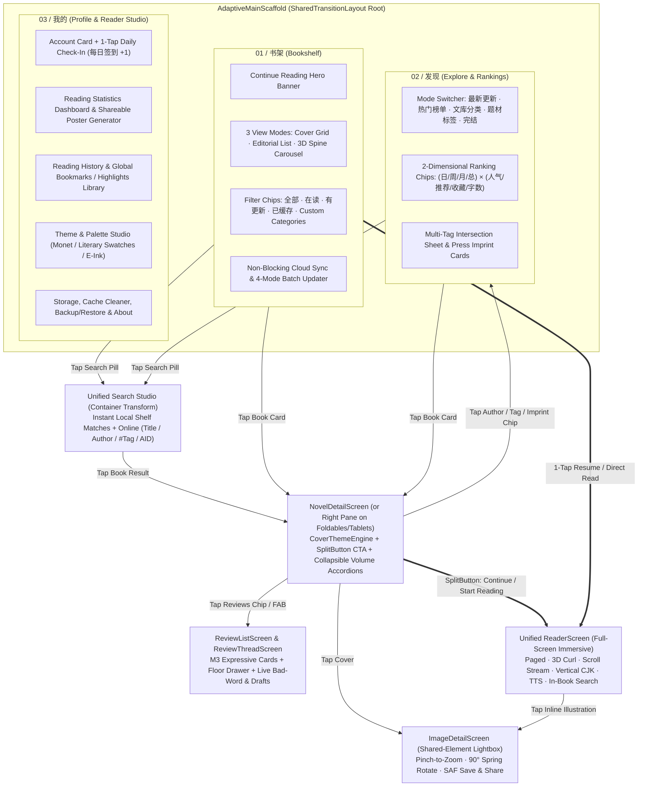
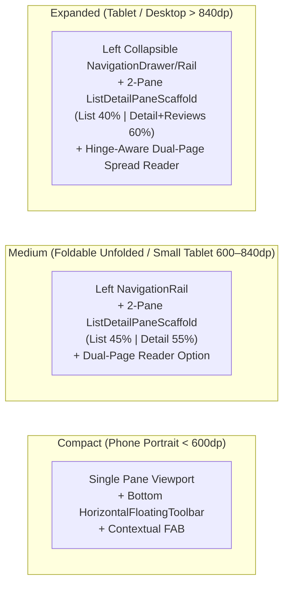
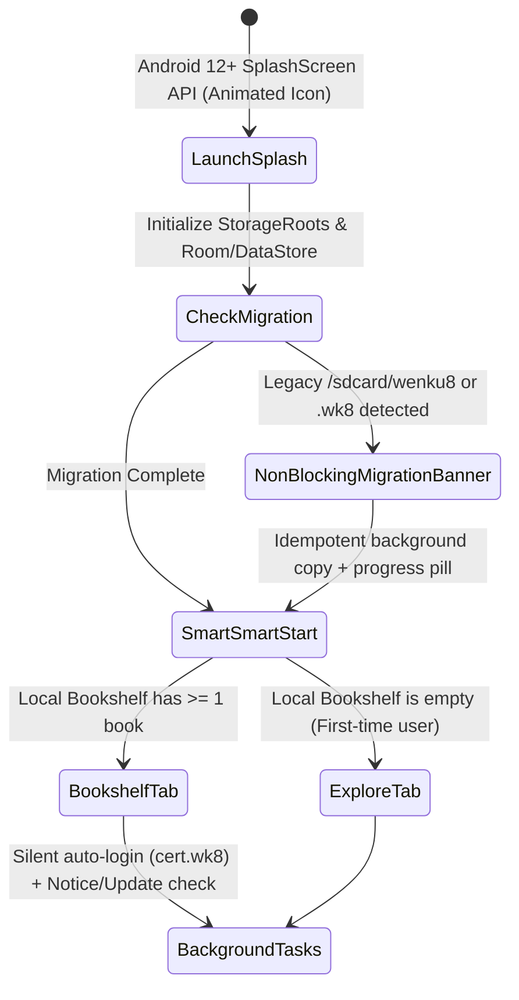
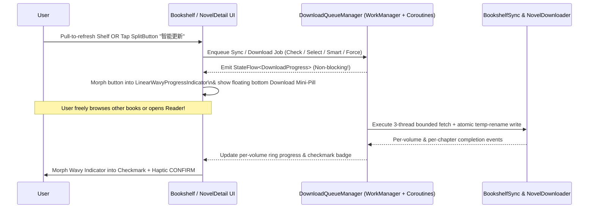
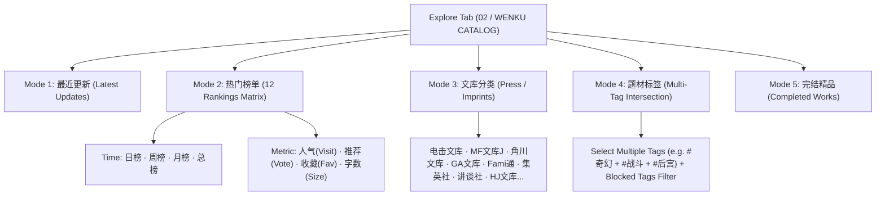
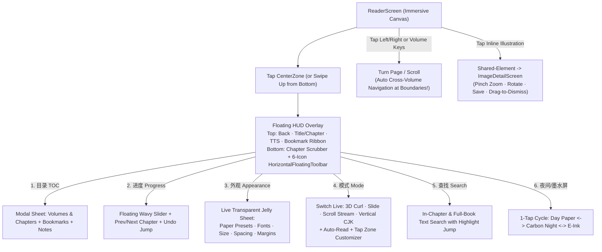

# 04 — Redesigned `v2.0` User Flow & Information Architecture

**Status:** Design Specification  
**Goal:** Replace `1.x`'s fragmented 2015 Hamburger-Drawer + multi-Activity maze with a spatial, gesture-first, non-blocking Material 3 Expressive user flow.

---

## 1. Structural Critique: Why the `1.x` User Flow Needs a Ground-Up Redesign

In `studio-android v1.x`, common user journeys suffer from high interaction cost and hidden affordances:

| User Goal | `v1.x` Legacy Flow (Pain Points) | `v2.0` Redesigned Flow (Target) |
| :--- | :--- | :--- |
| **Switch Top-Level Sections** | Reach to top-left hamburger icon or edge-swipe (conflicts with Android gesture back) → open `NavigationDrawerFragment` → tap row. | **1-Tap Floating Pill Dock (`HorizontalFloatingToolbar`)** at thumb level on phones, or persistent **`NavigationRail`** on foldables/tablets. |
| **Resume Last Read Book** | Open app → tap book in `FavFragment` → wait for `NovelInfoActivity` → tap small top-right toolbar icon `action_continue_read_progress` → confirm dialog. (4 steps) | **1-Tap Resume**: Tap the **"Continue Reading"** hero pill on `Bookshelf` (or tap the book cover directly if *Direct Read* is enabled) → 3D Book-Cover opens straight to the exact saved paragraph/word. |
| **Browse Rankings & Categories** | Open Drawer → tap `排行榜` → swipe horizontally through **12 separate `ViewPager` tabs** (`dayVisit`..`fullFlag`). No tag or imprint browsing exists. | **Unified `Explore` Hub**: 1-tap mode selector (`最新` / `排行` / `文库` / `标签` / `完结`) + instant 2-row filter chips (`日·周·月·总` × `人气·推荐·收藏·字数`). |
| **Search Bookshelf vs. Online** | Two completely separate screens (`BookshelfSearchActivity` vs. `SearchActivity` → `SearchResultActivity`). Title vs. Author toggle is an unlabeled color-changing icon (`search_option_btn`). | **Unified Container-Transform Search Studio**: One search bar searches **Local Bookshelf** (instant top section) + **Online Catalog** (`书名` / `作者` / `#标签` / `AID直达`) with explicit M3 Expressive connected `ToggleButton` chips. |
| **Switch Reader Engine (Paged vs. Scroll vs. Vertical)** | Must know a **secret hidden gesture**: open `NovelInfoActivity` → tap volume → open right side-sheet → **long-press** a chapter → pick engine in dialog. | **Unified Reader `v2.0`**: Switch between *3D Page Peel*, *Overlapped Slide*, *Continuous Scroll Stream*, and *Vertical R-to-L CJK* **live inside the Reader** via the `操作 (Mode)` floating sheet—zero restart required! |
| **Sync Shelf or Download Volumes** | Pops up a **blocking modal `ProgressDialogHelper`**; user cannot browse or read until download finishes or is cancelled. | **Non-Blocking Background Queue (`WorkManager`)**: Shows a sleek **`LinearWavyProgressIndicator`** inside the volume card and a floating bottom mini-pill while the user keeps reading or browsing. |
| **Check Account & Daily Sign-In** | Open Drawer → tap Avatar → opens separate `UserInfoActivity` → tap small text `"点击签到"`. | **Unified `Profile & Studio` Tab**: Displays User Card, 1-tap **`每日签到` button with celebratory animation**, Reading Statistics heatmap, History, and Settings in one place. |

---

## 2. `v2.0` Information Architecture: The 3-Pillar Adaptive Shell

Wenku8 `v2.0` consolidates 15 fragmented Activities and 6 legacy Fragments into a **single-Activity (`MainActivity`) Jetpack Compose architecture** with **3 primary top-level destinations**, a **global Container-Transform Search Overlay**, and **full-screen immersive Reader / Image Lightbox layers**.



---

## 3. Adaptive Layout Strategy Across Phones, Foldables & Tablets

Because Wenku8 is actively tested and used on both standard phones and large-screen foldables (such as the **Pixel 10 Pro Fold** documented in `STABILITY_PLAN.md`), `v2.0` uses Material 3 Adaptive (`NavigationSuiteScaffold` + `ListDetailPaneScaffold` + `WindowSizeClass`):



1. **Compact Width (`< 600.dp`)**:
   - Full-bleed edge-to-edge list/grid with a floating pill `HorizontalFloatingToolbar` (`书架`, `发现`, `我的` + trailing Search/Action FAB).
   - Tapping a novel navigates to `NovelDetailScreen` via the 5-element `SharedTransitionLayout`.
2. **Medium & Expanded Width (`>= 600.dp` — Foldables & Tablets)**:
   - Navigation automatically morphs into a left `NavigationRail` featuring a bottom **"Quick Resume" mini-cover widget** for the currently active book.
   - `Bookshelf` and `Explore` use `ListDetailPaneScaffold`: tapping any novel opens `NovelDetailScreen` in the right-hand detail pane while keeping the master grid/list interactive on the left.
   - Inside `ReaderScreen`, `WindowInfoTracker` detects hardware `FoldingFeature` hinges and automatically offers the **Dual-Page Book Spread (`ReaderSpreadFrame`)** with a realistic book-spine shadow down the center crease.

---

## 4. Redesigned Core User Flows

### 4.1 Flow 1: Startup, Silent Session Restore & Non-Destructive Storage Migration



- **Smart Start Destination**: Preserves `1.x`'s smart behavior—if the user has books on their shelf, the app opens directly to **书架 (`Bookshelf`)**; if the shelf is empty on first install, it opens to **发现 (`Explore`)** so the user immediately sees rich content.
- **Zero Startup Queueing**: Building on commit `c2d0d1b` (*"Stop the novel info screen queueing behind startup network calls"*), startup tasks (auto-login, server notice, version check) run on a dedicated low-priority background coroutine dispatcher so user taps on a book open `NovelDetailScreen` or `ReaderScreen` in `< 16ms`.

---

### 4.2 Flow 2: The "1-Tap Resume" & "2-Tap New Book" Reading Loop

```mermaid
flowchart LR
    subgraph ResumeFlow["Path A: 1-Tap Resume (Returning Reader)"]
        S1["Open App (Bookshelf)"] -->|Tap 'Continue Reading' Hero Card\nor Tap Book Cover (Direct-Read Mode)| R1["3D Cover Opens -> ReaderScreen\nat exact saved (vid, cid, lineId, wordId)"]
    end

    subgraph NewBookFlow["Path B: 2-Tap Start / Volume Browse"]
        S2["Tap Book in Explore / Shelf"] -->|5-Element Shared Transition| D1["NovelDetailScreen\n(CoverThemeEngine + Volume Accordions)"]
        D1 -->|Tap Primary SplitButton\n'Continue / Start Reading'| R2["ReaderScreen"]
        D1 -->|Tap Any Chapter inside\nCollapsible Volume Card| R2
    end
```

- **Eliminating the Right-Side Chapter Drawer**:
  - In `1.x`, `NovelInfoActivity` hid chapters inside a right-hand `DrawerLayout` side-sheet (`layout_novel_chapter_sidesheet.xml`), which conflicted with Android's right-edge swipe-back gesture!
  - In `v2.0`, volumes are **inline collapsible Material 3 Expressive Accordion Cards** right inside `NovelDetailScreen`'s `LazyColumn`:
    - The volume containing the user's current `ReadSavesV1` progress is **auto-expanded by default** with a glowing `"上次读到 · 第X话"` pill!
    - Users can also tap `"展开全部 / 倒序排列"` or type into an inline chapter filter chip bar, and tap any chapter to launch `ReaderScreen` immediately—no side-sheet drawer conflict with edge-back gestures!
- **Unified Reading Progress (`ReadSavesV1` + `ReadSaves` Unified)**:
  - Both paginated, 3D curl, vertical CJK, and continuous scroll modes read and write to a single unified **(volumeId, chapterId, paragraphIndex, charOffset)** progress model in Room (`reading_progress` table, backward-compatible with `read_saves_v1.wk8`), so switching between Paged and Scroll mode inside the reader keeps the exact paragraph in view!

---

### 4.3 Flow 3: Non-Blocking Cloud Sync & 4-Mode Offline Download Queue



- **Preserving All 4 Classic Download Modes with Zero Modal Blocking**:
  1. **智能更新 (Smart Update — Default 1-Tap)**: Automatically updates metadata and downloads new chapters for any volume that already has cached chapters on disk.
  2. **选择分卷下载 (Select Volumes)**: Opens a sleek bottom sheet with per-volume checkboxes, chapter counts, and cache status badges (`已缓存 12/12 章`, `未缓存`), plus a toggle for `"同时预下载章节插图 (Cache Illustrations)"`.
  3. **仅检查更新 (Check Metadata Updates)**: Refreshes `intro`, `introfull`, and `volume` XMLs and highlights newly serialized chapters with a `"NEW"` badge.
  4. **强制覆盖下载 (Force Overwrite)**: Re-downloads and atomically replaces all selected chapters and illustrations.

---

### 4.4 Flow 4: Unified Discovery, Multi-Dimension Rankings & Inline Search



- **2-Dimensional Ranking Selector (Replaces 12-Tab `ViewPager`)**:
  - Instead of swiping through 12 separate tabs (`dayVisit`, `dayVote`, `weekVisit`, `weekVote`, `monthVisit`, `monthVote`, `allVisit`, `allVote`, `postDate`, `goodNum`, `size`, `fullFlag`), selecting **`热门榜单`** reveals two compact connected `ButtonGroup` rows:
    - **Row 1 (Metric)**: `🔥 人气榜 (Visit)` | `👍 推荐榜 (Vote)` | `⭐ 收藏榜 (Fav)` | `📏 字数榜 (Size)`
    - **Row 2 (Period)**: `今日 (Day)` | `本周 (Week)` | `本月 (Month)` | `总计 (All-Time)`
  - Any combination is **1 tap away**, and the list transitions smoothly with `AnimatedContent` shared-axis X/Y motion!
- **Discovery Chain Drill-Down**:
  - On `NovelDetailScreen`, tapping the **Author name** (`支仓冻砂`), the **Publisher Imprint badge** (`电击文库`), or any **Tag chip** (`#奇幻`, `#旅行`) opens a filtered Discovery feed for that exact entity with a shared-bounds chip header.
- **Direct `AID` Jump in Unified Search**:
  - Typing a numeric ID (e.g., `1749` or `aid:1749` or `WK-01749`) into the Unified Search bar shows an instant `"直达作品 #1749"` card at the top of the search results.

---

### 4.5 Flow 5: Next-Gen Unified Reader & Illustration Workflow



- **Solving Cross-Volume Navigation**:
  - As noted in `STABILITY_PLAN.md` line 442, `1.x` only navigated within a single `VolumeList` and toasted `"已是最后一章"` at the end of a volume.
  - In `v2.0`, `ChapterNavigator` is extended across the full novel index (`List<VolumeList>`): paging past the last chapter of Volume 1 smoothly prompts (or auto-streams in Scroll mode) into **Volume 2, Chapter 1**!
- **Undo Accidental Progress Jump**:
  - When scrubbing the chapter/page progress slider in `ReaderScreen`, a floating `"↩ 还原位置 (Undo Jump)"` chip appears for 5 seconds so accidental slider drags never lose the user's reading spot.

---

### 4.6 Flow 6: Community Reviews, Floor Replies & Auto-Saved Drafts

- **Contextual Review Entry**:
  - On `NovelDetailScreen`, a live preview card shows the top 2 community reviews and total review count (`书评广场 · 142 条讨论`).
  - Tapping it morphs (`sharedBounds`) into `ReviewListScreen`.
- **Floor Replies & Quotes (`ReviewThreadScreen`)**:
  - Tapping any review thread expands it into `ReviewThreadScreen` with `01 / ORIGINAL POST` pinned or at the top, and floor numbers (`#2`, `#3`...) badged clearly.
  - Tapping a floor allows **Copy Text** or **Quote Floor (`回复 #3 @user`)**.
- **Safe Composer with Live GBK & Bad-Word Check**:
  - Both new review posts (`title` + `content >= 7 chars`) and inline replies validate against `Wenku8API.searchBadWords()` **as the user types**, highlighting any restricted token inline instead of failing with a generic alert after tapping Send.
  - All drafts are debounced (`400ms`) and persisted per `(aid, rid)` in DataStore/Room so accidental back gestures never lose a half-written review.
