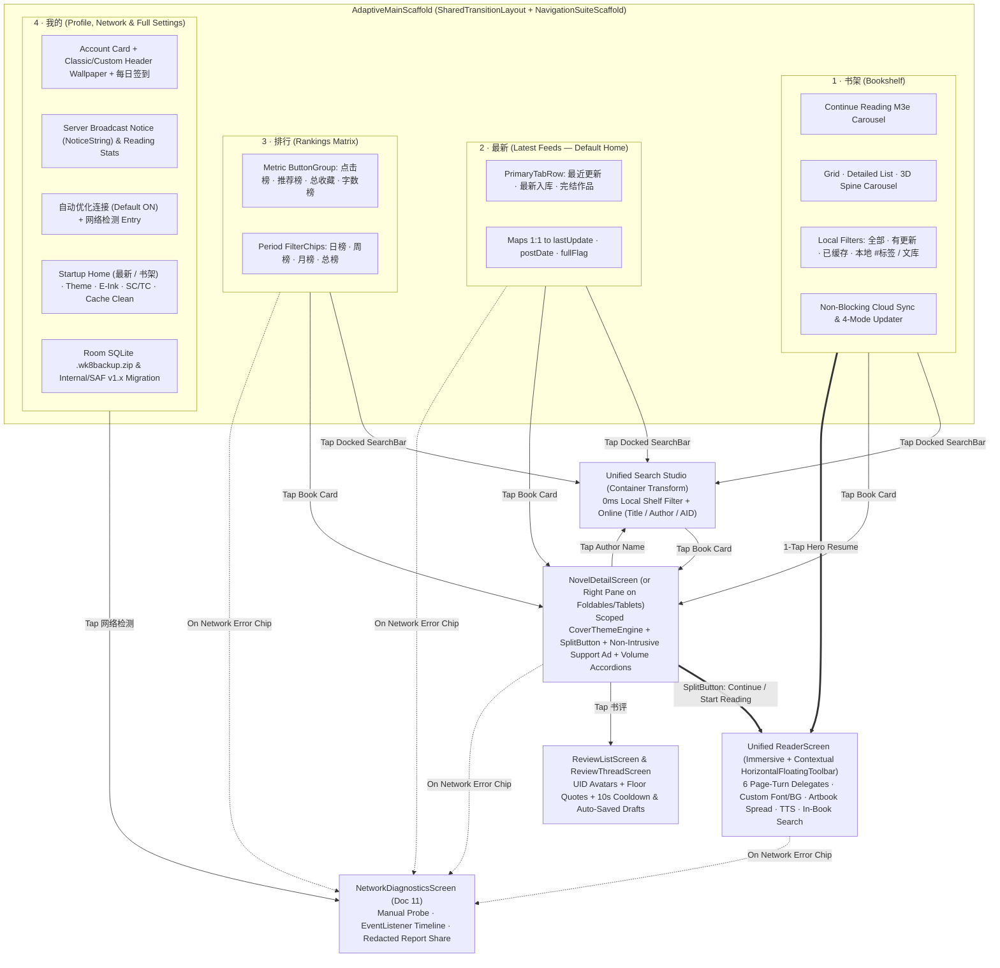

# 04 · User Flow & Information Architecture (`v2.0`)

## 1. Resolving `v1.31` Friction While Preserving Its Familiar Structure

| Friction in `v1.31` | Impact on User Experience | `v2.0` M3 Expressive (`M3e`) Resolution |
| :--- | :--- | :--- |
| **Hamburger Drawer Hides Primary Sections** | Switching between `最新`, `排行榜`, `本地书架`, and `设置` requires edge-swiping (colliding with Android 10–16 gesture navigation) or reaching top-left. | Keep the **exact same 4 top-level sections (`书架 · 最新 · 排行 · 我的`)** in an M3e **`NavigationSuiteScaffold`** (`ShortNavigationBar` `64.dp` on phones; `WideNavigationRail` on foldables/tablets). |
| **12-Tab Horizontal `RKListFragment` Strip** | Reaching "字数榜" or "总收藏榜" requires swiping through tiny tab labels. | Dedicated **`排行` Tab** with a 2-row M3e **Metric (`ButtonGroup`) × Period (`FilterChip`) Matrix**—any of 10 rankings in 1 tap. |
| **Right-Edge Chapter Drawer in `NovelInfoActivity`** | Directly collides with Android's right-edge Predictive Back gesture. | **Inline Collapsible Volume Accordions** inside `NovelDetailScreen` (`LazyColumn`), auto-expanding the user's current volume. |
| **Tapping Book Card Re-Orders Bookshelf** | Inspecting a book's synopsis (`FavFragment` line 131) jumps it to `#1` on the shelf. | `按最近阅读` updates **only** when opening a chapter in `ReaderScreen` (or via explicit `"置顶"`). |
| **Modal `ProgressDialog` Freezes UI** | Cloud bookshelf sync, 4-mode downloads, and `settings.wk8` language reload block or restart the app. | Non-blocking **`WorkManager` + M3e `LinearWavyProgressIndicator`** and zero-restart `AppCompatDelegate.setApplicationLocales`. |
| **Hardcoded Startup Screen** | Always opens `LatestFragment` when online without letting shelf-centric readers choose their home tab. | **Defaults to `最新` (`LatestScreen`)** just like `v1.31` (with smart offline fallback to `书架`), **plus a user setting (`默认启动页`)** to boot straight into `本地书架`! |
| **Slow / Blocked Mainland Network** | Mysterious timeouts or passive `relay_warning` banner; no way to test or optimize routing. | **Default-On `"自动优化连接"` + 1-Tap `网络检测`**: Compact idle tournament promotes faster verified Cloudflare ingress IPs, with `[ 🩺 网络检测 ]` in `我的` and on any network error card. |

---

## 2. `v2.0` Information Architecture: The 4-Destination M3e Adaptive Shell

Because `ShortNavigationBar` (`material3:1.4+`) natively supports **3–5 top-level destinations**, `v2.0` retains `v1.31`'s exact 4 primary pillars (`FAV`, `LATEST`, `RKLIST`, `CONFIG`) inside a single-Activity (`MainActivity`) Jetpack Compose graph:

---

## 3. Adaptive Layout Strategy Across Phones, Foldables & Tablets (`minSdk = 23`)

1. **Compact Width (`< 600.dp` — Phone Portrait)**:
   - Docked M3 Expressive **`ShortNavigationBar` (`64.dp` height)** with 4 vertical icon+label items (`书架`, `最新`, `排行`, `我的`).
   - Contextual **`HorizontalFloatingToolbar`** appears *only* inside `UnifiedReaderScreen` and during `BookshelfScreen` multi-select batch actions—never stacked over the bottom navigation bar.
2. **Medium Width (`600–840.dp` — Unfolded Foldables & Small Tablets)**:
   - Adapts via `NavigationSuiteScaffold` to `ShortNavigationBarMedium` (horizontal pills) or collapsed **`WideNavigationRail`**, paired with **`ListDetailPaneScaffold`** (`List 44% | NovelDetail 56%`).
3. **Expanded Width (`>= 840.dp` — Large Tablets & Desktops)**:
   - Spring-expandable **`WideNavigationRail`** (`WideNavigationRailState`, featuring a bottom mini "Continue Reading" resume card) + 2-pane `ListDetailPaneScaffold`, and automatic hinge-aware **Dual-Page Bunkobon Spread** inside `UnifiedReaderScreen`.

---

## 4. Redesigned Core User Flows

### 4.1 Flow 1: Configurable Startup Home (`最新` Default vs. `书架`), Play Store Upgrade Migration & Session Restore
- **Default Home Tab (`默认启动页`)**:
  - **Defaults to `最新` (`LatestScreen`, `DefaultHomeTab.LATEST`)**—matching `v1.31` (`MainActivity.status = LATEST`) so users opening the app immediately see fresh light novel updates (`最近更新`).
  - **User-Configurable Preference**: Users can switch **`默认启动页`** in `我的 → 外观与启动设置` between **`最新更新 (默认)`** and **`本地书架` (`DefaultHomeTab.BOOKSHELF`)**.
  - **Smart Offline Fallback (Preserving `NavigationDrawerFragment.java` L175)**: When `默认启动页 == 最新更新` and the device has zero active network connectivity on cold start, the app automatically opens **`书架`** (`BookshelfScreen`) with a subtle non-blocking hint (`当前离线，已自动打开本地书架`) instead of stranding the user on an offline error screen.
- **Seamless In-Place Play Store Upgrade Migration (`org.mewx.wenku8`)**:
  - Because `v2.0` ships under the **exact same `org.mewx.wenku8` package ID** on Google Play / GitHub Releases, `LegacyV1InternalStorageMigrator` automatically inspects internal app storage (`context.getFilesDir()/saves/` + readable fallback root via `StorageRoots` order) on first launch—requiring **zero file pickers or user prompts**:
    - Migrates **all 11 `settings.wk8` items** (`language`, `eink_mode`, `menu_bg_id`, `menu_bg_path`, `reader_font_size`, `reader_line_distance`, `reader_paragraph_distance`, `reader_paragraph_edge_distance`, `reader_font_path`, `reader_background_path`) into DataStore (`settings.preferences_pb`).
    - Preserves **`saves/cert.wk8` + `saves/avatar.jpg`** so logged-in `v1.31` users remain seamlessly signed in after updating!
    - Migrates `saves/bookshelf_local.wk8`, `saves/intro/{aid}-intro.xml` + `{aid}-introfull.xml` + `{aid}-volume.xml`, `saves/novel/{cid}.xml`, `saves/read_saves_v1.wk8`, `saves/read_saves.wk8`, and `saves/search_history.wk8` into `wenku8_v2.db`, while keeping offline illustrations (`saves/imgs/*`, `imgs/{aid}.jpg`) and custom assets (`custom/{menu_bg, reader_font, reader_background}`) **in place** with zero duplication.
  - For users restoring an old `/sdcard/wenku8/` folder onto a brand-new phone, `我的 → 导入旧版外部存档文件夹` also retains `ACTION_OPEN_DOCUMENT_TREE` SAF import.
- **Background Low-Priority Init**: Silent credential session check (`cert.wk8`), `NoticeString` fetch, `RelayRouteController` manifest check, and lazy post-first-frame `MobileAds` initialization run on background dispatchers—never blocking UI frames.

### 4.2 Flow 2: "1-Tap Resume", Inline Volume Accordions & Non-Intrusive Support Ad
- **Eliminating the Right-Side Chapter Drawer**: Volumes render inline inside `NovelDetailScreen`'s `LazyColumn` as collapsible M3e cards; the volume containing saved `READING_PROGRESS` auto-expands with a highlighted active chapter pill.
- **No Shelf Reorder on Inspection**: Tapping a book card to view `NovelDetailScreen` does **not** alter bookshelf order; `按最近阅读` updates only when a chapter is actually opened in `ReaderScreen` (or manually pinned).
- **Minimal Server-Support Banner Ad**: A single M3-styled banner container (`surfaceContainerLow`, fixed pre-reserved height when online + GMS available for **0 layout shift**) sits quietly between **Synopsis** and **Volume Directory** on `NovelDetailScreen`—collapsed cleanly when offline or on GMS-free devices, and **100% absent from the Reader and Bookshelf**.

### 4.3 Flow 3: Non-Blocking Cloud Sync & Atomic 4-Mode Offline Downloader
- Preserves all 4 Wenku8 download modes (*智能更新 Smart Update*, *检查并下载更新 Update Only*, *分卷自由勾选 Select Volumes*, *全量覆盖重下 Overwrite All*) via `WorkManager` + `LinearWavyProgressIndicator`, committing TOC updates via atomic `@Upsert` transactions (`toc_version`, Doc `09` §4) so concurrent syncs never wipe cached `CHAPTER_CONTENTS` or `READING_PROGRESS`.

### 4.4 Flow 4: API-Grounded Discovery (`最新` + `排行`) & Auto-Queued `5s` Search
- **`最新` Tab**: Clean 3-tab `PrimaryTabRow` for `最近更新` (`lastUpdate`), `最新入库` (`postDate`), and `完结作品` (`fullFlag`).
- **`排行` Tab**: 2-row M3e selector (`点击榜 · 推荐榜 · 总收藏 · 字数榜` × `日榜 · 周榜 · 月榜 · 总榜`) covering all 10 ranking sorts in 1 tap.
- **Unified Search Studio**: Filters the local Room bookshelf in `< 1ms` while querying Wenku8 online by **`按书名` (`articlename`)**, **`按作者` (`author`)**, or **numeric `AID` jump**, with an auto-queued `5s` server cooldown pill (`冷却中，将在 2s 后自动搜索…`).

### 4.5 Flow 5: Unified Reader 2.0, Full `v1.31` Customization Parity & Cross-Volume Streaming
- Preserves every `v1.31` customization (`8–36 sp` font size covering `8–32 sp`, `0–32 dp` line spacing, `0–48 dp` paragraph spacing, `0–32 dp` margins, custom `.ttf/.otf` font, custom day-mode background image `reader_background_path`, day/night switch, volume-key paging, chapter jump slider, high-res image viewer) while adding seamless 3-chapter cross-volume streaming (`ChapterWindowBuffer`), 5-second jump undo, and an opaque active-slider capsule during live reflow.

### 4.6 Flow 6: Community Reviews, UID Avatars & `10s`-Aware Draft Composer
- Loads real avatars via `Wenku8API.getAvatarURL(uid)` (gracefully inert on `api-stub`), supports floor quoting (`回复 3楼 @user`), auto-saves drafts every `400ms` in `REVIEW_DRAFTS`, and validates `>= 7` chars + `searchBadWords()` + `10s` post cooldown inline before GBK Base64 submission.

### 4.7 Flow 7: Account Lifecycle & Automatic Connection Optimization (`自动优化连接`)
- **Complete Account Flow in `我的`**: Logged-out state offers an M3e **Login Sheet** (**Username** or **Email** `<= 30` chars + Password toggle + non-blocking submit) and **Web Registration** (`REGISTER_URL`), while logged-in state provides **1-Tap `每日签到`**, **Logout confirmation**, and a non-destructive **Expired-Session Re-Login banner**.
- **Zero-Friction Network Optimization (Doc `11`)**: `"自动优化连接"` is enabled by default in `我的`, running a compact `<= 18`-probe / `25s` idle tournament to promote faster verified Cloudflare ingress IPs, while any network failure across the app surfaces a 1-tap **`[ 🩺 网络检测 ]`** chip.
