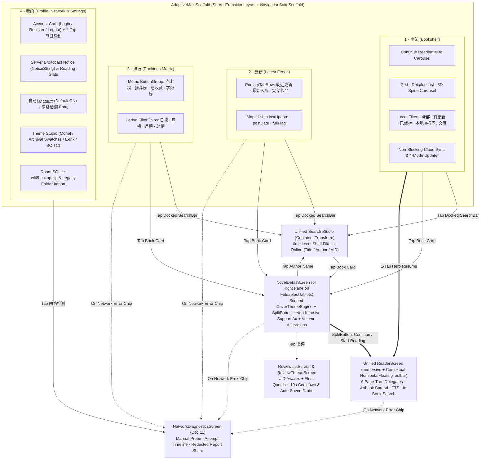

# 04 — Redesigned `v2.0` User Flow & Information Architecture (`M3e` 4-Destination Shell)

**Status:** Design Specification  
**Goal:** Replace `1.x`'s 2015 Hamburger-Drawer + 15-Activity maze with a familiar, zero-learning-curve **Material 3 Expressive (`M3e`) 4-Destination Adaptive Shell** (`ShortNavigationBar` + `WideNavigationRail`) that preserves `v1.31`'s core mental model (`书架 · 最新 · 排行 · 我的`) while eliminating modal blockers and hidden gestures.

---

## 1. Structural Critique: Upgrading `1.x` Without Breaking Muscle Memory

| User Goal | `v1.31` Legacy Flow (Pain Points) | `v2.0` Material 3 Expressive Flow |
| :--- | :--- | :--- |
| **Switch Top-Level Sections** | Reach to top-left hamburger icon or left-edge swipe (conflicts with Android gesture back) → open `NavigationDrawerFragment` → tap `我的书架 / 最新小说 / 排行榜 / 设置`. | **1-Tap M3e `ShortNavigationBar` (`64.dp`)** on phones or **`WideNavigationRail`** on foldables/tablets, keeping the exact 4 familiar sections (`书架 · 最新 · 排行 · 我的`). |
| **Resume Last Read Book** | Open app → tap book in `FavFragment` (accidentally reordering shelf!) → wait for `NovelInfoActivity` → tap small toolbar icon → confirm dialog. | **1-Tap Resume**: Tap the **`继续阅读`** hero carousel card on `书架` → 3D Book-Cover opens straight to the exact saved `(vid, cid, paragraphIndex, charOffset)`. Inspecting `NovelDetail` no longer reorders the shelf! |
| **Browse Rankings (`排行榜`)** | Swipe horizontally through **12 separate `ViewPager` tabs** (`dayVisit`..`fullFlag`). | **Dedicated `排行` Tab with 2D M3e Matrix**: 1-tap `ButtonGroup` (`点击榜 · 推荐榜 · 总收藏 · 字数榜`) × `FilterChip` (`日榜 · 周榜 · 月榜 · 总榜`). |
| **Search Shelf vs. Online** | Two separate screens (`BookshelfSearchActivity` vs. `SearchActivity` → `SearchResultActivity`) with an unlabeled color-changing toggle and `5s` cooldown errors. | **Unified Container-Transform Search Studio**: Instant `< 1ms` Room shelf matches + online Wenku8 search (`按小说书名` / `按作者名称` / `AID直达`), with automatic `5s` cooldown queueing. |
| **Switch Reader Mode** | Secret hidden gesture: open `NovelInfoActivity` → tap volume → right side-sheet → **long-press** chapter → dialog. | **Unified Reader `v2.0`**: Switch live inside the Reader (`覆盖翻页 · 仿真卷曲 · 平滑滑动 · 上下卷轴 · 文库竖排 · 墨水屏`) via the contextual `HorizontalFloatingToolbar`. |
| **Sync Shelf or Cache Volumes** | Blocking modal `ProgressDialogHelper` freezes the entire UI. | **Non-Blocking `WorkManager` Queue**: Active downloads show an M3e `LinearWavyProgressIndicator` while browsing or reading continues uninterrupted. |
| **Slow / Blocked Mainland Network** | Mysterious timeouts or cryptic yellow `relay_warning` banner; no way to test or optimize routing. | **Default-On `"自动优化连接"` + 1-Tap `网络检测`**: Automatically selects faster verified Cloudflare ingress routes when idle, with `[ 🩺 网络检测 ]` available in `我的` and on any network error card. |

---

## 2. `v2.0` Information Architecture: The 4-Destination M3e Adaptive Shell

Because `ShortNavigationBar` (`material3:1.4+`) natively supports **3–5 top-level destinations**, `v2.0` retains `v1.31`'s exact 4 primary pillars (`FAV`, `LATEST`, `RKLIST`, `CONFIG`) inside a single-Activity (`MainActivity`) Jetpack Compose graph:

---

## 3. Adaptive Layout Strategy Across Phones, Foldables & Tablets (`minSdk = 23`)

1. **Compact Width (`< 600.dp` — Phone Portrait)**:
   - Docked M3 Expressive **`ShortNavigationBar` (`64.dp` height)** with 4 vertical icon+label items (`书架`, `最新`, `排行`, `我的`).
   - Contextual **`HorizontalFloatingToolbar`** appears *only* inside `UnifiedReaderScreen` and during `BookshelfScreen` multi-select batch actions—never stacked over the bottom navigation bar.
2. **Medium Width (`600–840.dp` — Unfolded Foldables & Small Tablets)**:
   - Adapts via `NavigationSuiteScaffold` to `ShortNavigationBarMedium` (horizontal pills) or collapsed **`WideNavigationRail`**, paired with **`ListDetailPaneScaffold`** (`List 44% | NovelDetail 56%`).
3. **Expanded Width (`>= 840.dp` — Large Tablets & Desktops)**:
   - Spring-expandable **`WideNavigationRail`** (`WideNavigationRailState`, featuring a bottom mini "Continue Reading" resume card) + 2-pane `ListDetailPaneScaffold`, and automatic hinge-aware **Dual-Page Bunkobon Spread** inside `UnifiedReaderScreen`.

---

## 4. Redesigned Core User Flows

### 4.1 Flow 1: Offline-First Smart Startup, Session Restore & Non-Destructive Migration
- **Smart Start Tab**:
  - If **offline** (`!isNetworkAvailable`) OR if the local Room bookshelf has `>= 1` book, boots directly into **`书架`** in `< 16ms` without firing failing network calls.
  - Only on a first-time online launch with an empty bookshelf does the app open **`最新`** (`lastUpdate`) so new readers immediately see live content.
- **Background Low-Priority Init**: Silent credential session check (`cert.wk8`), `NoticeString` fetch, `RelayRouteController` manifest check, and lazy post-first-frame `MobileAds` initialization run on background coroutine dispatchers—never queueing user navigation.
- **Idempotent Legacy Migration**: Detects `saves/bookshelf_local.wk8` / `read_saves_v1.wk8` / `read_saves.wk8` / `search_history.wk8`, imports into `wenku8_v2.db` inside a Room `@Transaction`, and leaves original `.wk8` files untouched for 1 release cycle.

### 4.2 Flow 2: "1-Tap Resume", Inline Volume Accordions & Non-Intrusive Support Ad
- **Eliminating the Right-Side Chapter Drawer**: Volumes render inline inside `NovelDetailScreen`'s `LazyColumn` as collapsible M3e cards; the volume containing saved `READING_PROGRESS` auto-expands with a highlighted active chapter pill.
- **No Shelf Reorder on Inspection**: Tapping a book card to view `NovelDetailScreen` does **not** alter bookshelf order; `按最近阅读` updates only when a chapter is actually opened in `ReaderScreen` (or manually pinned).
- **Minimal Server-Support Banner Ad**: To help cover relay server costs without harming UX, a single M3-styled banner container (`surfaceContainerLow`, fixed pre-reserved height when online + GMS available for **0 layout shift**) sits quietly between the **Synopsis** card and the **Volume Directory** header on `NovelDetailScreen`—far away from `继续阅读` and chapter tap targets, collapsed cleanly when offline or on GMS-free devices, and **100% absent from the Reader and Bookshelf**.

### 4.3 Flow 3: Non-Blocking Cloud Sync & Atomic 4-Mode Offline Downloader
- Preserves all 4 Wenku8 download modes (*智能更新 Smart Update*, *检查并下载更新 Update Only*, *分卷自由勾选 Select Volumes*, *全量覆盖重下 Overwrite All*) via `WorkManager` + `LinearWavyProgressIndicator`, committing TOC updates via atomic `@Upsert` transactions (`toc_version`, Doc `09` §4) so concurrent syncs never wipe cached `CHAPTER_CONTENTS` or `READING_PROGRESS`.

### 4.4 Flow 4: API-Grounded Discovery (`最新` + `排行`) & Auto-Queued `5s` Search
- **`最新` Tab**: Clean 3-tab `PrimaryTabRow` for `最近更新` (`lastUpdate`), `最新入库` (`postDate`), and `完结作品` (`fullFlag`).
- **`排行` Tab**: 2-row M3e selector (`点击榜 · 推荐榜 · 总收藏 · 字数榜` × `日榜 · 周榜 · 月榜 · 总榜`) covering all 10 ranking sorts in 1 tap.
- **Unified Search Studio**: Filters the local Room bookshelf in `< 1ms` (including local `#Tag` and `电击文库` imprint filtering on cached shelf metadata) while querying Wenku8 online by **`按书名` (`articlename`)**, **`按作者` (`author`)**, or **numeric `AID` jump**. If the user submits a second online search within Wenku8's `5s` server cooldown, the app displays a calm countdown chip (`冷却中，将在 2s 后自动搜索…`) and fires automatically when ready.

### 4.5 Flow 5: Unified Reader 2.0, Opaque-Capsule Reflow & Cross-Volume Streaming
- Seamless 3-chapter sliding ring buffer (`ChapterWindowBuffer`) across volume boundaries (`Volume N Last Chapter → Volume N+1 Chapter 1`), 5-second `"↩ 还原跳转位置"` undo chip after scrubbing progress, and an opaque pill capsule around the active dragged slider so live chapter reflow is 90% visible without text-on-text collision.

### 4.6 Flow 6: Community Reviews, UID Avatars & `10s`-Aware Draft Composer
- Loads real avatars via `Wenku8API.getAvatarURL(uid)` (gracefully inert on `api-stub`), supports floor quoting (`回复 3楼 @user`), auto-saves drafts every `400ms` in `REVIEW_DRAFTS`, and validates `>= 7` chars + `searchBadWords()` + `10s` post cooldown inline before GBK Base64 submission.

### 4.7 Flow 7: Account Lifecycle & Automatic Connection Optimization (`自动优化连接`)
- **Complete Account Flow in `我的`**: Logged-out state offers an M3e **Login Sheet** (supporting both **Username** and **Email** `<= 30` chars + Password toggle + non-blocking submit) and **Web Registration** (`REGISTER_URL`), while logged-in state provides **1-Tap `每日签到`**, **Logout confirmation**, and an **Expired-Session Re-Login banner** if `cert.wk8` expires.
- **Zero-Friction Network Optimization (Doc `11`)**: `"自动优化连接"` is enabled by default in `我的`, silently promoting faster verified Cloudflare ingress IPs when idle and falling back automatically on network transitions, while any network failure across the app surfaces a 1-tap **`[ 🩺 网络检测 ]`** chip.
