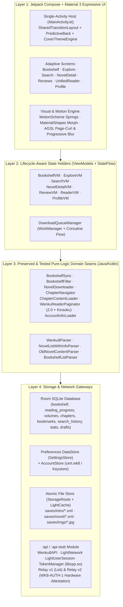
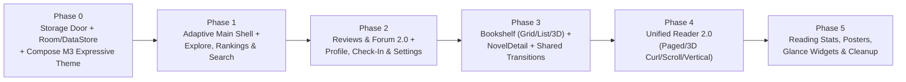

# 06 — `v2.0` Technical Architecture, Storage Migration & Incremental Roadmap

**Status:** Architectural Blueprint  
**Core Principle:** *Replace the 2015 View/Activity/AsyncTask UI shell and `.wk8` flat-file storage with Jetpack Compose, Material 3 Expressive, Coroutines, and Room/DataStore — while 100% preserving the battle-tested XML parsers, `:api` relay/attestation module, and JVM/instrumented test suite.*

---

## 1. Architectural Layered Blueprint

As established in `STABILITY_PLAN.md` and `STORAGE_MIGRATION_PLAN.md`, twelve years of real-world Wenku8 server edge cases (malformed XML declarations, CDATA volume quirks, GBK review encoding, non-destructive cloud/local bookshelf union, and `:api` vs `:api-stub` separation) are already solved and covered by **328 JVM and instrumented tests**.

Wenku8 `v2.0` keeps this proven domain core intact and builds a clean, reactive Kotlin + Jetpack Compose architecture around it:



---

## 2. Modernized Tech Stack & Dependency Upgrades

| Subsystem | Legacy `v1.31` | `v2.0` Target Stack | Rationale |
| :--- | :--- | :--- | :--- |
| **Language** | Java 17 | **Kotlin 2.x + Java 17 Interop** | Enables Jetpack Compose, Coroutines, `StateFlow`, and type-safe navigation while directly calling existing Java parsers and `:api` classes without rewriting them. |
| **UI Toolkit** | XML Views + `android.app.Fragment` + `androidx.fragment` | **Jetpack Compose (BOM `2026.x`)** | Declarative UI with native `SharedTransitionLayout`, spring physics, and zero `FragmentManager` mismatch bugs. |
| **Design System** | Hybrid Material 1 XML + partial M3 theme | **`material3` (`1.4+` Expressive) + `material3-adaptive`** | Provides `MotionScheme.expressive()`, `HorizontalFloatingToolbar`, `SplitButtonLayout`, `ButtonGroup`, `LinearWavyProgressIndicator`, `MaterialShapes`, and `ListDetailPaneScaffold`. |
| **Navigation** | 15 Activities + `Intent` extras + `DrawerLayout` | **`navigation-compose:2.8+` (Type-Safe Routes)** | Coordinates multi-element `sharedElement` / `sharedBounds` transitions and Android 15/16 Predictive Back gestures across all screens. |
| **Concurrency** | 24 `AsyncTask` subclasses + `AsyncTaskTracker` | **Kotlin Coroutines (`viewModelScope`) + `WorkManager`** | Automatic cancellation on lifecycle teardown; `WorkManager` handles multi-volume offline downloads in the background without modal blocking dialogs. |
| **Structured Storage** | Delimiter-separated `.wk8` flat files (`\|\|`, `::::`, `,,`) | **Room SQLite + Preferences DataStore** | Executes `STORAGE_MIGRATION_PLAN.md`; eliminates parsing/truncation bugs and runs storage tests against in-memory Room on the JVM in milliseconds. |
| **Image Loading** | `universal-image-loader:1.9.5` (2015) + `RoundedImageView` | **Coil 3 (`coil-compose` + `coil-network-okhttp`)** | Coroutine-native, Compose-integrated, supports hardware bitmaps and custom disk cache mapped to existing Wenku8 cover/illustration folders. |
| **Deep Zoom Image** | `subsampling-scale-image-view:3.10.0` | **Telephoto (`me.saket.telephoto:zoomable-image-coil3`)** | Compose-native sub-sampled tiling zoomable image viewer with full `SharedTransitionLayout` and vertical drag-to-dismiss support. |
| **Backup Rules** | Unfiltered `allowBackup="true"` (exceeds 25MB quota) | **Android 12+ `dataExtractionRules` + `.wk8backup` Export** | Includes Room DB and DataStore (`< 1MB`) in Auto Backup while excluding `saves/novel/` and `saves/imgs/` caches, plus adds manual `.wk8backup` ZIP export/import. |

---

## 3. Executing `STORAGE_MIGRATION_PLAN.md`: Room + DataStore Schema

Following the non-negotiable rules in `STORAGE_MIGRATION_PLAN.md`:
1. **Never delete old `.wk8` files in the release that migrates them** (keep them untouched as fallback).
2. **Idempotent & resumable** migration per store.
3. **Counted & reported** (`recordsIn == recordsOut`, logging any discrepancy to `CrashReporter`).
4. **Tested against corrupt inputs** (`LocalBookshelfTest`, `ReadSavesV1Test`, `VolumeIndexCacheTest` fixtures).

### 3.1 Room Database Entities (`Wenku8Database`)

```kotlin
@Entity(tableName = "bookshelf")
data class BookshelfEntity(
    @PrimaryKey val aid: Int,
    val sortOrder: Int,              // Preserves manual/top ordering from bookshelf_local.wk8
    val title: String,
    val author: String,
    val bookStatus: String,
    val lastUpdate: String,
    val latestChapterCid: Int,
    val latestChapterName: String,
    val coverPath: String?,
    val categoryId: String = "default",
    val addedAtEpochMs: Long,
    val lastSyncedAtEpochMs: Long
)

@Entity(tableName = "reading_progress")
data class ReadingProgressEntity(
    @PrimaryKey val aid: Int,
    val vid: Int,                    // Volume ID (from read_saves_v1.wk8)
    val cid: Int,                    // Chapter ID
    val paragraphIndex: Int,         // lineId (0-based paragraph index)
    val wordIndex: Int,              // wordId (0-based char offset in paragraph)
    val scrollPixelOffset: Int = 0,  // Legacy V0 fallback (from read_saves.wk8)
    val chapterTitle: String = "",
    val progressPercent: Float = 0f,
    val updatedAtEpochMs: Long
)

@Entity(
    tableName = "chapter_cache_status",
    primaryKeys = ["aid", "vid", "cid"]
)
data class ChapterCacheEntity(
    val aid: Int,
    val vid: Int,
    val cid: Int,
    val volumeTitle: String,
    val chapterTitle: String,
    val chapterOrder: Int,
    val isXmlComplete: Boolean,      // True only after atomic temp-file rename + fsync succeeds
    val imageCount: Int = 0,
    val cachedImageCount: Int = 0
)

@Entity(tableName = "search_history")
data class SearchHistoryEntity(
    @PrimaryKey val query: String,   // Eliminates the '[' delimiter bug in search_history.wk8!
    val searchScope: String,         // TITLE, AUTHOR, TAG, ALL
    val searchedAtEpochMs: Long
)

@Entity(tableName = "bookmarks_notes")
data class BookmarkNoteEntity(
    @PrimaryKey(autoGenerate = true) val id: Long = 0,
    val aid: Int,
    val vid: Int,
    val cid: Int,
    val startParagraph: Int,
    val startChar: Int,
    val endParagraph: Int,
    val endChar: Int,
    val selectedText: String,
    val noteMarkdown: String?,
    val styleType: String,           // BOOKMARK, HIGHLIGHT, UNDERLINE, WAVY
    val colorHex: String,
    val createdAtEpochMs: Long
)

@Entity(tableName = "reading_sessions")
data class ReadingSessionEntity(
    @PrimaryKey(autoGenerate = true) val id: Long = 0,
    val aid: Int,
    val cid: Int,
    val dateEpochDay: Long,          // For calendar heatmap & streak calculation
    val durationSeconds: Int,
    val charactersRead: Int
)

@Entity(tableName = "review_drafts", primaryKeys = ["aid", "rid"])
data class ReviewDraftEntity(
    val aid: Int,
    val rid: Int,                    // 0 for new thread, >0 for thread reply
    val draftTitle: String,
    val draftContent: String,
    val updatedAtEpochMs: Long
)
```

---

## 4. Reader 2.0 Engine Architecture (`org.mewx.wenku8.reader.v2`)

To eliminate **Root Cause 2** (`WenkuReaderPageView`'s mutable `static` fields) while supporting 4 layout modes and 6 transition animations:

1. **Instance-Scoped `ReaderSessionState` (No More Statics)**:
   - Owned by `ReaderViewModel` (`SavedStateHandle` backed by `aid`, `vid`, `cid`), surviving configuration changes, foldable posture changes (folding/unfolding a Pixel Pro Fold mid-chapter!), and process death without static state collisions.
2. **Enhanced `WenkuReaderPaginator` with CJK Kinsoku Shori (禁则处理)**:
   - Extends the existing JVM-tested `WenkuReaderPaginator` (`TextMeasurer` lambda seam) with a CJK line-break rule table:
     - **No-Start Characters (行首禁则)**: `，。！？；：、”’）】》」』〉〕〗％‰` — if a line break falls immediately before one of these characters, the character is pulled onto the end of the current line (hanging punctuation) or the preceding character is pushed to the next line.
     - **No-End Characters (行尾禁则)**: `“‘（【《「『〈〔〖￥＄` — never left dangling at the end of a line.
3. **Full-Novel `CrossVolumeNavigator`**:
   - Wraps `ChapterNavigator` with `List<VolumeList>` loaded from `<aid>-volume.xml` so reaching the end of Volume $N$ seamlessly transitions into Volume $N+1$, Chapter 1.
4. **Dual Rendering Pipeline**:
   - **Paged / 3D Curl / Vertical CJK Modes**: Rendered on a hardware-accelerated Compose `Canvas` (`DrawScope`) wrapped in an AGSL `RuntimeShader` modifier (for 3D page peel on API 33+) or 3D triangle mesh (`Canvas.drawVertices` fallback on API 24–32).
   - **Continuous Scroll Stream Mode**: Rendered via Compose `LazyColumn` with paragraph items keyed by `(cid, paragraphIndex)` and automatic prefetching of adjacent chapters via `ChapterContentLoader`.

---

## 5. Phased Incremental Implementation Roadmap

To avoid the "big-bang rewrite stall" warned against in `STABILITY_PLAN.md` (line 1104), `v2.0` is structured into **6 self-contained, independently verifiable phases**:



| Phase | Scope & Deliverables | Verification Gate |
| :--- | :--- | :--- |
| **Phase 0: Foundation, Storage & Theme Engine** | • Enable Kotlin + Compose + Material 3 Expressive + Coil 3 in `:app`.<br>• Funnel remaining `LightCache` callers through `GlobalConfig` (`STORAGE_MIGRATION_PLAN.md` Step 0).<br>• Implement `Wenku8Database` (Room) + `SettingsDataStore` + idempotent `.wk8` migration harness.<br>• Build `Wenku8Theme` (4 lighting modes: Archival Day, Carbon Night, AMOLED, E-Ink + Monet + `CoverThemeEngine` + `MotionScheme.expressive()`). | • All 133+ existing JVM tests pass.<br>• New JVM in-memory Room migration tests pass against corrupt `.wk8` fixtures.<br>• `--forceApiStub` CI build green. |
| **Phase 1: Adaptive Shell, Explore, Rankings & Unified Search** | • Build `AdaptiveMainScaffold` (`HorizontalFloatingToolbar` on phones, `NavigationRail` + `ListDetailPaneScaffold` on foldables/tablets).<br>• Build `ExploreScreen` (Latest, 2D Ranking Matrix replacing 12-tab `ViewPager`, Press Imprint browser, Multi-Tag intersection).<br>• Build `UnifiedSearchScreen` (Container-transform search bar, instant local shelf + online Title/Author/`#Tag`/AID search, Room search history). | • Robolectric / Compose UI tests for Explore, 2D Ranking switches, and Search filtering.<br>• Zero regressions on stub and live API builds. |
| **Phase 2: Community Reviews 2.0, Profile & Studio** | • Port & upgrade the `migrate-to-compose-md3` review screens (`ReviewListScreen`, `ReviewThreadScreen`, `ReviewComposerSheet`) with container transforms, floor quotes, live GBK bad-word highlighting, and Room draft auto-save.<br>• Build `ProfileAndStudioScreen` (User Card, `AccountInfoLoader`, celebratory `每日签到`, Theme/Palette Studio, `.wk8backup` export/import, Cache Manager, About). | • `AccountInfoLoaderTest` (15 JVM tests) + new Compose UI tests for Review composer bad-word & draft persistence. |
| **Phase 3: Bookshelf 2.0, Novel Detail & Shared Transitions** | • Build `BookshelfScreen` (Continue Reading hero card, Cover Grid, Editorial List, 3D Perspective Spine Carousel, category/status filters, batch mode).<br>• Build `NovelDetailScreen` (`CoverThemeEngine`, 5-element `SharedTransitionLayout`, `SplitButtonLayout` CTAs, inline Collapsible Volume Accordions, `WorkManager` 4-mode non-blocking download queue with `LinearWavyProgressIndicator`).<br>• Build `ImageDetailScreen` lightbox with shared-element zoom and vertical drag-to-dismiss. | • `BookshelfSyncTest`, `BookshelfFilterTest`, `VolumeIndexCacheTest` pass.<br>• End-to-end Predictive Back + Shared Transition verification on phone & foldable. |
| **Phase 4: Unified Reader 2.0 & Illustration Engine** | • Build `UnifiedReaderScreen` combining Horizontal Paged (with CJK *Kinsoku Shori* & foldable Dual-Page Spread), AGSL 3D Curved Page Peel, Continuous Multi-Chapter Scroll Stream, and Vertical R-to-L CJK modes.<br>• Build Live Transparent Typography Sheet (`88%` transparent during slider drag), Cross-Volume `ChapterNavigator`, In-Book Full-Text Search, Text Selection/Bookmarks, and Android `TextToSpeech` listening mode. | • `WenkuReaderPaginatorTest`, `ChapterNavigatorTest`, `ChapterContentLoaderTest`, and `ReaderRecreationTest` pass.<br>• Verified under *Don't keep activities* and foldable unfold/fold continuity. |
| **Phase 5: Reading Statistics, Posters, Widgets & Legacy Retirement** | • Build Reading Statistics dashboard (calendar heatmap, streaks, 8-theme shareable reading report poster).<br>• Build Jetpack Glance home screen widgets (`今日阅读`, `最近在读`).<br>• Delete deprecated `android.app.Fragment` classes, legacy XML layouts, `AsyncTask` classes, and `universal-image-loader`. | • Full JVM + Instrumented test suite green.<br>• APK size, startup baseline profile, and 120fps frame-timing verification. |
