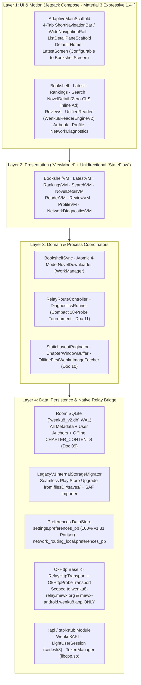
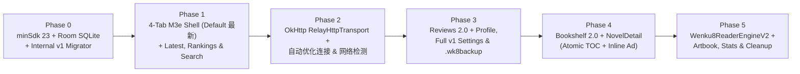

# 06 · Technical Architecture & Incremental Migration Plan (`v2.0`)

## 1. Clean 4-Layer Architecture (`minSdk = 23` · Official AndroidX + `:api` JNI Preservation)

---

## 2. Modernized Tech Stack & Official AndroidX Policy

| Subsystem | Legacy `v1.31` | `v2.0` Target Stack | Rationale |
| :--- | :--- | :--- | :--- |
| **`minSdkVersion`** | API 21 | **API 23 (Android 6.0)** | Required by AndroidX Compose M3 Expressive (`material3:1.4+`) and guarantees `ConnectivityManager.getActiveNetwork()` across all devices. |
| **Language** | Java 17 | **Kotlin 2.x + Java 17 Interop** | Coroutines, `StateFlow`, and Compose while calling existing Java XML parsers and `:api` JNI classes directly. |
| **Design System** | Hybrid Material 1 XML | **`material3:1.4+` (`M3e`) + `material3-adaptive`** | Official `ShortNavigationBar`, `WideNavigationRail`, `HorizontalFloatingToolbar`, `SplitButtonLayout`, `ButtonGroup`, `LinearWavyProgressIndicator`, and `MaterialShapes` (**zero third-party UI libraries**). |
| **Locale Switching** | Deprecated `updateConfiguration` + `Activity` restart | **`AppCompatDelegate.setApplicationLocales`** | Instant, recreation-safe `SC` (`zh-CN`) ↔ `TC` (`zh-TW`/`zh-HK`) switching without restarting `MainActivity`. |
| **Persistence** | `.wk8` delimiter files + loose `intro/*.xml` & `novel/*.xml` | **Room SQLite (`wenku8_v2.db` WAL) + DataStore** | All structured records **and** offline chapter texts live in ACID SQLite with atomic `@Upsert` TOC versioning (`toc_version`, Doc `09`) and automatic internal-storage Play Store upgrade migration. |
| **Relay & Diagnostic Transport** | `HttpURLConnection` (`LightNetwork`) | **OkHttp 5.x (`RelayHttpTransport` + `OkHttpProbeTransport`)** | Shared base client with `IpLiteralParser` (`InetAddress.getByAddress`), generation-isolated `ConnectionPool`s, `Accept-Encoding: identity` probes, and `EventListener` telemetry (Doc `11`). |
| **Image & Offline Art Stack** | `universal-image-loader:1.9.3` + `saves/imgs/` | **Coil 3 (`coil-compose`) + `OfflineFirstWenkuImageFetcher` + `BitmapRegionDecoder`** | Reads persistent `filesDir/saves/imgs/` & `filesDir/imgs/` **first** (zero-copy `v1.31` upgrade + immune to LRU cache eviction!) before `Dns.SYSTEM` CDN fetch; `BitmapRegionDecoder` tiles 4000px+ `口绘` spreads. |
| **Monetization** | Synchronous `AdView` on `NovelInfoActivity` | **Lazy-Init Non-Intrusive `AdView` on `NovelDetailScreen` Only** | Initializes `MobileAds` on `Dispatchers.IO` *after* first frame draw; pre-reserves fixed height only when online + GMS available (CLS = 0) to cover relay server costs without harming UX. |

---

## 3. Complete `v1.31 → v2.0` Settings Preservation Matrix ("More, Never Less")

Every single `GlobalConfig.SettingItems` entry and user-facing action in `v1.31` is preserved in `settings.preferences_pb` and migrated automatically from `filesDir/saves/settings.wk8` (`||||` record / `::::` field delimiters):

| `v1.31` Setting / Feature | `v1.31` Key / Source | `v2.0` DataStore Key & Behavior |
| :--- | :--- | :--- |
| **Language (`SC` / `TC`)** | `SettingItems.language` | `app_language` (`SC` / `TC`) + `AppCompatDelegate` locale + `content_lang` cache tag |
| **E-Ink Mode** | `SettingItems.eink_mode` (`0`/`1`) | `eink_mode_enabled` (`1.dp` `#111111` borders, `SnapSpec(0)`, static progress, `EInkInstantDelegate`) |
| **Header Wallpaper** | `menu_bg_id` (`0`..`5`), `menu_bg_path` | `profile_header_bg_mode` (`M3E_TONAL`, `PRESET_1..5`, `CUSTOM`) + `profile_header_bg_path` (`filesDir/custom/menu_bg`) |
| **Reader Font Size** | `reader_font_size` (`8..32` sp, def `18`) | `reader_font_size_sp` (**`8..36` sp**, default `18`, preserving full `8..32` range without clamping) |
| **Reader Line Spacing** | `reader_line_distance` (`0..32` dp, def `16`) | `reader_line_spacing_dp` (`0..32` dp, default `16`) |
| **Reader Paragraph Spacing** | `reader_paragraph_distance` (`0..48` dp, def `20`) | `reader_paragraph_spacing_dp` (`0..48` dp, default `20`) |
| **Reader Page Margin** | `reader_paragraph_edge_distance` (`0..32` dp, def `8`) | `reader_page_margin_dp` (`0..32` dp, default `8`) |
| **Custom Reader Font** | `reader_font_path` (`"0"` or `.ttf/.otf`) | `reader_custom_font_path` (`null` or `filesDir/custom/reader_font`) |
| **Custom Reader Background** | `reader_background_path` (`"0"` or image) | `reader_custom_bg_image_path` (`null` or `filesDir/custom/reader_background`, alongside M3e paper presets) |
| **Reader Day/Night & Volume Paging** | `Wenku8ReaderActivityV1` | `reader_lighting_mode` + `reader_volume_key_paging` (default `true`) |
| **Cache Wipe (Fast & Deep)** | `ConfigFragment` (`AsyncDeleteFast` / `Slow`) | Both preserved: **Fast Clean** (Coil cache + non-shelf covers) & **Deep Clean** (removes orphan `saves/imgs/*`) |
| **NEW — Default Home Tab** | *(Was hardcoded `LATEST` + offline `FAV`)* | **`default_home_tab`**: **`LATEST` (`最新更新`, Default)** or **`BOOKSHELF` (`本地书架`)**, with automatic offline fallback to `BOOKSHELF` |
| **NEW — Auto Connection Optimization** | *(New in `v2.0`, Doc `11`)* | **`auto_optimize_connection`** (default `true`, device-local routing state in `network_routing_local.preferences_pb`) |

---

## 4. Seamless Play Store Upgrade, Atomic SQLite & `api-stub` Safety

1. **Automatic Internal-Storage Play Store Upgrade (`org.mewx.wenku8` — Full Spec in [Doc `09`](./09-room-database-and-backup-archive-design.md))**:
   - On first `v2.0` launch, `LegacyV1InternalStorageMigrator` inspects `context.getFilesDir()/saves/` (and readable fallback root per `StorageRoots`) **automatically with zero user file-picker prompts**:
     - Migrates `settings.wk8`, keeps `cert.wk8` + `avatar.jpg` signed-in, imports `bookshelf_local.wk8`, `intro/{aid}-intro.xml` + `{aid}-introfull.xml` + `{aid}-volume.xml`, `novel/{cid}.xml` (batched in 25-chapter WAL chunks), `read_saves_v1.wk8`, `read_saves.wk8`, and `search_history.wk8` into `wenku8_v2.db`.
     - Leaves `filesDir/saves/imgs/*`, `filesDir/imgs/*`, and `filesDir/custom/*` **in place** so existing offline illustrations and custom fonts/backgrounds work immediately without duplicating storage, and leaves `.wk8` files untouched for 1 full release cycle (`STORAGE_MIGRATION_PLAN.md` Rule 1).
2. **`api-stub` CI & Instrumentation Safety**:
   - Update `api-stub`'s `Wenku8API.getAvatarURL(int uid)` to return `""` and `Wenku8API.searchBadWords(String source)` to return `null` so Review screens never throw `UnsupportedOperationException("stub")` on CI.
   - `DiagnosticsEndpointConfig` rejects relative/stub `BASE_URL == "Unknown"` cleanly without network or JNI calls.
   - Retain `CrashReporter` breadcrumb keys (`NOVEL_AID`, `CHAPTER_CID`, `READER_MODE`, `LANGUAGE`, `STORAGE_MODE`).

---

## 5. Phased Incremental Implementation Roadmap

| Phase | Scope & Deliverables | Verification Gate |
| :--- | :--- | :--- |
| **Phase 0: Foundation, Room SQLite & Internal `v1.x` Migrator** | • Bump `minSdkVersion` to `23`; enable Kotlin 2.x, Compose, `material3:1.4+` (`M3e`), Room 2.7 (`WAL`), DataStore, Coil 3 (`OfflineFirstWenkuImageFetcher`), and OkHttp 5.x. • Implement `wenku8_v2.db` + `@Upsert` `syncNovelIndexAtomically` + `LegacyV1InternalStorageMigrator` (in-place Play Store upgrade from `filesDir/saves/`). • Update `api-stub` (`getAvatarURL`, `searchBadWords`) and build `Wenku8ExpressiveTheme`. | • All existing JVM parser/domain tests pass. • Play Store upgrade tests verify `filesDir/saves/` (`settings.wk8`, `cert.wk8`, `intro/*`, `novel/*`, `saves/imgs/*`) migrate cleanly with zero data loss. • `--forceApiStub` CI green. |
| **Phase 1: 4-Tab M3e Shell (`最新` Default), Rankings & Search** | • Build `AdaptiveMainScaffold` (`ShortNavigationBar` 64dp + `WideNavigationRail`: `书架 · 最新 · 排行 · 我的`, defaulting to `最新` with configurable `本地书架` & offline fallback). • Build `LatestScreen`, `RankingsScreen` (2D Matrix), and `UnifiedSearchScreen` (`5s` auto-queued cooldown). | • Compose UI & Robolectric tests for default `最新` vs. `本地书架` home setting, offline fallback, and `5s` search queueing. |
| **Phase 2: `RelayHttpTransport`, `"自动优化连接"` & `网络检测`** | • Build `IpLiteralParser`, `OkHttpProbeTransport` (`Accept-Encoding: identity`), `RelayHttpTransport`, `ManifestRepository`, `RoutingBudgetDataStore`, and `RelayRouteController` (`<= 18`-probe / `25s` compact tournament, [Doc `11`](./11-network-diagnostics-and-auto-routing-ui.md)). • Build `NetworkDiagnosticsScreen` + Pre-Share Privacy `ModalBottomSheet` + `[ 🩺 网络检测 ]` error chips. | • Fake-clock/transport unit tests for 2-slot DNS stall bound, compact 5+6+1 tournament, `requestHeadersStart` boundary, E-Ink mode, and `wenku8-network-report-v1` null fixtures. |
| **Phase 3: Reviews 2.0, Profile, Full Settings Parity & Backup** | • Build `ReviewListScreen` & `ReviewThreadScreen` (UID avatars, floor quotes, `10s` cooldown + bad-word chips, `REVIEW_DRAFTS`). • Build `ProfileAndStudioScreen` (Login/Register/Logout, `每日签到`, `NoticeString`, Profile Wallpaper `menu_bg_id`, Fast & Deep Cache Clean, `.wk8backup.zip`, SAF external folder import). | • `AccountInfoLoaderTest` + Compose UI tests for all migrated `v1.31` settings, Fast/Deep cache clean, and `.wk8backup.zip` smart merge. |
| **Phase 4: Bookshelf 2.0, Novel Detail & Non-Blocking Downloads** | • Build `BookshelfScreen` (`HorizontalMultiBrowseCarousel`, Grid/List/3D Spine, flat vs. wavy progress, batch `HorizontalFloatingToolbar`). • Build `NovelDetailScreen` (reading-only `SplitButtonLayout`, inline Volume Accordions, 4-Mode `WorkManager` downloader, lazy-init zero-CLS inline `AdView`). | • `BookshelfSyncTest`, `NovelDownloader` atomic SQLite tests, Predictive Back shared-element scrubbing, and offline/GMS-free ad collapse. |
| **Phase 5: `Wenku8ReaderEngineV2`, Artbook, Stats & Retirement** | • Build `UnifiedReaderScreen` (`StaticLayoutPaginator` + CJK Kinsoku + 3-Chapter `ChapterWindowBuffer` + 6 Page-Turn Delegates + `8–36 sp` opaque-capsule reflow + custom font & custom day BG image + TTS) & `ArtbookLightboxOverlay` (`BitmapRegionDecoder` + `跨页拼合`). • Build Reading Statistics & Glance Widgets; retire legacy Activities/Fragments/`AsyncTask`/UIL. | • Full JVM + Instrumented test suite & JaCoCo coverage green; 120fps frame-timing and foldable posture-change continuity verified. |
