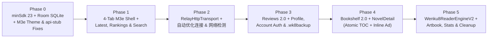

# 06 — `v2.0` Technical Architecture, SQLite Migration & Incremental Roadmap

**Status:** Architectural Blueprint  
**SDK Baseline:** `minSdkVersion = 23` · `targetSdkVersion = 37` · Java 17 + Kotlin 2.x  
**Core Principle:** *Replace the 2015 View/Activity/AsyncTask UI shell, `HttpURLConnection` helper, and `.wk8` flat files with Jetpack Compose, **Material 3 Expressive (`M3e`)**, Coroutines, unified Room SQLite (`wenku8_v2.db`), and OkHttp `RelayHttpTransport` — while 100% preserving the battle-tested XML parsers, `:api` hardware-attested relay module, and JVM/instrumented test suite.*

---

## 1. Architectural Layered Blueprint

```mermaid
flowchart TB
    subgraph UI["Layer 1: Jetpack Compose + Material 3 Expressive (M3e) UI"]
        Main["Single-Activity Host (MainActivity.kt)\nNavigationSuiteScaffold (4-Tab ShortNavigationBar / WideNavigationRail)\nSharedTransitionLayout + PredictiveBack + Scoped CoverThemeEngine"]
        Screens["M3e Screens:\nBookshelf · Latest · Rankings · Search · NovelDetail (+Inline Support Ad)\nReviews · UnifiedReader · ArtbookLightbox · Profile · NetworkDiagnostics"]
    end

    subgraph VM["Layer 2: Lifecycle-Aware State Holders (ViewModels + StateFlow)"]
        VMs["BookshelfVM · LatestVM · RankingsVM · SearchVM · NovelDetailVM\nReviewVM · ReaderVM · ProfileVM · NetworkDiagnosticsVM"]
        Workers["DownloadQueueManager (WorkManager) · RelayRouteController (Idle Auto-Optimization)"]
    end

    subgraph Domain["Layer 3: Preserved & Tested Pure-Logic Domain Core (Java/Kotlin)"]
        Seams["BookshelfSync · BookshelfFilter · NovelDownloader · CrossVolumeNavigator\nWenkuChapterParser · StaticLayoutPaginator · AccountInfoLoader · DiagnosticsRunner"]
        Parsers["Wenku8Parser · NovelListWithInfoParser · OldNovelContentParser · BookshelfListParser"]
    end

    subgraph Data["Layer 4: SQLite Persistence & Scoped Network Gateways"]
        Room["Room SQLite Database (wenku8_v2.db · WAL Mode)\nnovels · volumes · chapters · chapter_contents · reading_progress\nbookmarks_notes · reading_sessions · review_drafts · search_history"]
        DS["Preferences DataStore\nsettings.preferences_pb (Synced/Backed Up)\nnetwork_routing_local.preferences_pb (Device-Local Leases & 24h Probe Budgets)"]
        Net["RelayHttpTransport (OkHttp + Per-Host Dns + EventListener)\nScoped Strictly to Relay v1/v2 · Isolated from Coil 3 Image CDN Client"]
        API[":api / :api-stub Module\nWenku8API · LightUserSession · TokenManager (libcpp.so)\nRelay v1 (wenku8-relay.mewx.org) & Relay v2 (wenku8-android.mewx.org)"]
    end

    UI --> VM
    VM --> Domain
    Domain --> Data
```

---

## 2. Modernized Tech Stack & Official AndroidX Policy

| Subsystem | Legacy `v1.31` | `v2.0` Target Stack | Rationale |
| :--- | :--- | :--- | :--- |
| **`minSdkVersion`** | API 21 | **API 23 (Android 6.0)** | Required by AndroidX Compose M3 Expressive (`material3:1.4+`) and guarantees `ConnectivityManager.getActiveNetwork()` + `getDefaultProxy()` across all devices. |
| **Language** | Java 17 | **Kotlin 2.x + Java 17 Interop** | Coroutines, `StateFlow`, and Compose while calling existing Java XML parsers and `:api` JNI classes directly. |
| **Design System** | Hybrid Material 1 XML | **`material3:1.4+` (`M3e`) + `material3-adaptive`** | Official `ShortNavigationBar`, `WideNavigationRail`, `HorizontalFloatingToolbar`, `SplitButtonLayout`, `ButtonGroup`, `LinearWavyProgressIndicator`, and `MaterialShapes` (**zero third-party UI libraries**). |
| **Locale Switching** | Deprecated `updateConfiguration` + `Activity` restart | **`AppCompatDelegate.setApplicationLocales`** | Instant, recreation-safe `SC` (`zh-CN`) ↔ `TC` (`zh-TW`/`zh-HK`) switching without restarting `MainActivity`. |
| **Persistence** | `.wk8` delimiter files + loose `novel/*.xml` | **Room SQLite (`wenku8_v2.db` WAL) + DataStore** | All structured records **and** offline chapter texts live in ACID SQLite with atomic `@Upsert` TOC versioning (`toc_version`, Doc `09`) and 1-file `VACUUM INTO` `.wk8backup.zip` archives. |
| **Relay & Diagnostic Transport** | `HttpURLConnection` (`LightNetwork`) | **OkHttp 4.12+ (`RelayHttpTransport`)** | Supports per-hostname custom `Dns` candidate-IP overrides, generation-isolated `ConnectionPool`s, and `EventListener` phase/reuse telemetry for `"自动优化连接"` (Doc `11`). |
| **Image & Deep-Zoom Stack** | `universal-image-loader:1.9.3` + `SubsamplingScaleImageView` | **Coil 3 (`coil-compose`) + Official `Canvas` + `BitmapRegionDecoder`** | Coil 3 uses an isolated `Dns.SYSTEM` client for `img.wenku8.com` / `pic.wenku8.cn`; `BitmapRegionDecoder` tiles 4000px+ `口绘` spreads with zero third-party UI dependencies. |
| **Monetization** | Synchronous `AdView` on `NovelInfoActivity` | **Lazy-Init Non-Intrusive `AdView` on `NovelDetailScreen` Only** | Initializes `MobileAds` on `Dispatchers.IO` *after* first frame draw; pre-reserves fixed height only when online + GMS available (CLS = 0) to cover relay server costs without harming UX. |

---

## 3. Atomic SQLite Schema, TOC Versioning & `api-stub` Safety

1. **Unified Room SQLite (`wenku8_v2.db` — Full Spec in [Doc `09`](./09-room-database-and-backup-archive-design.md))**:
   - Stores `novels`, `volumes`, `chapters`, `chapter_contents`, `reading_progress`, `bookmarks_notes`, `reading_sessions`, `review_drafts`, and `search_history`.
   - **Zero Cascade Data Loss**: `chapter_contents`, `reading_progress`, and `bookmarks_notes` hold foreign keys to `novels(aid)` rather than `ON DELETE CASCADE` on `volumes`/`chapters`. Updating a novel's chapter list (`do=list`) executes inside `@Transaction syncNovelIndexAtomically(...)` using `@Upsert` (`ON CONFLICT DO UPDATE`) and monotonic `toc_version` checks—never `OnConflictStrategy.REPLACE` (`DELETE` + `INSERT`).
   - **2 MB `CursorWindow` Guard**: `chapter_contents.content_text` is excluded from all multi-row TOC queries and loaded strictly one `cid` at a time.
   - **Safe `v1.x` `.wk8` Migration**: `LegacyWk8Migrator` parses `bookshelf_local.wk8`, `read_saves_v1.wk8` (`aid:vid:cid:lineId:wordId||...`), `read_saves.wk8` (`cid,,pos,,height||...`), and `search_history.wk8` (stripping leading `0`/`1` scope prefixes), while leaving original `.wk8` files untouched in place for 1 full release cycle.
2. **`api-stub` CI & Instrumentation Safety**:
   - All screens must render cleanly on `--forceApiStub` CI builds without calling JNI or throwing `UnsupportedOperationException("stub")`:
     - Update `api-stub`'s `Wenku8API.getAvatarURL(int uid)` to return `""` and `Wenku8API.searchBadWords(String source)` to return `null` so `ReviewListScreen` and `ReviewThreadScreen` never crash on CI.
     - `NetworkDiagnosticsScreen` and `RelayRouteController` inspect `DiagnosticsEndpointConfig` (`BASE_URL == "Unknown"`) and surface the supported `"此版本未配置中转检测服务"` state without network or native calls.
   - Retain `CrashReporter` breadcrumb keys (`NOVEL_AID`, `CHAPTER_CID`, `READER_MODE`) inside `NovelDetailViewModel` and `ReaderViewModel`.

---

## 4. Phased Incremental Implementation Roadmap

| Phase | Scope & Deliverables | Verification Gate |
| :--- | :--- | :--- |
| **Phase 0: Foundation, Room SQLite & M3e Theme** | • Bump `minSdkVersion` to `23`; enable Kotlin 2.x, Compose, `material3:1.4+` (`M3e`), Room 2.7 (`WAL`), DataStore, Coil 3, and OkHttp. • Implement `wenku8_v2.db` + `@Upsert` `syncNovelIndexAtomically` + `LegacyWk8Migrator` (`bookshelf_local.wk8`, V1/V0 saves, `[0/1]` search history). • Update `api-stub` (`getAvatarURL`, `searchBadWords`) for crash-free CI. • Build `Wenku8ExpressiveTheme` (Archival Day, Carbon Night, AMOLED, E-Ink `1.dp` border mode + Monet + scoped `CoverThemeEngine`). | • All existing JVM parser/domain tests pass. • In-memory Room tests verify atomic TOC updates never cascade-delete `chapter_contents` or `reading_progress`, plus corrupt `.wk8` migration fixtures. • `--forceApiStub` CI green. |
| **Phase 1: 4-Tab M3e Shell, `最新`, `排行` & Search** | • Build `AdaptiveMainScaffold` (`ShortNavigationBar` 64dp + `WideNavigationRail`: `书架 · 最新 · 排行 · 我的`). • Build `LatestScreen` (`lastUpdate`, `postDate`, `fullFlag`), `RankingsScreen` (2D Metric × Period M3e matrix), and `UnifiedSearchScreen` (`0ms` local Room filter + auto-queued `5s` cooldown online `articlename`/`author`/`AID` search). | • Compose UI & Robolectric tests for 4-tab navigation, offline-first startup routing, and `5s` search cooldown queueing. |
| **Phase 2: `RelayHttpTransport`, `"自动优化连接"` & `网络检测`** | • Build `RelayHttpTransport` (strictly scoped per-hostname `Dns` + isolated `ConnectionPool`s + `EventListener`), `ManifestRepository`, `RoutingBudgetDataStore`, `RelayRouteController`, and `DiagnosticsRunner` ([Doc `11`](./11-network-diagnostics-and-auto-routing-ui.md)). • Build `NetworkDiagnosticsScreen` + Pre-Share Privacy `ModalBottomSheet` + contextual `[ 🩺 网络检测 ]` error chips. | • Fake-clock/transport unit tests for 2-slot DNS stall bound, 3-stage candidate promotion, pre-send vs. idempotent replay boundary, E-Ink static progress, and `wenku8-network-report-v1` JSON null round-trips. |
| **Phase 3: Reviews 2.0, Profile, Account Auth & Backup** | • Build `ReviewListScreen` & `ReviewThreadScreen` (UID avatars, floor quotes, `10s` cooldown + live bad-word chips, `REVIEW_DRAFTS`). • Build `ProfileAndStudioScreen` (Login sheet for Username/Email, `REGISTER_URL`, Logout, `每日签到`, `NoticeString` HTML banner, `"自动优化连接"` card, `.wk8backup.zip` `VACUUM INTO` export/smart-merge import, SAF legacy folder import). | • `AccountInfoLoaderTest` + Compose UI tests for Login/Logout, review draft persistence, and `.wk8backup.zip` smart merge. |
| **Phase 4: Bookshelf 2.0, Novel Detail & Non-Blocking Downloads** | • Build `BookshelfScreen` (`HorizontalMultiBrowseCarousel`, Grid/List/3D Spine Carousel, flat static progress vs. wavy active download progress, contextual batch `HorizontalFloatingToolbar`). • Build `NovelDetailScreen` (`SplitButtonLayout` for reading variants, inline Volume Accordions, 4-Mode `WorkManager` downloader, lazy-init zero-CLS inline `AdView` between Synopsis & Volumes). | • `BookshelfSyncTest`, `NovelDownloader` atomic SQLite tests, Predictive Back shared-element scrubbing, and offline/GMS-free ad-collapse verification. |
| **Phase 5: `Wenku8ReaderEngineV2`, Artbook, Stats & Retirement** | • Build `UnifiedReaderScreen` (`StaticLayoutPaginator` + CJK Kinsoku + 3-Chapter `ChapterWindowBuffer` + 6 Page-Turn Delegates + opaque active-slider reflow capsule + Cross-Volume navigation + TTS + In-Book Search) & `ArtbookLightboxOverlay` (`BitmapRegionDecoder` tiling + `跨页拼合`). • Build Reading Statistics & Glance Widgets; retire legacy Activities/Fragments/`AsyncTask`/UIL. | • Full JVM + Instrumented test suite & JaCoCo coverage green; 120fps frame-timing and foldable posture-change continuity verified. |
