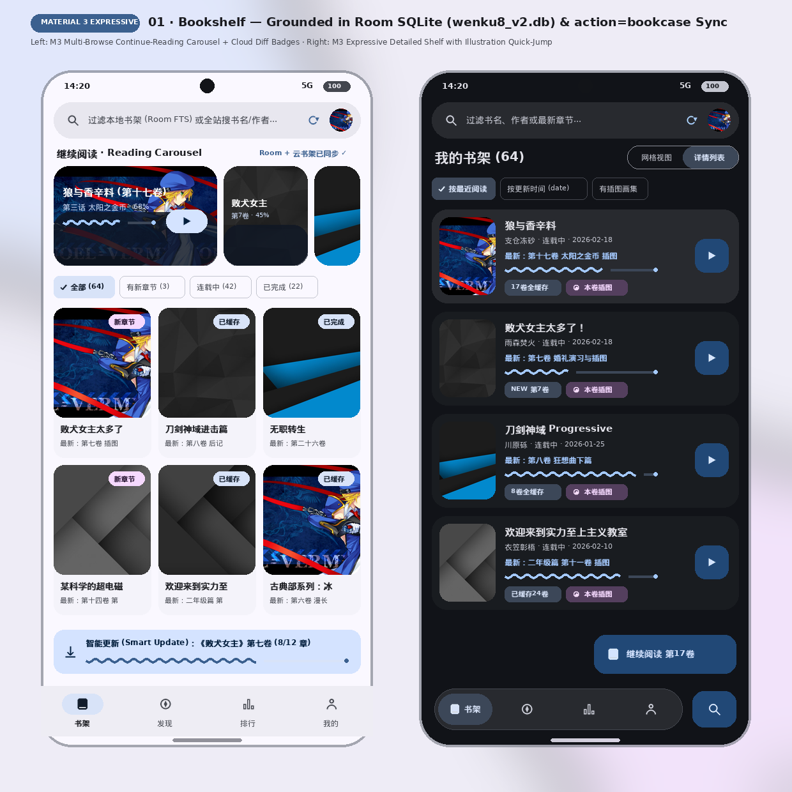
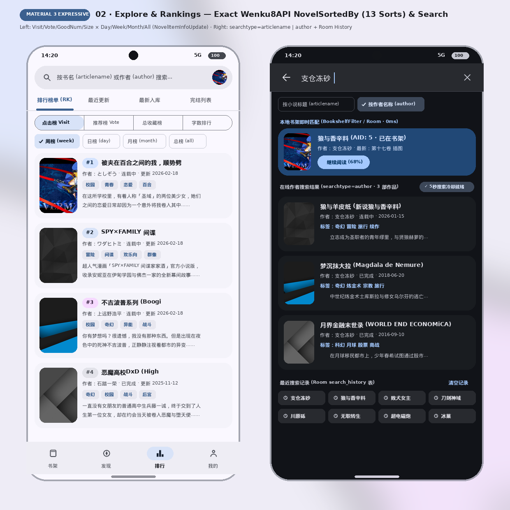
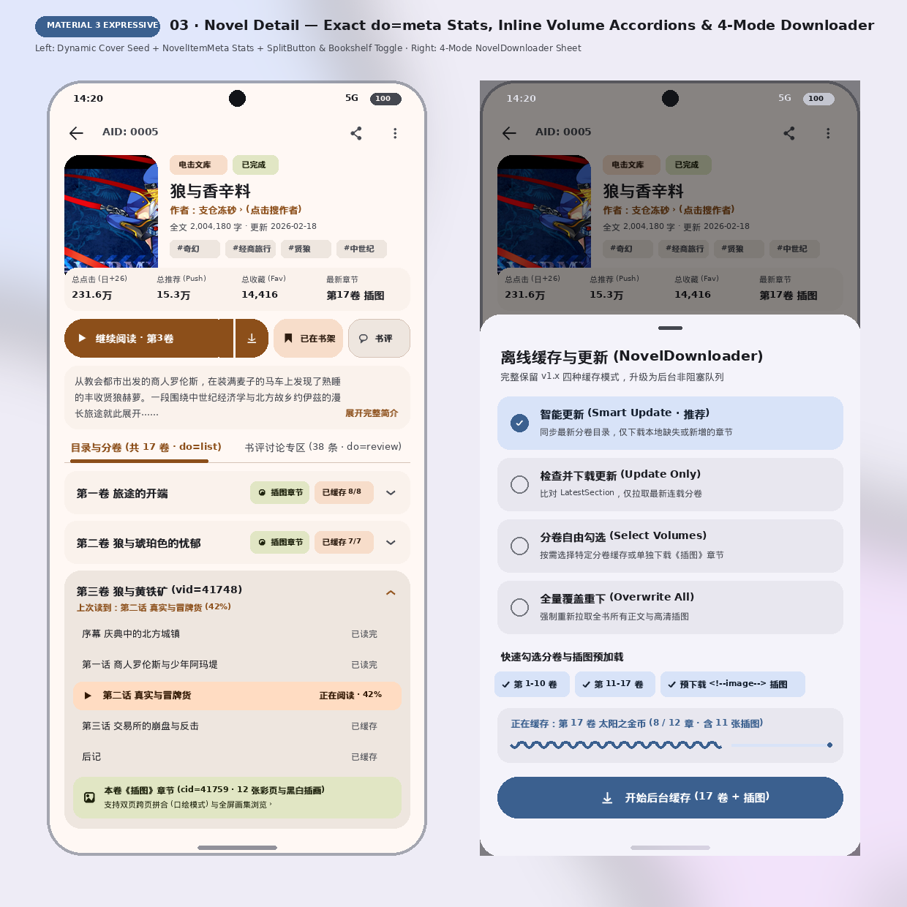
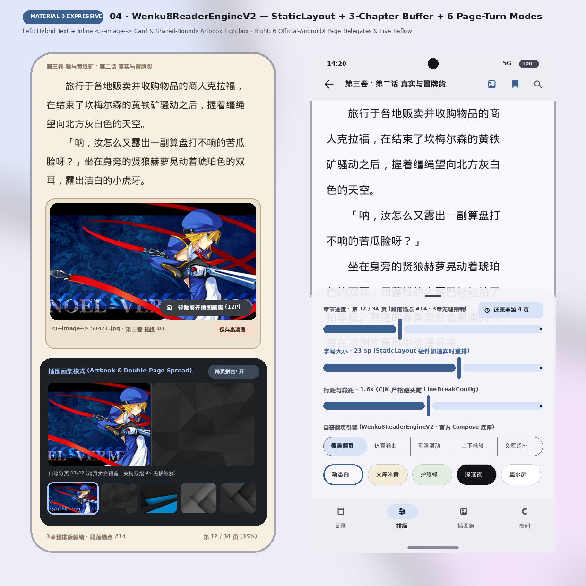
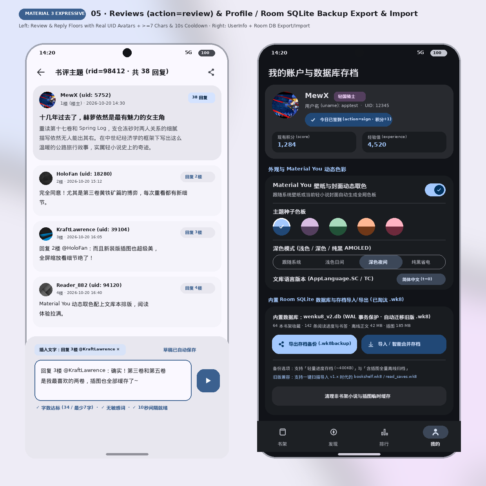
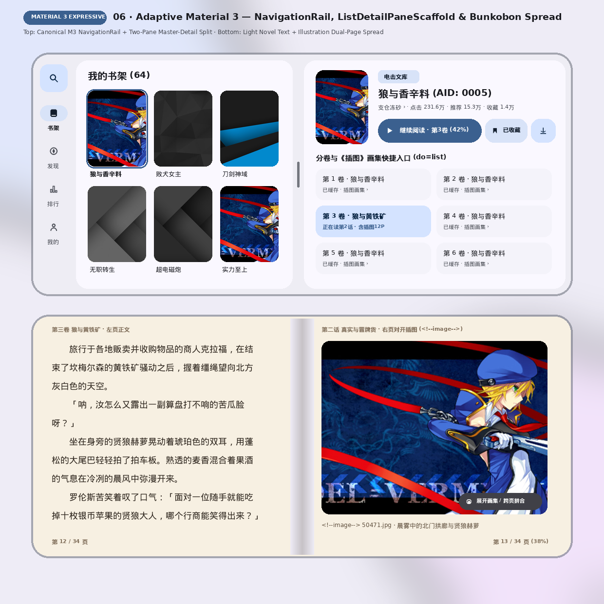

# 07 · Material 3 Expressive (`M3e`) UI Mockups & Interactive Prototype (`v2.0`)

This document presents **6 high-DPI Material 3 Expressive screen mockup boards** (`1240×1240` PNGs in [`docs/designs/v2/mockups/`](file:///home/mewx/codes/light-novel-library_Wenku8_Android/docs/designs/v2/mockups/)) alongside an updated interactive browser prototype ([`interactive-prototype.html`](file:///home/mewx/codes/light-novel-library_Wenku8_Android/docs/designs/v2/mockups/interactive-prototype.html)).

---

## Core Material 3 Expressive (`M3e`) Components & Production Refinements

> [!IMPORTANT]
> **Production UI Guardrails Over Early Wireframe Annotations (`Boards 01–06`)**:
> 1. **4-Tab M3e `ShortNavigationBar` (`64dp`) & `WideNavigationRail`**: Top-level navigation uses `NavigationSuiteScaffold` with `v1.31`'s familiar 4 sections (**`书架 · 最新 · 排行 · 我的`**). `HorizontalFloatingToolbar` (shown on Board 01 Right as a comparison exploration) is reserved strictly for contextual actions (Reader HUD & Bookshelf multi-select) without duplicate FABs.
> 2. **Active-Only Wavy Progress**: `LinearWavyProgressIndicator` is used **only** for active in-flight work (active `WorkManager` download, cloud sync, or manual `网络检测` probe); static resting reading progress uses a flat M3 `LinearProgressIndicator` (and E-Ink mode uses `1dp` solid card borders + static flat bars everywhere).
> 3. **Reading-Only `SplitButtonLayout` + Inline Server-Support Banner**: On `NovelDetailScreen`, `SplitButtonLayout` groups `▶ 继续阅读` with its reading-mode variants (`▾`), while `✓ 已在书架`, `↓ 离线缓存`, and `💬 书评` sit on a separate balanced row, and a single zero-CLS `surfaceContainerLow` server-support banner sits quietly between Synopsis and Volume Accordions.
> 4. **Opaque Active-Slider Capsule in Reader**: While dragging a typography slider (Board 04 Right), inactive controls hide completely while the active slider stays inside a `92%`-opaque `surfaceContainerHighest` pill capsule so text-on-text overlap never occurs.
> 5. **Clean Localized Copy**: Technical diagram callouts visible on the mockup boards (`Room FTS`, `articlename`, `do=list`, `vid=41748`, `<!--image-->`, `StaticLayout`, `t=0`, `wenku8_v2.db`) are **architecture review annotations only** and are stripped from production `strings.xml`.

---

## Interactive HTML5 M3e Sandbox (`mockups/interactive-prototype.html`)

Open [`interactive-prototype.html`](./mockups/interactive-prototype.html) in any browser to test:
- **4 Distinct M3e `ShortNavigationBar` (`64px`) Tabs**: `书架` · `最新` (`最近更新 / 最新入库 / 完结精品`) · `排行` (`2D Metric × Period Matrix`) · `我的` (Account Login/Check-In + `"自动优化连接"` + `.wk8backup`).
- **Live `NetworkDiagnosticsScreen` & `"自动优化连接"` Toggle**: Interactive benchmark simulation (`10` probes, success/median/header stats, attempt timeline, and pre-share privacy sheet).
- **`NovelDetailScreen`**: Scoped `CoverThemeEngine` Amber seed, reading-only `SplitButton`, 4-mode downloader, non-intrusive server-support banner card, and collapsible volume accordions.
- **`UnifiedReaderScreen`**: Opaque-capsule live font reflow preview (`15–26 sp`).

---

## Visual Mockup Boards (`docs/designs/v2/mockups/`)

### Board 01 — Bookshelf: M3e Multi-Browse Carousel & Tonal Cards

### Board 02 — Rankings Matrix (`ButtonGroup` + `FilterChip`) & Fullscreen M3 `SearchView`

### Board 03 — Novel Detail (Scoped Cover Seed, `SplitButton` & 4-Mode `ModalBottomSheet`)

### Board 04 — Unified Reader: Inline Art Cards, Artbook Spread & Typography Sheet

### Board 05 — Community Reviews (`action=review`) & Profile / SQLite Backup Studio

### Board 06 — Adaptive Foldable & Tablet UX (`WideNavigationRail` + `ListDetailPaneScaffold` & Dual-Page Spread)

