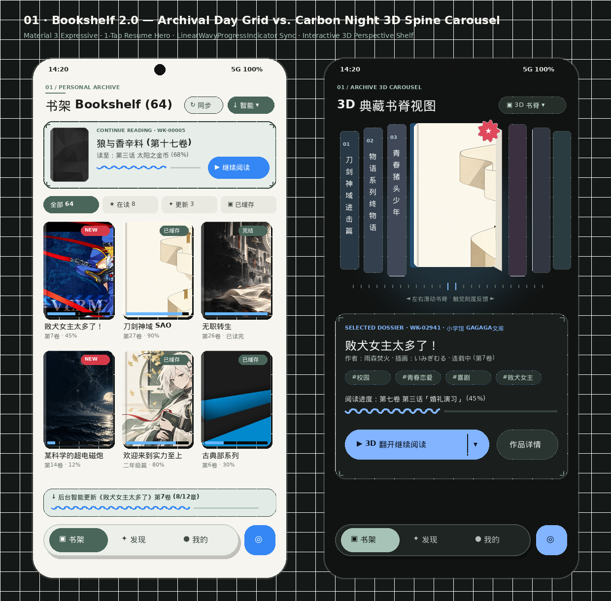
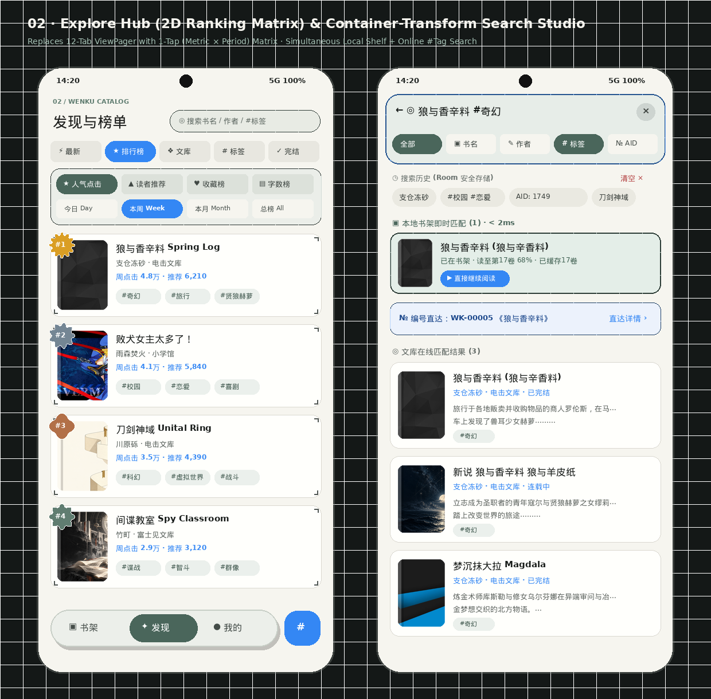
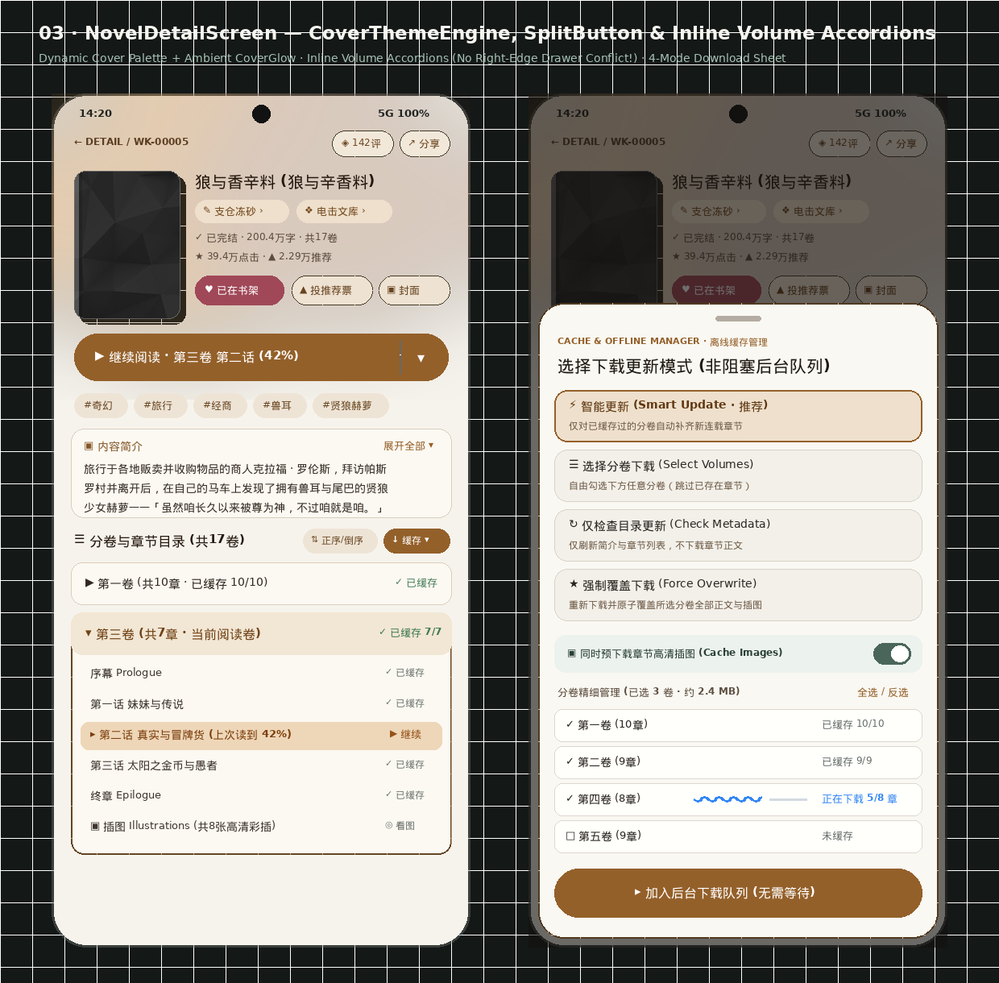
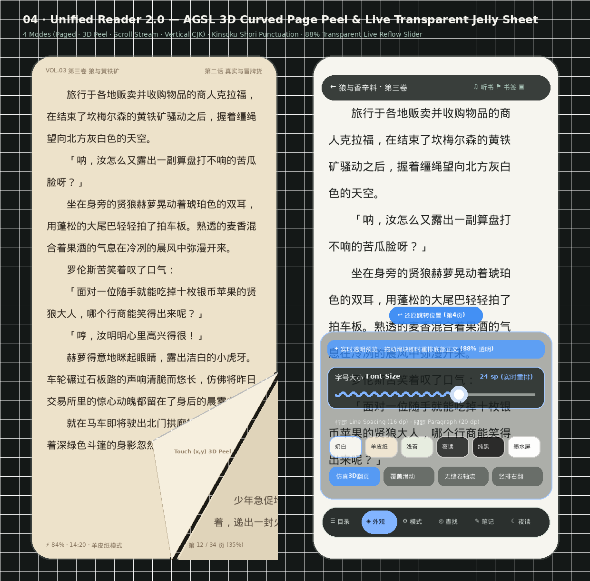
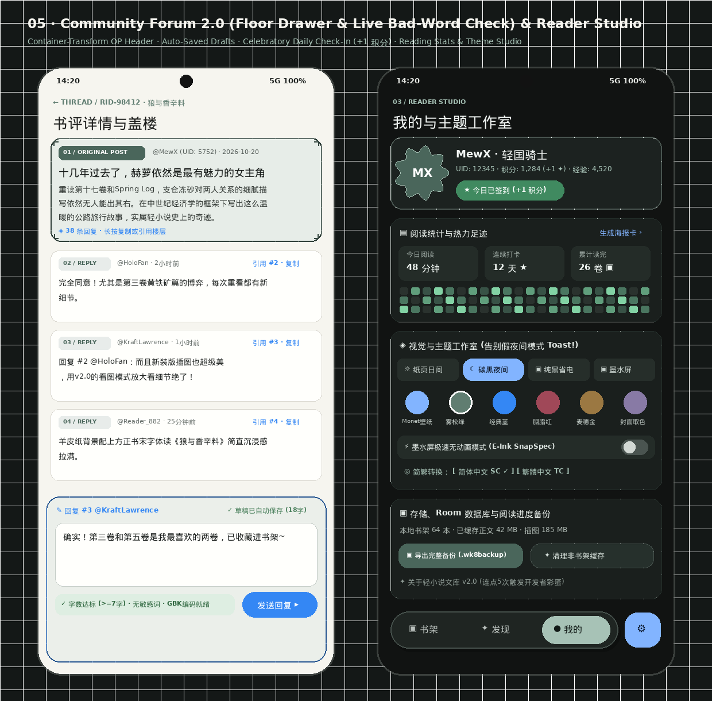
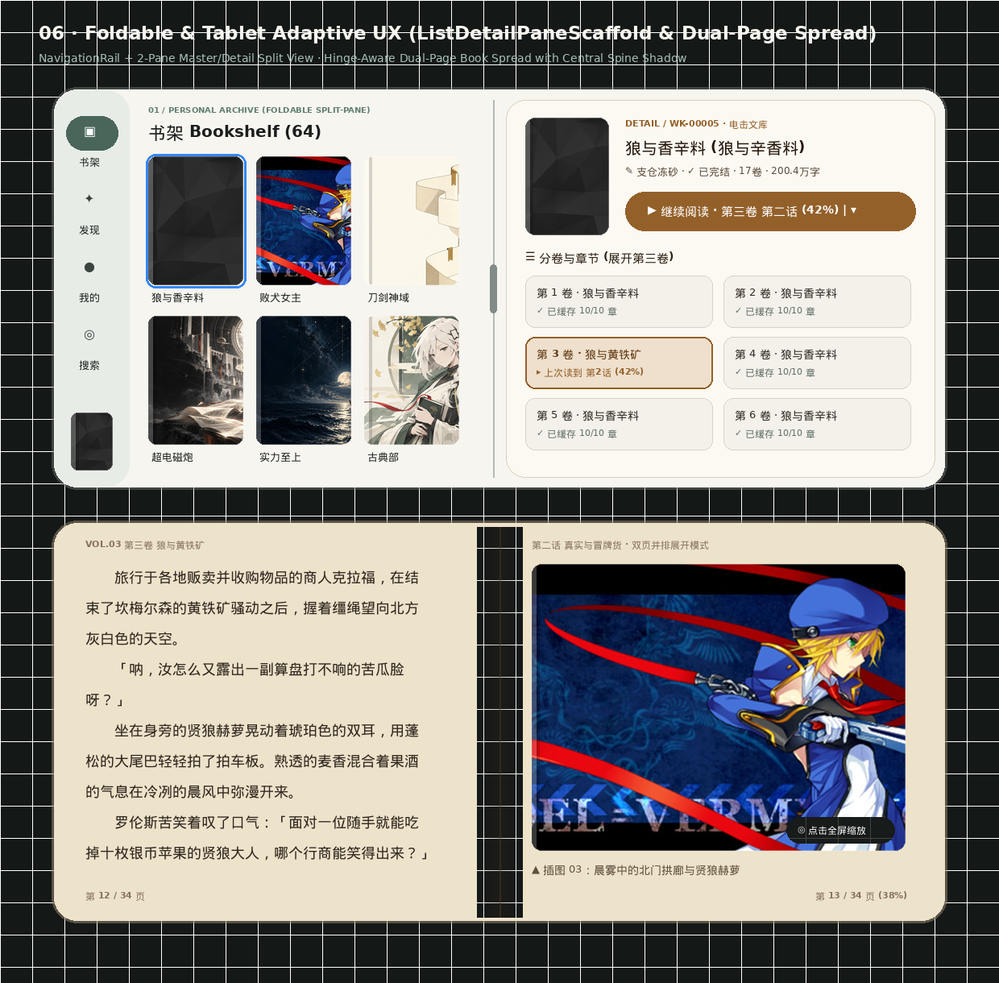

# 07 · High-DPI UI Mockup Boards & Interactive Prototype (`v2.0`)

To iterate visually on the **Wenku8 Android `v2.0`** redesign before locking in implementation phases, this directory includes **6 high-DPI visual mockup boards** (`1240×1240` PNGs rendered with real `studio-android` assets and `fzss-gbk.ttf` typography) alongside a self-contained **Interactive HTML5/CSS3/JS Prototype** ([`interactive-prototype.html`](file:///home/mewx/codes/light-novel-library_Wenku8_Android/docs/designs/v2/mockups/interactive-prototype.html)).

---

## 1. Visual Mockup Boards (`docs/designs/v2/mockups/`)

### Board 01 — Bookshelf 2.0: Archival Day Grid vs. Carbon Night 3D Spine Carousel

- **Left Phone (Archival Day `#F6F5EF`)**:
  - `01 / PERSONAL ARCHIVE` editorial header with registration marks (`┌ ┐ └ ┘`).
  - **1-Tap Continue Reading Dossier Card** (`WK-00005 · 狼与香辛料 第十七卷`) with `LinearWavyProgressIndicator` (`68%`) and direct `▶ 继续阅读` action (collapsing `v1.x`'s 4-activity chain into 1 tap).
  - Morphing M3 Expressive filter chips (`全部 64`, `★ 在读 8`, `✦ 更新 3`, `▣ 已缓存`).
  - 3-column book grid with dual progress bars (reading % + cached volumes) and `MaterialShapes.Sunny` badges.
  - Non-blocking `WorkManager` download banner (`LinearWavyProgressIndicator`) above the floating pill navigation bar (`HorizontalFloatingToolbar` + Search FAB).
- **Right Phone (Carbon Night `#111312` — Interactive 3D Spine Carousel)**:
  - Ported from `Wenku8_Flutter`'s signature `Archive3DCarousel` using Compose `graphicsLayer { cameraDistance; rotationY }`.
  - Vertical CJK spines tilt in 3D perspective; the focused book (`WK-02941 · 败犬女主太多了！`) rotates open (`-14°`) with a live `SELECTED DOSSIER` preview card and `SplitButtonLayout` (`▶ 3D 翻开继续阅读 | ▾`).

---

### Board 02 — Explore 2.0 (2D Ranking Matrix) & Unified Search Studio

- **Left Phone (Explore & 2D Ranking Matrix)**:
  - Replaces `v1.x`'s 8-tab horizontal `PagerSlidingTabStrip` with a single-screen **2D Chip Matrix**: Category Row (`★ 热门榜`, `✦ 动画化`, `↻ 今日更新`, `▣ 新书一览`, `✓ 完结精品`) × Time Period Row (`周榜 Weekly`, `月榜 Monthly`, `总榜 All-Time`).
  - Top-3 ranked novels feature M3 Expressive morphing polygon rank badges (`#1`, `#2`, `#3`) and heat metrics (`24.8万热度`).
- **Right Phone (Unified Search Studio — Carbon Night)**:
  - Merges `ArticleSearchActivity` + `SearchResultActivity` into a single expanding M3 `SearchBar`.
  - Instant scope selector (`▣ 作品标题` / `✎ 作者名称` / `# 分类标签` / `№ AID直达` — typing `2941` or `0005` jumps straight to the novel).
  - Live ** Bookshelf Hit Card** (`已在本地书架 · 第7卷已缓存`) above online Wenku8 relay results.

---

### Board 03 — Novel Detail Dossier (Inline Accordions) & 4-Mode Offline Download Sheet

- **Left Phone (Novel Detail with Cover-Adaptive Glow & Inline Volume Accordions)**:
  - `CoverThemeEngine` extracts a warm amber palette from the `狼与香辛料` cover for the top gradient glow and primary CTA.
  - **M3 Expressive `SplitButtonLayout`**: Left pill (`▶ 继续阅读 · 第三卷 第二话 42%`) launches the reader immediately; right chevron (`↓ 缓存 ▾`) opens the 4-mode download sheet.
  - **Inline Collapsible Volume Accordions**: Eliminates `NovelChapterActivity`! Volumes expand in place (`VOL.01`, `VOL.02`, `VOL.03` expanded showing `第一话`..`第四话` + `▣ 本卷插图画廊 12张`).
- **Right Phone (4-Mode Non-Blocking Offline Download Sheet)**:
  - Preserves 100% of `v1.x`'s 4 download modes (`智能更新 [推荐]`, `仅下载更新分卷`, `全量覆盖重下`, `分卷自选`) while replacing blocking `MaterialDialog` progress popups with a non-blocking `WorkManager` queue and `LinearWavyProgressIndicator`.

---

### Board 04 — Unified Reader 2.0 (3D Page Curl & Live Transparent Typography Sheet)

- **Left Phone (Unified Reader Canvas with 3D Page-Peel Physics)**:
  - Renders novel body text with the bundled `fzss-gbk.ttf` serif font on warm parchment (`#EDE2CA`), with CJK *Kinsoku Shori* punctuation hanging and interactive 3D corner page curl.
- **Right Phone (Live Transparent Jelly Sheet Preview)**:
  - Ported from `Wenku8_Flutter`'s best UX innovation: while dragging the **Font Size (`24 sp`)**, **Line Spacing**, or **Paragraph Spacing** sliders, the settings sheet drops to **12% background opacity (`88%` transparent)** so the reader watches the actual novel text reflow live underneath.
  - Includes a floating `↩ 还原跳转位置 (第4页)` undo pill after scrubbing chapters/pages, plus paper presets (`奶白`, `羊皮纸`, `浅苔`, `夜读`, `纯黑`, `墨水屏`) and layout modes (`仿真3D翻页`, `覆盖滑动`, `无缝卷轴流`, `竖排右翻`).

---

### Board 05 — Community Forum 2.0 & Reader Studio / Theme Workshop

- **Left Phone (Review Replies & Floor Composer)**:
  - Container-transformed `01 / ORIGINAL POST` dossier header + numbered reply floors (`02 / REPLY`, `03 / REPLY`, `04 / REPLY`).
  - Persistent bottom reply drawer with **auto-saved drafts**, **1-tap floor quote (`回复 #3 @KraftLawrence`)**, and **live pre-submit validation** (`✓ 字数达标 (>=7字) · 无敏感词 · GBK编码就绪`).
- **Right Phone (Profile, Celebratory Check-In & Theme Studio)**:
  - Celebratory 1-tap daily check-in (`★ 今日已签到 +1 积分`), reading heatmap (`今日阅读 48 分钟`, `连续打卡 12 天`), and **Visual & Theme Studio** eliminating `v1.x`'s infamously unimplemented night-mode Toast (`"然而夜间模式并没有做好..."`).

---

### Board 06 — Foldable & Tablet Adaptive UX (`ListDetailPaneScaffold` & Dual-Page Spread)

- **Top Foldable Canvas (`ListDetailPaneScaffold` Master/Detail Split View)**:
  - Left `NavigationRail` (with mini now-reading cover) + 3-column Bookshelf pane on the left + inline `NovelDetail` & `VolumeAccordion` pane on the right with a draggable split handle.
- **Bottom Foldable Canvas (Dual-Page Book Spread Reader)**:
  - Hinge-aware two-page spread with a realistic central book-spine shadow gradient: CJK body text on the left page (`第 12 / 34 页`) and full-bleed high-res light novel illustration on the right page (`第 13 / 34 页`).

---

## 2. Interactive HTML/CSS/JS Prototype

Open [`mockups/interactive-prototype.html`](file:///home/mewx/codes/light-novel-library_Wenku8_Android/docs/designs/v2/mockups/interactive-prototype.html) in any browser to test:
1. **4 Lighting Modes**: Toggle live between `☼ 纸页日间 (#F6F5EF)`, `☾ 碳黑夜间 (#111312)`, `▣ 纯黑 AMOLED`, and `⚡ 墨水屏无动画`.
2. **Phone vs. Foldable Form Factor**: Toggle the device frame between `412px` phone and `960px` foldable width.
3. **Bookshelf Grid vs. 3D Spine Carousel**: Click `▣ 切换 3D 书脊` on the Bookshelf to flip between the 3-column card grid and the interactive 3D perspective spine shelf.
4. **1-Tap Continue Reading & Inline Volume Accordions**: Click the top hero card to jump straight into the reader, or click any novel card to expand inline volume accordions.
5. **Live Transparent Slider Reflow & Vertical CJK Typesetting**: Inside the reader, drag the font-size slider to watch the bottom sheet turn transparent while reflowing the novel text in real time, or click `竖排/横排` to test right-to-left vertical CJK layout (`writing-mode: vertical-rl`).
