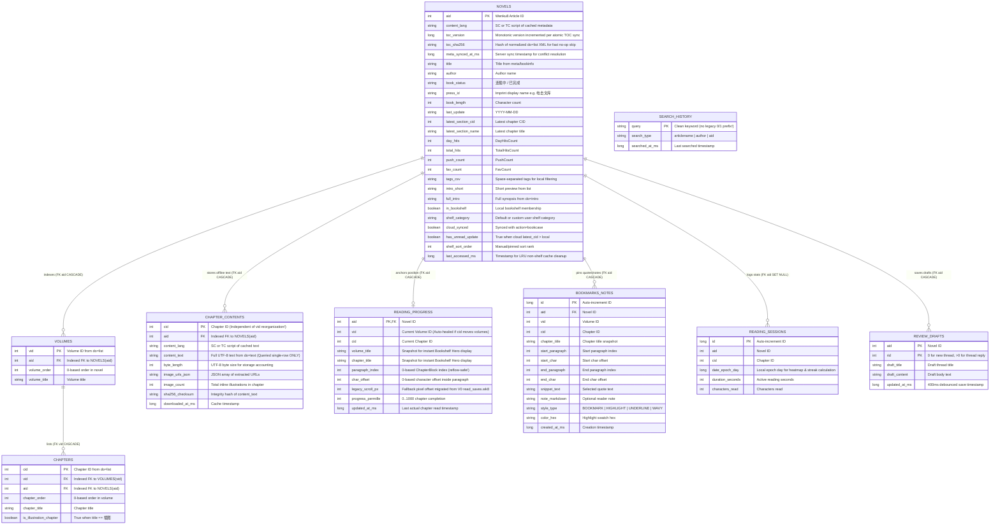

# 09 · Built-In Room SQLite Database, Atomic TOC Versioning & Backup Archive Design (Retiring `.wk8`)

> **Core Mandate**: Retire all legacy `.wk8` custom-delimiter text files (`bookshelf_local.wk8`, `read_saves.wk8`, `read_saves_v1.wk8`, `search_history.wk8`, `settings.wk8`) and loose XML files (`intro/*.xml`, `novel/*.xml`). Consolidate all structured records and offline chapter text into a single **official AndroidX Room SQLite database (`wenku8_v2.db` in WAL mode)** + **AndroidX Preferences DataStore**, governed by **atomic `@Upsert` TOC versioning (zero destructive `REPLACE` cascades)**, a **`.wk8backup.zip` Export/Import Archive**, and **non-destructive `v1.x` migration**.

---

## 1. Why the Legacy `.wk8` & Loose-XML Format Is Retired

In `studio-android` (`v1.31`), user state and offline content were split across custom plain-text files inside [`GlobalConfig.java`](file:///home/mewx/codes/light-novel-library_Wenku8_Android/studio-android/LightNovelLibrary/app/src/main/java/org/mewx/wenku8/global/GlobalConfig.java) and [`LightCache.java`](file:///home/mewx/codes/light-novel-library_Wenku8_Android/studio-android/LightNovelLibrary/app/src/main/java/org/mewx/wenku8/util/LightCache.java):

| Legacy `v1.x` File | Exact Legacy Format & Separator | Critical Reliability Defects |
| :--- | :--- | :--- |
| `bookshelf_local.wk8` | `aid1\|\|aid2\|\|aid3` | Full-file overwrite on every add/remove/tap-reorder; no transaction isolation; stores only `aid` ints while metadata lives in separate `intro/{aid}-intro.xml` & `intro/{aid}-volume.xml` files that can desynchronize. |
| `read_saves_v1.wk8` & `read_saves.wk8` | V1: `aid:vid:cid:lineId:wordId\|\|...`<br>V0: `cid,,pos,,height\|\|...` | Rewritten from scratch on every reader exit; stores screen/font-dependent `lineId`/`wordId` or pixel offsets; two incompatible save files across Paged vs. Vertical readers. |
| `search_history.wk8` | `[0query][1query]...` (`0`=Title, `1`=Author) | Breaks or drops input when search text contains `[` or `]`; full-file rewrite on every search. |
| `settings.wk8` | `key::::value\|\|key2::::value2` | Hand-rolled string splitting (`\|\|` and `::::`); unvalidated string-to-enum parsing; no reactive `Flow` observation. |
| `novel/{cid}.xml` & `intro/{aid}-*.xml` | Raw XML/text files written via `LightCache.saveFile()` | Truncates destination before writing without atomic temp-file-and-rename, leaving 0-byte or half-written chapters when network or battery drops mid-download. |

---

## 2. Official AndroidX Persistence Stack

`v2.0` (`minSdk = 23`) uses **100% official Google AndroidX persistence libraries**:

| Artifact Coordinate | Role in `v2.0` |
| :--- | :--- |
| `androidx.room:room-runtime:2.7.0+` & `room-ktx` | Official AndroidX SQLite ORM with compile-time SQL verification, `@Upsert`, `@Transaction` coroutines, and reactive `Flow<T>` queries |
| `androidx.sqlite:sqlite-framework:2.5.0+` | Native Android SQLite configured in **WAL (Write-Ahead Logging)** mode (`JournalMode.WRITE_AHEAD_LOGGING`) for concurrent reads during background downloads |
| `androidx.datastore:datastore-preferences:1.1.2+` | Atomic key-value storage split into `settings.preferences_pb` (user preferences, included in backup) and `network_routing_local.preferences_pb` (device-local relay leases & probe budgets, **excluded** from backup) |

---

## 3. Unified Room SQLite Schema (`wenku8_v2.db`)

> [!IMPORTANT]
> **Foreign-Key Isolation Rule (Preventing Cascade Data Loss During Chapter-List Updates):**
> `CHAPTER_CONTENTS`, `READING_PROGRESS`, and `BOOKMARKS_NOTES` reference **`NOVELS(aid)`** (NOT `ON DELETE CASCADE` on `VOLUMES` or `CHAPTERS`)! When Wenku8 editors reorganize chapters (e.g., moving serialized web chapters into a newly compiled Bunkobon volume with a new `vid`) or when the table of contents (`do=list`) is refreshed, updating `VOLUMES` and `CHAPTERS` **never** cascade-deletes downloaded chapter text, reading progress, or user highlights/bookmarks.



---

## 4. Atomic TOC / Chapter-List Synchronization, Versioning & Conflict Rules

Updating a novel's volume and chapter list (`do=list` + `do=meta`) concurrently from `BookshelfSync`, `NovelDetailScreen`, and `WorkManager` downloads is the highest-risk write path in a novel reader. `v2.0` enforces **five strict SQLite invariants**:

### 4.1 Ban `OnConflictStrategy.REPLACE` — Always Use `@Upsert` (`ON CONFLICT DO UPDATE`)
- In SQLite, `INSERT OR REPLACE` is implemented as **`DELETE` followed by `INSERT`**, which triggers `ON DELETE CASCADE` on child tables and resets unmentioned columns!
- All DAOs for `NOVELS`, `VOLUMES`, `CHAPTERS`, and `CHAPTER_CONTENTS` strictly use Room's **`@Upsert`** (`INSERT ... ON CONFLICT DO UPDATE`) or explicit targeted `UPDATE` statements, preserving user-owned columns (`in_bookshelf`, `shelf_category`, `shelf_sort_order`, `cloud_synced`).

### 4.2 Single-`@Transaction` TOC Diff-Upsert & Stale-Response Rejection

```kotlin
@Transaction
suspend fun syncNovelIndexAtomically(
    aid: Int,
    lang: AppLanguage,
    requestStartedAtMs: Long,
    parsedVolumes: List<VolumeWithChapters>,
    normalizedTocSha256: String
): TocSyncResult {
    val current = novelDao.getSyncHeader(aid)

    // 1. Reject out-of-order stale network responses (e.g., slow UI fetch finishing after background sync)
    if (current != null && current.metaSyncedAtMs > requestStartedAtMs) {
        return TocSyncResult.SkippedStaleResponse(current.tocVersion)
    }

    // 2. Fast-path no-op if the normalized TOC hash & language match
    if (current != null && current.tocSha256 == normalizedTocSha256 && current.contentLang == lang.name) {
        novelDao.touchMetaSyncedAt(aid, requestStartedAtMs)
        return TocSyncResult.Unchanged(current.tocVersion)
    }

    // 3. Upsert all live volumes & chapters in-place (NO DELETE+INSERT!)
    val liveVids = parsedVolumes.map { it.vid }
    val liveCids = parsedVolumes.flatMap { vol -> vol.chapters.map { it.cid } }
    tocDao.upsertVolumes(parsedVolumes.mapIndexed { idx, v -> v.toEntity(aid, idx) })
    tocDao.upsertChapters(parsedVolumes.flatMap { v ->
        v.chapters.mapIndexed { idx, ch -> ch.toEntity(aid, v.vid, idx) }
    })

    // 4. Prune chapters/volumes removed upstream (CHAPTER_CONTENTS stays intact via FK to NOVELS!)
    if (liveCids.isNotEmpty()) tocDao.deleteChaptersNotIn(aid, liveCids)
    if (liveVids.isNotEmpty()) tocDao.deleteVolumesNotIn(aid, liveVids)

    // 5. Auto-heal READING_PROGRESS.vid if the saved cid moved into a recompiled volume!
    val progress = progressDao.getForNovel(aid)
    if (progress != null) {
        val newOwnerVid = tocDao.findVidForCid(aid, progress.cid)
        if (newOwnerVid != null && newOwnerVid != progress.vid) {
            progressDao.updateVolumeOwner(aid, newOwnerVid)
        }
    }

    // 6. Bump monotonic toc_version
    val nextVersion = (current?.tocVersion ?: 0L) + 1L
    novelDao.updateTocVersion(aid, nextVersion, normalizedTocSha256, lang.name, requestStartedAtMs)
    return TocSyncResult.Updated(nextVersion)
}
```

### 4.3 `CursorWindow` (`2 MB`) Protection for `CHAPTER_CONTENTS`
- Android's Binder-backed SQLite `CursorWindow` enforces a **2 MB hard ceiling** per cursor window (`SQLiteBlobTooBigException`).
- **Rule 1**: List, TOC, and cache-badge queries **never** select `CHAPTER_CONTENTS.content_text`; cache status is derived via a lightweight `EXISTS(SELECT 1 FROM chapter_contents cc WHERE cc.cid = chapters.cid)` projection (`ChapterSummaryView`).
- **Rule 2**: `ReaderViewModel` fetches `content_text` strictly **one `cid` at a time** (`@Query("SELECT content_text, image_urls_json FROM chapter_contents WHERE cid = :cid")`). For extreme omnibus single-chapter volumes (`> 1.5 MB` UTF-8), `SUBSTR(content_text, :offset, :chunkLen)` streaming prevents `CursorWindow` overflow completely.

### 4.4 Simplified / Traditional (`SC` ↔ `TC`) Script Tracking
- Both `NOVELS.content_lang` and `CHAPTER_CONTENTS.content_lang` record whether the cached text was fetched under `AppLanguage.SC` (`t=0`) or `TC` (`t=1`). Switching language in `ProfileAndStudioScreen` triggers lazy background re-hydration when opening a chapter whose `content_lang != currentLang` (while offline mode continues serving the cached script cleanly rather than failing).

---

## 5. Portable Export & Import Backup System (`.wk8backup.zip`)

All user state exports/imports cleanly via Android's **Storage Access Framework (`CreateDocument` / `OpenDocument`)** with zero storage permissions:

| Backup Mode | File Name | Contents | Typical Size |
| :--- | :--- | :--- | :--- |
| **轻量存档备份 (Default)** | `wenku8-save-YYYYMMDD.wk8backup.zip` | `manifest.json` + `wenku8_v2_light.db` (`VACUUM INTO` snapshot with `DELETE FROM chapter_contents; VACUUM;`) + `settings.json` *(excludes `network_routing_local`)* | **150 KB – 800 KB** |
| **完整离线全量归档** | `wenku8-full-YYYYMMDD.wk8backup.zip` | `manifest.json` + full `wenku8_v2_full.db` (**including** `chapter_contents`) + `settings.json` + cached `covers/` & `illustrations/` | **20 MB – 500 MB** |

- **Smart Merge Import (`智能合并`, Default)**: Unions `in_bookshelf = 1` novels, keeps `MAX(updated_at_ms)` per `aid` for `reading_progress`, unions `bookmarks_notes` and `chapter_contents`, and runs `PRAGMA integrity_check` before touching live data.
- **Android 12+ Auto Backup (`data_extraction_rules.xml`)**: Includes `settings.preferences_pb` while excluding bulky cached images and `network_routing_local.preferences_pb` so cloud device-restore stays well under Google's 25 MB quota.

---

## 6. Safe, Non-Destructive Legacy `v1.x` Migration (`LegacyWk8Migrator`)

Cross-checked against [`GlobalConfig.java`](file:///home/mewx/codes/light-novel-library_Wenku8_Android/studio-android/LightNovelLibrary/app/src/main/java/org/mewx/wenku8/global/GlobalConfig.java) and [`STORAGE_MIGRATION_PLAN.md`](file:///home/mewx/codes/light-novel-library_Wenku8_Android/studio-android/LightNovelLibrary/STORAGE_MIGRATION_PLAN.md):

1. **Exact `v1.x` File & Delimiter Parsing**:
   - **Bookshelf**: Reads **`saves/bookshelf_local.wk8`** (`aid1||aid2||...`), preserving exact array index as `shelf_sort_order` and hydrating metadata from `saves/intro/{aid}-intro.xml`, `{aid}-introfull.xml`, and `{aid}-volume.xml`.
   - **Reading Progress (Both V1 & V0)**:
     - Reads **`saves/read_saves_v1.wk8`** using `||` record separator and **`:` field separator** (`aid:vid:cid:lineId:wordId`), mapping `(lineId, wordId)` to `(paragraph_index, char_offset)`.
     - Also reads legacy **`saves/read_saves.wk8`** (`cid,,pos,,height||...`) for any `cid` belonging to a bookshelf novel without a V1 save, preserving `pos` in `legacy_scroll_px` so `VerticalReaderActivity` users lose zero progress!
   - **Search History**: Reads **`saves/search_history.wk8`** (`[0query][1query]...`), stripping the leading `'0'` (`articlename`) / `'1'` (`author`) type prefix into `(query, search_type)`.
   - **Offline Chapters**: Imports valid `saves/novel/{cid}.xml` files into `CHAPTER_CONTENTS` with SHA-256 checksums, skipping 0-byte or truncated files (`recordsIn` vs. `recordsOut` logged via `CrashReporter`).
2. **Non-Destructive Retention (`STORAGE_MIGRATION_PLAN.md` Rule 1)**:
   - Migration is **idempotent, resumable, and one-way versioned** (`legacy_wk8_migration_v2_done = true` in DataStore).
   - **Original `.wk8` and `saves/` files are left untouched in place** during the `v2.0` migration release (never deleted in the same release that migrates them), and are only reclaimed in a subsequent `v2.1+` cleanup option.
3. **Manual Legacy Folder Import (`ACTION_OPEN_DOCUMENT_TREE`)**:
   - Preserves `v1.31`'s SAF directory picker under **我的 → 导入旧版 `wenku8` 存档文件夹** so users upgrading from an old phone's `/sdcard/wenku8` folder on Android 13–16 can import directly into `wenku8_v2.db`.
