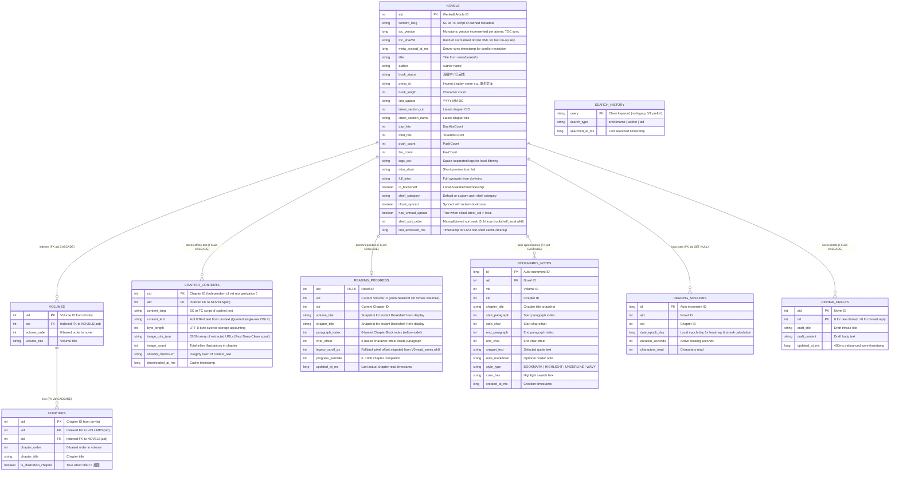

# 09 · Built-In Room SQLite Database, Atomic TOC Versioning & In-Place `v1.x` Migration (Retiring `.wk8`)

> **Core Mandate**: Retire all legacy `.wk8` custom-delimiter text files (`bookshelf_local.wk8`, `read_saves.wk8`, `read_saves_v1.wk8`, `search_history.wk8`, `settings.wk8`) and loose XML files (`intro/*.xml`, `novel/*.xml`). Consolidate all structured records and offline chapter text into a single **official AndroidX Room SQLite database (`wenku8_v2.db` in WAL mode)** + **AndroidX Preferences DataStore**, governed by **atomic `@Upsert` TOC versioning (zero destructive `REPLACE` cascades)**, **automatic in-place internal-storage migration for Play Store upgrades (`org.mewx.wenku8`)**, and a **`.wk8backup.zip` Export/Import Archive**.

---

## 1. Why the Legacy `.wk8` & Loose-XML Format Is Retired

In `studio-android` (`v1.31`), user state and offline content were split across custom plain-text files inside [`GlobalConfig.java`](file:///home/mewx/codes/light-novel-library_Wenku8_Android/studio-android/LightNovelLibrary/app/src/main/java/org/mewx/wenku8/global/GlobalConfig.java), [`SettingsStore.java`](file:///home/mewx/codes/light-novel-library_Wenku8_Android/studio-android/LightNovelLibrary/app/src/main/java/org/mewx/wenku8/global/SettingsStore.java), and [`LightCache.java`](file:///home/mewx/codes/light-novel-library_Wenku8_Android/studio-android/LightNovelLibrary/app/src/main/java/org/mewx/wenku8/util/LightCache.java):

| Legacy `v1.x` File (under `filesDir/`) | Exact `v1.31` Format & Delimiter | Critical Reliability Defects |
| :--- | :--- | :--- |
| `saves/bookshelf_local.wk8` | `aid1\|\|aid2\|\|aid3` | Full-file overwrite on every add/remove/tap-reorder; stores only `aid` ints while metadata lives in separate `saves/intro/{aid}-*.xml` files that can desynchronize. |
| `saves/read_saves_v1.wk8` & `saves/read_saves.wk8` | V1: `aid:vid:cid:lineId:wordId\|\|...`<br>V0: `cid,,pos,,height\|\|...` | Rewritten from scratch on every reader exit; stores screen/font-dependent `lineId`/`wordId` or pixel offsets; two separate live files across Paged vs. Vertical readers. |
| `saves/search_history.wk8` | `[0query][1query]...` (`0`=Title, `1`=Author) | Drops input containing `[` or `]`; full-file rewrite on every search. |
| `saves/settings.wk8` | `key::::value\|\|\|\|key2::::value2` *(4 colons & 4 pipes!)* | Hand-rolled string splitting with zero escaping; unvalidated string-to-enum parsing; no reactive `Flow` observation. |
| `saves/intro/{aid}-intro.xml`, `{aid}-introfull.xml`, `{aid}-volume.xml` & `saves/novel/{cid}.xml` | Raw XML files written via `LightCache.saveFile()` | Truncates destination before writing without atomic temp-file-and-rename, leaving 0-byte or half-written chapters on interrupted downloads; thousands of tiny files slow down backup and orphan scanning. |

---

## 2. Official AndroidX Persistence & Offline Asset Layout

| Storage Component | Location in `org.mewx.wenku8` | Role in `v2.0` (`minSdk = 23`) |
| :--- | :--- | :--- |
| **`wenku8_v2.db` (`Room 2.7+` WAL)** | `context.getDatabasePath("wenku8_v2.db")` | Stores all novels, volumes, chapters, offline `chapter_contents`, `reading_progress`, `bookmarks_notes`, `reading_sessions`, `review_drafts`, and `search_history`. |
| **`settings.preferences_pb`** | `DataStore` (`filesDir/datastore/`) | Stores all migrated `v1.31` settings + `default_home_tab` (`LATEST` default / `BOOKSHELF`) + `auto_optimize_connection` toggle (included in backup). |
| **`network_routing_local.preferences_pb`** | `DataStore` (`filesDir/datastore/`) | Device-local relay candidate leases, 24h probe budgets, and rollout bucket (**excluded** from `.wk8backup.zip` and Auto Backup). |
| **`saves/cert.wk8` & `saves/avatar.jpg`** | `filesDir/saves/` *(migrated to encrypted/private session store while keeping backward-compatible reader)* | Preserves active `LightUserSession` credentials across `v1.31 → v2.0` Play Store updates so users **stay logged in** seamlessly. |
| **`saves/imgs/` & `imgs/` & `custom/`** | `filesDir/saves/imgs/`, `filesDir/imgs/`, `filesDir/custom/` | Persistent offline chapter illustrations (`pictures*.jpg`), bookshelf covers (`{aid}.jpg`), and custom user fonts/wallpapers/backgrounds—read **in place** by Coil 3's `OfflineFirstWenkuImageFetcher` with **zero file duplication** on upgrade and **zero LRU cache eviction**! |

---

## 3. Unified Room SQLite Schema (`wenku8_v2.db`)

> [!IMPORTANT]
> **Foreign-Key Isolation Rule (Preventing Cascade Data Loss During Chapter-List Updates):**
> `CHAPTER_CONTENTS`, `READING_PROGRESS`, and `BOOKMARKS_NOTES` reference **`NOVELS(aid)`** (NOT `ON DELETE CASCADE` on `VOLUMES` or `CHAPTERS`)! When Wenku8 editors reorganize chapters (e.g., moving serialized web chapters into a newly compiled Bunkobon volume with a new `vid`) or when `do=list` is refreshed, updating `VOLUMES` and `CHAPTERS` **never** cascade-deletes downloaded chapter text, reading progress, or user highlights/bookmarks.



---

## 4. Atomic TOC / Chapter-List Synchronization, Versioning & Conflict Rules

### 4.1 Ban `OnConflictStrategy.REPLACE` — Always Use `@Upsert` (`ON CONFLICT DO UPDATE`)
- In SQLite, `INSERT OR REPLACE` executes **`DELETE` followed by `INSERT`**, triggering `ON DELETE CASCADE` on child tables and wiping unmentioned user columns!
- All DAOs for `NOVELS`, `VOLUMES`, `CHAPTERS`, and `CHAPTER_CONTENTS` strictly use Room's **`@Upsert`** (`INSERT ... ON CONFLICT DO UPDATE`) or explicit targeted `UPDATE` statements.

### 4.2 Single-`@Transaction` TOC Diff-Upsert & Stale-Response Rejection

```kotlin
@Transaction
suspend fun syncNovelIndexAtomically(
    aid: Int,
    lang: AppLanguage,
    requestStartedAtMs: Long,
    parsedVolumes: List<VolumeWithChapters>,
    normalizedTocSha256: String
): TocSyncResult {
    val current = novelDao.getSyncHeader(aid)

    // 1. Reject out-of-order stale network responses
    if (current != null && current.metaSyncedAtMs > requestStartedAtMs) {
        return TocSyncResult.SkippedStaleResponse(current.tocVersion)
    }

    // 2. Fast-path no-op if normalized TOC hash & script match
    if (current != null && current.tocSha256 == normalizedTocSha256 && current.contentLang == lang.name) {
        novelDao.touchMetaSyncedAt(aid, requestStartedAtMs)
        return TocSyncResult.Unchanged(current.tocVersion)
    }

    // 3. Upsert all live volumes & chapters in-place (NO DELETE+INSERT!)
    val liveVids = parsedVolumes.map { it.vid }
    val liveCids = parsedVolumes.flatMap { vol -> vol.chapters.map { it.cid } }
    tocDao.upsertVolumes(parsedVolumes.mapIndexed { idx, v -> v.toEntity(aid, idx) })
    tocDao.upsertChapters(parsedVolumes.flatMap { v ->
        v.chapters.mapIndexed { idx, ch -> ch.toEntity(aid, v.vid, idx) }
    })

    // 4. Prune chapters/volumes removed upstream (CHAPTER_CONTENTS stays intact via FK to NOVELS!)
    if (liveCids.isNotEmpty()) tocDao.deleteChaptersNotIn(aid, liveCids)
    if (liveVids.isNotEmpty()) tocDao.deleteVolumesNotIn(aid, liveVids)

    // 5. Auto-heal READING_PROGRESS.vid if saved cid moved into a recompiled volume!
    val progress = progressDao.getForNovel(aid)
    if (progress != null) {
        val newOwnerVid = tocDao.findVidForCid(aid, progress.cid)
        if (newOwnerVid != null && newOwnerVid != progress.vid) {
            progressDao.updateVolumeOwner(aid, newOwnerVid)
        }
    }

    // 6. Bump monotonic toc_version
    val nextVersion = (current?.tocVersion ?: 0L) + 1L
    novelDao.updateTocVersion(aid, nextVersion, normalizedTocSha256, lang.name, requestStartedAtMs)
    return TocSyncResult.Updated(nextVersion)
}
```

### 4.3 `CursorWindow` (`2 MB`) Protection & Instant Deep-Clean Illustration Index
- List, TOC, and cache-badge queries **never** select `CHAPTER_CONTENTS.content_text`; `ReaderViewModel` fetches `content_text` strictly **one `cid` at a time** (with `SUBSTR` chunking fallback for `> 1.5 MB` omnibus chapters).
- Because `CHAPTER_CONTENTS.image_urls_json` pre-indexes every `<!--image-->` URL at save time, **Deep Cache Clean (`深度清理`)** computes the live illustration set via `SELECT image_urls_json FROM chapter_contents` in milliseconds rather than re-parsing thousands of XML files on disk!

---

## 5. Seamless Play Store Upgrade Migration (`LegacyV1InternalStorageMigrator`)

Because `v2.0` updates `org.mewx.wenku8` **in place** from Google Play / GitHub Releases, existing users already hold their saves inside **app-private internal storage** (`context.getFilesDir()`, i.e. `SaveFileMigration.getInternalSavePath()`, with optional legacy fallback `/sdcard/wenku8/` per [`StorageRoots.java`](file:///home/mewx/codes/light-novel-library_Wenku8_Android/studio-android/LightNovelLibrary/app/src/main/java/org/mewx/wenku8/global/StorageRoots.java)).

### 5.1 Automatic Zero-Prompt Internal Storage Migration Pipeline
On first `v2.0` launch (`legacy_v1_internal_migrated_version < 2`), `LegacyV1InternalStorageMigrator` resolves `primaryRoot = context.getFilesDir()` and `backupRoot = legacyExternalIfReadable` (matching `StorageRoots` probe order) and executes:

1. **All 11 `settings.wk8` Keys → `settings.preferences_pb`**:
   - Splits `saves/settings.wk8` on **`||||` (`RECORD_SEPARATOR = "\\|\\|\\|\\|"`)** and **`::::` (`FIELD_SEPARATOR`)**.
   - Migrates `language` (`SC`/`TC`), `eink_mode` (`0`/`1`), `menu_bg_id` (`0`..`5`), `menu_bg_path`, `reader_font_size` (`8..32`), `reader_line_distance` (`0..32`), `reader_paragraph_distance` (`0..48`), `reader_paragraph_edge_distance` (`0..32`), `reader_font_path`, and `reader_background_path`.
   - **Custom Asset Path Re-Anchoring**: If `menu_bg_path`, `reader_font_path`, or `reader_background_path` still points to an old `/sdcard/wenku8/custom/{name}` string from before Android 11 migration, automatically re-anchors it to `File(context.filesDir, "custom/$name")` when present!
2. **Account Session & Notice Continuity (`cert.wk8`, `avatar.jpg`, `notice.wk8`)**:
   - Reads `saves/cert.wk8` + `saves/avatar.jpg` in place so `LightUserSession` keeps the user logged in across the `v1.31 → v2.0` upgrade with **zero forced re-login**, and imports `saves/notice.wk8` as initial `NoticeString` cache.
3. **Bookshelf & Cached Novel Metadata (`bookshelf_local.wk8` + `saves/intro/*.xml`)**:
   - Parses `saves/bookshelf_local.wk8` (`aid1||aid2||...`), preserving exact shelf order (`shelf_sort_order = index`).
   - Scans **all** `saves/intro/{aid}-intro.xml`, `{aid}-introfull.xml`, and `{aid}-volume.xml` files (both bookshelf and recently viewed novels!), parsing them via `Wenku8Parser.parseNovelFullMeta` and `Wenku8Parser.getVolumeList` into `NOVELS`, `VOLUMES`, and `CHAPTERS` inside a Room `@Transaction`. (If a bookshelf `aid` has a damaged/missing intro XML, inserts a stub `NOVELS(aid, in_bookshelf = true)` row queued for immediate cloud metadata hydration so no shelf book is ever dropped!)
4. **Chunked Offline Chapter Import (`saves/novel/{cid}.xml` → `CHAPTER_CONTENTS`)**:
   - Enumerates `saves/novel/*.xml`, maps `cid → aid` via the migrated `CHAPTERS` index, extracts `<!--image-->` URLs into `image_urls_json`, computes SHA-256, and `@Upsert`s in **streaming batches of 25 chapters per WAL transaction** (emitting non-blocking progress if `> 100` chapters exist so even a 3,000-chapter offline library migrates without `OutOfMemoryError` or ANR).
5. **Dual Reader Progress (`read_saves_v1.wk8` & `read_saves.wk8`) & Search History (`search_history.wk8`)**:
   - Imports `saves/read_saves_v1.wk8` (`aid:vid:cid:lineId:wordId||...`) → `(paragraph_index = lineId, char_offset = wordId)`.
   - Imports `saves/read_saves.wk8` (`cid,,pos,,height||...`) for any novel without a V1 save (resolving `cid → (aid, vid)` via `CHAPTERS` and storing `legacy_scroll_px = pos` + estimated `progress_permille = pos * 1000 / max(1, height)`).
   - Imports `saves/search_history.wk8` (`[0query][1query]...`), stripping `'0'` (`articlename`) / `'1'` (`author`) prefixes cleanly.
6. **Zero-Copy In-Place Retention (`STORAGE_MIGRATION_PLAN.md` Rule 1)**:
   - Offline illustrations (`filesDir/saves/imgs/*`, `filesDir/imgs/*`) and custom files (`filesDir/custom/*`) remain **in place** as live `v2.0` asset directories.
   - Original `.wk8`, `saves/intro/`, and `saves/novel/` files are **never deleted in `v2.0`**—left untouched in place for at least one full release cycle (`v2.1+` optional space-reclaim button) and logged (`recordsIn` vs. `recordsOut`) via `CrashReporter`.

### 5.2 Manual External Folder Import (`SAF`) for Cross-Device `/sdcard/wenku8` Restores
- Alongside automatic internal-storage migration, **我的 → 从外部文件夹导入旧版 `v1.x` 存档** retains `ACTION_OPEN_DOCUMENT_TREE` (`DocumentFile`) feeding the exact same parser pipeline for users migrating an old `/sdcard/wenku8` folder onto a new phone.

---

## 6. Portable Export & Import Backup System (`.wk8backup.zip`)

| Backup Mode | File Name | Contents | Typical Size |
| :--- | :--- | :--- | :--- |
| **轻量存档备份 (Default)** | `wenku8-save-YYYYMMDD.wk8backup.zip` | `manifest.json` + `wenku8_v2_light.db` (`VACUUM INTO` snapshot without `chapter_contents`) + `settings.json` + `custom/` *(excludes `network_routing_local` & `cert.wk8`)* | **150 KB – 2 MB** |
| **完整离线全量归档** | `wenku8-full-YYYYMMDD.wk8backup.zip` | `manifest.json` + full `wenku8_v2_full.db` (**including** `chapter_contents`) + `settings.json` + `custom/` + `saves/imgs/` & `imgs/` | **20 MB – 500 MB** |

- **Smart Merge Import (`智能合并`, Default)**: Verifies `PRAGMA integrity_check`, unions `in_bookshelf = 1` novels, keeps `MAX(updated_at_ms)` per `aid` for `reading_progress`, unions `bookmarks_notes` and `chapter_contents`, and merges `saves/imgs/`.
