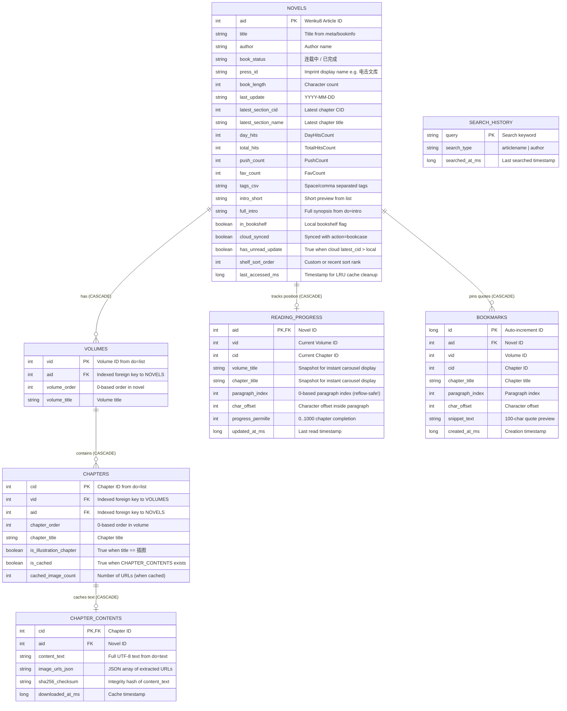
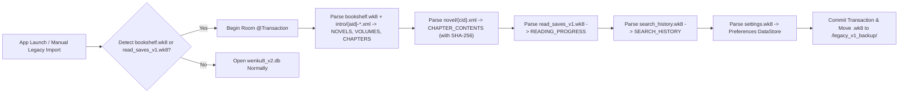

# 09 · Built-In Room SQLite Database & Backup Archive Design (Retiring `.wk8`)

> **Core Mandate**: Completely retire all legacy `.wk8` custom-delimiter text files (`bookshelf.wk8`, `read_saves.wk8`, `read_saves_v1.wk8`, `search_history.wk8`, `settings.wk8`) and loose XML files (`intro/*.xml`, `novel/*.xml`). Replace them with an **official AndroidX Room SQLite database (`wenku8_v2.db`)** + **AndroidX Preferences DataStore**, paired with a first-class **Export / Import Backup Archive system** and automatic one-way migration from `v1.x`.

---

## 1. Why the Legacy `.wk8` Format Must Be Retired

In `studio-android` (`v1.xx`), all user state and offline content were stored in custom ad-hoc plain-text files inside `GlobalConfig.java` and `LightCache.java`:

| Legacy v1.x File | Legacy Format & Separator | Critical Reliability Defects |
| :--- | :--- | :--- |
| `bookshelf.wk8` | `aid1\|\|aid2\|\|aid3` | Full-file overwrite on every add/remove; no transaction isolation; only stores raw `aid` integers while metadata lives in separate `intro/{aid}-intro.xml` & `intro/{aid}-volume.xml` files that can desynchronize. |
| `read_saves_v1.wk8` | `aid\|\|vid\|\|cid\|\|lineId\|\|wordId@@...` | Rewritten from scratch on every reader exit; stores layout-dependent `lineId`/`wordId` that become invalid when font size or screen width changes; corrupts if process dies mid-write. |
| `search_history.wk8` | `[history1][history2]` | Breaks if a user searches for text containing `[` or `]`; full-file rewrite on every search. |
| `settings.wk8` | `key::::value\|\|key2::::value2` | Hand-rolled string splitting (`\|\|` and `::::`); unvalidated string-to-enum parsing; no type safety or reactive observation. |
| `novel/{cid}.xml` & `intro/{aid}-*.xml` | Raw XML/text files written via `LightCache.saveFile()` | As documented in [`STORAGE_MIGRATION_PLAN.md`](file:///home/mewx/codes/light-novel-library_Wenku8_Android/studio-android/LightNovelLibrary/STORAGE_MIGRATION_PLAN.md), `LightCache.saveFile()` writes directly to the target path without atomic temp-file-and-rename, leaving 0-byte or half-written chapters when network or battery drops mid-download. |

---

## 2. Official AndroidX Persistence Stack (Zero Third-Party DB Libraries)

`v2.0` uses **100% official Google AndroidX persistence libraries**:

| Artifact Coordinate | Role in `v2.0` |
| :--- | :--- |
| `androidx.room:room-runtime:2.7.0+` | Official AndroidX ORM and SQLite abstraction layer with compile-time SQL verification |
| `androidx.room:room-ktx:2.7.0+` | Kotlin Coroutines (`suspend`) and reactive `Flow<T>` queries for instant UI updates |
| `androidx.sqlite:sqlite-framework:2.5.0+` | Native Android SQLite driver configured in **WAL (Write-Ahead Logging)** mode (`JournalMode.WRITE_AHEAD_LOGGING`) |
| `androidx.datastore:datastore-preferences:1.1.2+` | Atomic, coroutine-safe key-value storage for global App & Reader preferences (replacing `settings.wk8`) |

---

## 3. Complete Room SQLite Schema (`wenku8_v2.db`)

All structured data—including bookshelf state, novel metadata, volume/chapter indexes, **offline chapter texts**, paragraph-anchored reading progress, bookmarks, and search history—is stored inside a single ACID-compliant Room database (`wenku8_v2.db`).



### Key Stability Improvements Over `.wk8` & Raw XML Files

1. **Storing Offline Chapter Text (`chapter_contents`) Inside SQLite**:
   - A typical light novel chapter is `8 KB – 25 KB` of UTF-8 text. SQLite in WAL mode reads and writes `25 KB` rows **3–5× faster** than opening and closing individual filesystem files (`novel/{cid}.xml`).
   - More importantly, `NovelDownloader` writes downloaded chapters inside a Room transaction (`@Transaction`). If the app is killed or the network drops mid-download, SQLite automatically rolls back the uncommitted transaction—**0-byte or half-written chapters are 100% impossible**.
   - Deleting a novel or clearing non-bookshelf cache is a single `DELETE FROM novels WHERE in_bookshelf = 0` with `ON DELETE CASCADE`, rather than scanning thousands of files on disk.
2. **Paragraph-Anchored Reading Progress (`paragraph_index` + `char_offset`)**:
   - Legacy `read_saves_v1.wk8` stored `lineId` and `wordId` tied to a specific screen resolution and font size.
   - `READING_PROGRESS` stores the **logical paragraph index (`0..N`) and character offset within that paragraph**. Whether the user changes font size from `16sp` to `24sp`, switches between Horizontal and Vertical Bunkobon mode, or unfolds a foldable phone, the reader engine always resolves `(paragraph_index, char_offset)` to the exact page containing that sentence.
3. **Instant Local Bookshelf & Search Filtering (`Flow<List<BookshelfNovelItem>>`)**:
   - Replacing `BookshelfFilter.java` with an indexed Room query (`WHERE in_bookshelf = 1 AND (title LIKE '%' || :q || '%' OR author LIKE '%' || :q || '%' OR latest_section_name LIKE '%' || :q || '%')`) delivers `< 1ms` reactive filtering with zero manual list copying.

---

## 4. Portable Export & Import Backup System (`.wk8backup.zip`)

Because all user state lives cleanly in `wenku8_v2.db` and `datastore/settings.preferences_pb`, exporting and importing backups via Android's **Storage Access Framework (`ActivityResultContracts.CreateDocument` / `OpenDocument`)** requires zero extra storage permissions (`WRITE_EXTERNAL_STORAGE` is completely eliminated).

### 4.1 Two Export Modes

Users can trigger backup export from **我的 (Profile) → 本地数据库与存档备份**:

| Backup Mode | File Extension | Included Contents | Typical Size | Use Case |
| :--- | :--- | :--- | :--- | :--- |
| **轻量存档备份 (Lightweight Save Backup — Default)** | `wenku8-save-YYYYMMDD.wk8backup.zip` | 1. `manifest.json` (schema version, timestamp, device info, SHA-256 hashes)<br>2. `wenku8_v2_light.db` (SQLite snapshot containing `novels`, `volumes`, `chapters`, `reading_progress`, `bookmarks`, `search_history`, without bulky `chapter_contents`)<br>3. `settings.json` (exported DataStore preferences) | **150 KB – 800 KB** | Fast daily backup, switching phones, sharing across devices via cloud drive / Telegram / WebDAV |
| **完整离线全量归档 (Full Offline Archive)** | `wenku8-full-YYYYMMDD.wk8backup.zip` | 1. `manifest.json`<br>2. `wenku8_v2_full.db` (Full SQLite snapshot **including** `chapter_contents` offline text for all cached novels)<br>3. `settings.json`<br>4. `covers/` & `illustrations/` (cached cover and chapter illustration bitmaps) | **20 MB – 500 MB** | Complete offline archival of downloaded light novels and illustrations |

### 4.2 Atomic SQLite Export via `VACUUM INTO`

To guarantee that an exported database is never corrupted by active background writes:
```kotlin
@Dao
interface BackupDao {
    @RawQuery
    suspend fun checkpointWal(query: SupportSQLiteQuery): Int

    @RawQuery
    suspend fun vacuumInto(query: SupportSQLiteQuery): Int
}
```
1. Execute `PRAGMA wal_checkpoint(FULL)` to flush all WAL frames.
2. Execute `VACUUM INTO '/data/.../cache/export_staging.db'`—SQLite natively creates a compact, defragmented, 100% consistent single-file database snapshot without locking the UI.
3. For **Lightweight Save Backup**, run `DELETE FROM chapter_contents` on `export_staging.db` followed by `VACUUM` before zipping.
4. Package `manifest.json`, `export_staging.db`, and `settings.json` into the user-selected SAF `Uri` stream.

### 4.3 Import & Smart Merge Strategies

When importing a `.wk8backup.zip` file via SAF (`OpenDocument`), the app validates `manifest.json` and `PRAGMA integrity_check` on the temporary SQLite file before offering two restore modes in a Material 3 `ModalBottomSheet`:

1. **智能合并 (Smart Merge — Recommended)**:
   - **Bookshelf (`novels`)**: Unions `in_bookshelf = 1` novels from both local and backup databases.
   - **Reading Progress (`reading_progress`)**: For each `aid`, compares `updated_at_ms` and keeps the **most recent** reading position (`MAX(updated_at_ms)`).
   - **Bookmarks (`bookmarks`)**: Unions bookmarks deduplicated by `(aid, cid, paragraph_index, char_offset)`.
   - **Offline Chapters (`chapter_contents`)**: Retains all existing cached chapters and inserts any missing cached chapters from the backup.
2. **全量覆盖恢复 (Full Overwrite)**:
   - Atomically replaces the current database state and DataStore preferences with the backup archive.

---

## 5. Automatic Legacy `.wk8` Migration (`LegacyWk8Migrator`)

To ensure existing `v1.x` users lose **zero data** when upgrading to `v2.0` (and can also manually import an old `v1.x` `.wk8` folder from SD card):



- **Legacy Line/Word Offset Conversion**: During migration of `read_saves_v1.wk8` (`aid||vid||cid||lineId||wordId`), `LegacyWk8Migrator` maps `lineId` directly to `paragraph_index` and `wordId` to `char_offset`, seamlessly upgrading legacy reading saves into reflow-safe `v2.0` reading anchors.
