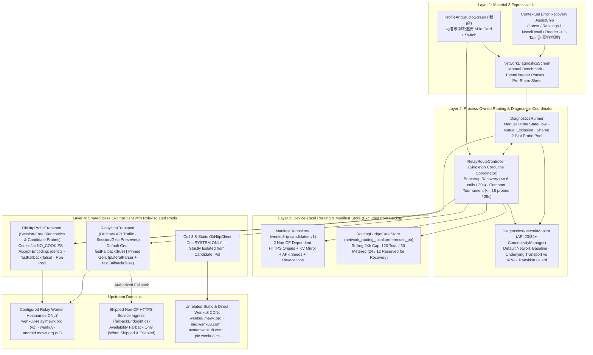

# 11 · Network Diagnostics (`网络检测`) & Automatic Connection Optimization (`自动优化连接`) — `v2.0` M3 Expressive Specification

**Status:** Architectural & UI/UX Specification (`v2.0` Native)  
**Target SDK / Baseline:** `minSdk = 23` · Kotlin Coroutines · OkHttp 5.x (`OkHttpProbeTransport` + `RelayHttpTransport`) · Preferences DataStore · Material 3 Expressive (`M3e`)  
**Companion Relay Spec:** `wenku8-relay/docs/network-connectivity-and-routing-design.md`

> [!NOTE]
> While an initial Java/XML implementation may ship independently in `v1.3x` for API 21+, **Wenku8 Android `v2.0` implements Network Diagnostics and `"自动优化连接"` natively** on `minSdk = 23` with Kotlin Coroutines, a shared process-wide OkHttp base client (`OkHttpProbeTransport` + `RelayHttpTransport`), and **Material 3 Expressive (`M3e`)** components—preserving 100% wire, statistical, tournament, budget, and privacy parity with `network-connectivity-and-routing-design.md`.

---

## 1. Problem Context & Design Principles

Production relay telemetry shows that ~53.9% of mainland China (`CN`) requests enter Cloudflare via European data centers (`AMS`/`LHR`) and ~44.0% via North American West Coast (`SEA`/`SJC`/`LAX`), while Worker execution is placed near Taipei (`Relay hit p50 = 6 ms`, `CN transport RTT p50 = 228–254 ms`). Aggregate server RTT cannot tell whether an alternate Cloudflare anycast ingress IP or IPv6 route improves complete end-to-end latency on a specific user's carrier, region, and time of day.

`v2.0` addresses this with two tightly coupled capabilities:
1. **Zero-Config Automatic Connection Optimization (`自动优化连接`, Default ON)**: Silently screens curated Cloudflare ingress candidates via a **compact 12–15 probe tournament (`<= 18` probes / `25s`)** when foreground relay I/O is idle (or immediately during `6`-call / `20s` blocked-route bootstrap recovery), promoting a candidate **only** when counterbalanced measurements + warm-reuse verification prove it is both reliable and meaningfully faster on the current network.
2. **Transparent User-Initiated Network Diagnostics (`网络检测`)**: Lets any user benchmark reachability and latency to the configured relay in ~20 seconds (`10` sequential probes, `1s` gap, `60s` cap), inspect `EventListener` phase/reuse telemetry without developer tools, and share a privacy-redacted JSON/text report (`wenku8-network-report-v1`).

---

## 2. `v2.0` Native Networking & Routing Architecture (`minSdk = 23`)



### 2.1 Six Core Architectural Invariants (Aligned with `network-connectivity-and-routing-design.md`)

1. **Strict Relay-Hostname Isolation & SNI Preservation**:
   - Candidate-IP overrides apply **exclusively** to explicitly configured relay Worker hostnames (`wenku8-relay.mewx.org` and `wenku8-android.mewx.org`, matched against the manifest's `hostname`). Static blog/notice checks (`wenku8.mewx.org`), independent manifest origins, and direct image CDNs (`img.wenku8.com`, `avatar.wenku8.com`, `pic.wenku8.cn` via Coil 3) **always** use `Dns.SYSTEM`.
   - **Never rewrite URLs to `https://<IP>/` or touch server DNS**: A pure-Kotlin/Java **`IpLiteralParser`** validates public IPv4/IPv6 literals into `byte[4]` / `byte[16]` (rejecting hostnames, CIDRs, ports, private/reserved/scoped ranges) and constructs `InetAddress.getByAddress(relayHostname, rawBytes)` in `0 ms` without calling OS `getaddrinfo`, preserving plaintext TLS SNI (`server_name`), X.509 SAN hostname verification, and HTTP/2 `:authority`!
   - **Proxy Respect**: `EventListener.connectStart(call, inetSocketAddress, proxy)` inspects the actual `java.net.Proxy` on every connection; whenever `proxy.type() != Proxy.Type.DIRECT`, direct candidate selection is marked unavailable rather than bypassing the user's proxy or misattributing proxy latency.
2. **Deterministic `OkHttpProbeTransport` & `Accept-Encoding: identity`**:
   - Derived from the shared base `OkHttpClient` via `newBuilder()` with `CookieJar.NO_COOKIES` (never sending `PHPSESSID` or mutating `LightUserSession`), `cache(null)`, `followRedirects(false)`, `followSslRedirects(false)`, `retryOnConnectionFailure(false)`, and **`fastFallback(false)`** (`connectTimeout = 3s`, `readTimeout = 5s`, `writeTimeout = 5s`, `callTimeout = 10s`).
   - Explicitly sets **`Accept-Encoding: identity`** so OkHttp's `BridgeInterceptor` never transparently injects `gzip` or auto-decompresses responses; requires absent/`identity` `Content-Encoding` on HTTP 200 and enforces a bounded `2 KiB + 1 byte` stream read (`responseBodyBytesRead` = HTTP payload bytes, `bodyComplete`).
   - Manual diagnostic runs allocate a **fresh run-owned `ConnectionPool`** (evicted on completion) so `#01` never reuses a browsing socket while `#02..#10` exercise keep-alive reuse (`connectionReuse = true` strictly when `connectionAcquired` fires without `connectStart`, `false` when a handshake ran, `null` on pre-connection failure).
   - Elapsed durations are captured via `SystemClock.elapsedRealtimeNanos()`, stored as integer nanoseconds, exported as unrounded decimal milliseconds (preserving half-ns even-count medians), and rounded half-up to integer `ms` **only** for UI display.
3. **Default vs. Pinned `RelayHttpTransport` Route Generations**:
   - **Default generation (no override active)**: Uses `Dns.SYSTEM` with **`fastFallback(true)`** (RFC 8305 Happy Eyeballs, 250 ms IPv6/IPv4 stagger) and `retryOnConnectionFailure(false)`.
   - **Pinned candidate generation**: Uses single-address `IpLiteralParser` `Dns`, its **own dedicated `ConnectionPool`**, **`fastFallback(false)`**, and **`retryOnConnectionFailure(false)`**. On route/network change, new calls bind to the new generation's pool while in-flight calls finish on their existing pool before `evictAll()`. Passive `EventListener` hooks on ordinary calls record new-connection setup durations and `connectFailed` signals with zero synthetic traffic.
4. **Shared 2-Slot Probe I/O Cap (Stalled OS DNS Protection)**:
   - Manual and automatic probes share one serialized coordinator and a **process-owned 2-slot bounded probe executor** with no unbounded queue. While `IpLiteralParser` candidate probes never touch OS DNS, a cancelled `Dns.SYSTEM` lookup can remain blocked in native `getaddrinfo`; the 2nd slot lets a subsequent recovery/manual run proceed, and if both slots are still occupied, UI admission cleanly refuses with `"上次检测仍在结束，请稍后重试"`.
5. **Exact `requestHeadersStart` Pre-Send Fallback vs. Audited Read-Only Replay**:
   - **Pre-send failure (`EventListener.requestHeadersStart` has NOT fired)**: Proven zero bytes reached the server → **1 same-call fallback** via an authorized alternate/default route within the original shared call deadline (`10s` POST, `15s` relay download), quarantining the failed candidate for `30 min`.
   - **Ambiguous failure (`requestHeadersStart` HAS fired)**: Replay at most once **only** for explicitly audited `IdempotentRead` operations (`novellist`, `bookinfo`, `do=meta`, `do=list`, `do=text`, `review&do=list`). Unknown actions, `login`, `do=sign`, `bookcase&do=add|del`, and `review&do=post|reply` are **never** replayed!
   - **HTTP `4xx` / `5xx` / `429` / Application Errors**: Preserved as-is (`Retry-After` honored); never trigger IP rotation. HTTP `503 {"error":"diagnostics_disabled"}` on `/__diagnostics/latency` stops the cycle and pauses automatic probes for **1 hour**.
6. **`DiagnosticsEndpointConfig` Validation & Device-Local Persistence**:
   - Because `URI.create("Unknown")` (`api-stub`'s `Wenku8API.BASE_URL`) parses as a relative URI without throwing, `DiagnosticsEndpointConfig` validates absolute `https` scheme + non-empty host `!= "Unknown"` + zero user-info/query/fragment before `baseUri.resolve("/__diagnostics/latency")`, returning an explicit unavailable state on `api-stub` with zero hardcoded production hostnames.
   - Rolling 24h probe budgets (`120` total / `60` metered, reserving `24` / `12` for recovery), monotonic accepted manifest `revision`/`issuedAt` + revocations, and the local random `rolloutPermille` bucket live in `network_routing_local.preferences_pb`—explicitly **excluded** from `.wk8backup.zip` and Android Auto Backup.

---

## 3. Automatic Connection Optimization (`自动优化连接`) Lifecycle & UX

### 3.1 Bootstrap Recovery & Compact Idle Tournament (`<= 18 Probes / 25s`)

- **Manifest Refresh (`wenku8-ip-candidates-v1`)**: Fetched asynchronously via `Dns.SYSTEM` (`5s` per-origin deadline, `ETag`/`304` aware without extending `expiresAt <= 24h`) from **two independent HTTPS configuration origins** (at least primary outside Cloudflare proxying) when `> 15 min` old (`+ 0–60s` jitter) on foreground activity, accepting `<= 16` literal public IPs (`<= 16 KiB`).
- **Blocked-Route Bootstrap Recovery (`RECOVERING` — `<= 6` calls / `20s`, `5 min` backoff)**:
  - Does **not** wait for idle or for 2 user-visible failures: triggers an early seed probe if the first default TLS setup stalls `> 1s`, or enters coalesced `RECOVERING` on the first default-route DNS/connect/TLS failure.
  - Tries up to `4` deduplicated addresses (`2s` connect / `4s` call deadline: fresh cached candidates → unrevoked 7-day discovery hints → APK-bundled seeds; **seeds never authorize account traffic directly**) via `POST /__diagnostics/latency`. If local manifest authorization is stale/absent, fetches `GET /__bootstrap/ip-candidates.json` (`NETWORK_BOOTSTRAP` KV mirror on that working relay IP, `<= 2` reads) and—if enabled and valid—grants a **10-minute provisional recovery lease** (with `2 calls / 8s` reserved for an optional shipped non-Cloudflare HTTPS gateway in `fallbackEndpointIds` when all Cloudflare prefixes fail).
- **Compact Idle Performance Tournament (`<= 18` probes / `25s`, `500 ms` gap)**:
  - Runs **only** in foreground after relay I/O is idle for `5s` (`+ 5–15s` jitter), `>= 30 min` since the last full cycle (or when `>= 3 of the last 5` new-connection setup times exceed **both `2× baseline` and `baseline + 200 ms`**), and paused in background, Battery Saver, or Data Saver. Immediately preempted if any user foreground request starts!
  1. **Screen (`<= 5` probes)**: Screens `Dns.SYSTEM` (`fastFallback(true)`, crediting dual-stack Happy Eyeballs to control) + up to **4** manifest candidates (`fastFallback(false)`), requiring `Proxy.Type.DIRECT`, valid TLS SAN, HTTP 200, and echoed `nonce`.
  2. **Confirm (`6` or `9` probes)**: Fastest reachable challenger vs. control (and incumbent pinned route if different), **3 fresh-pool samples per arm in counterbalanced order** (`C, D, D, C, C, D`). Requires **`3/3` challenger successes**; promotes on reliability if control/incumbent fails `>= 1` probe, or requires challenger 3-sample median full-response time to improve by **both `>= 20%` and `>= 30 ms`** against each healthy arm.
  3. **Warm-Reuse Guard (`1` probe)**: Issues 1 immediate follow-up probe on the challenger's last confirmation pool; requires HTTP 200 + echoed `nonce`, verified socket reuse (`connectionAcquired` without `connectStart`), and latency `<=` its own cold confirmation median (catching broken edge keep-alive/HTTP2 multiplexing in a single probe; typical 2-arm cycle = **12 probes / ~10–14s**).
  4. **Publish**: Atomically promotes the new `RouteGeneration` for up to **6 hours** (never beyond manifest `expiresAt`). Process restarts always begin cleanly on `Dns.SYSTEM` with cached manifest metadata rather than blindly restoring an old IP.

### 3.2 Entry Point 1: `ProfileAndStudioScreen` (`Tab 4 · 我的`)

Placed in `ProfileAndStudioScreen`, replacing `v1.x`'s passive `relay_warning` banner:

```text
🌐 网络与中转连接
+-------------------------------------------------------------------+
| 自动优化连接                                              [ ON  ] |
| 自动优化连接：开启 · 已优化当前网络连接 (cf-v4-02 · 降低 34% · 14:12)|
| 自动选择更快的文库中转线路，不修改系统网络，不自动上传诊断数据    |
| ----------------------------------------------------------------- |
| [ 🩺 网络检测与诊断 › ]                        [ ↺ 恢复默认重测 ] |
+-------------------------------------------------------------------+
```

#### Informational UI Status Copy (Exact Alignment with Relay Spec)

| Controller State | Primary Status Copy | Secondary Detail / Guardrail |
| :--- | :--- | :--- |
| **`DefaultHealthy`** | `自动优化连接：开启 · 使用默认连接` | Default `Dns.SYSTEM` Happy Eyeballs route is healthy; no candidate beat it by `>= 20%` & `>= 30 ms`. |
| **`ComparingIdle`** | `自动优化连接：开启 · 正在比较连接` | Calm static text (no spinning/wavy animation during background idle checks). |
| **`OptimizedLatency`** | `已优化当前网络连接` | Appends `(线路 {id} · 中转延迟降低 {pct}% · {HH:mm} 对比 3 次)` **only** after a completed matched confirmation—never implies all chapter/image reads improve by `{pct}%`. |
| **`RecoveredAvailability`** | `已切换可用中转线路 (临时恢复 · {id})` | 10-min provisional bootstrap recovery lease; **zero** percentage-speedup claim. |
| **`RestoredDefault`** | `已恢复默认连接` | Shown after network/VPN transition, lease/manifest expiry, or 30-min candidate quarantine. |
| **`DisabledByUser`** | `自动优化连接：关闭 · 使用默认连接` | Turning the M3e `Switch` off immediately revokes overrides and retires candidate pools. |
| **`UnavailableStub`** | `此版本未配置中转检测服务` | Shown on `api-stub` (`BASE_URL == "Unknown"`). Controls disabled cleanly; zero JNI/crash paths. |

### 3.3 Entry Point 2: Contextual 1-Tap Error Recovery (`[ 🩺 网络检测 ]`)

Whenever a relay timeout or connection error occurs on **`LatestScreen` (`最新`)**, **`RankingsScreen` (`排行`)**, **`NovelDetailScreen`**, **`BookshelfSync`**, or **`UnifiedReaderScreen`**, the M3e inline error card pairs `[ ↻ 立即重试 ]` with `[ 🩺 网络检测 ]`.

---

## 4. `NetworkDiagnosticsScreen` M3 Expressive Specification

### 4.1 Wireframe & State Hierarchy

```text
+-------------------------------------------------------------------+
| [←]  网络检测                                       [📋] [📤 分享] |
+-------------------------------------------------------------------+
| 📡 当前网络与优化状态 (Filled Card: surfaceContainerLow)           |
| 底层传输    Wi-Fi (未计费)        VPN 状态    未检测到             |
| 测试服务    当前文库中转服务      连接状态    已优化当前网络连接   |
| [ ↺ 恢复默认连接并重新评估 ]                       [ 自动优化 ON ] |
+-------------------------------------------------------------------+
| 🩺 中转连接快速检测 (Filled Card: surfaceContainer)                |
|                                                                   |
| --- [ State 1: Idle / Ready ] ----------------------------------- |
| 测量当前网络到文库中转服务的连通性与响应延迟（10 次请求，间隔 1s） |
| 仅发送固定诊断包，不携带登录 Cookie，不读取账号与书架内容。       |
| +---------------------------------------------------------------+ |
| |                       ▶ 开始快速检测                          | |
| +---------------------------------------------------------------+ |
|                                                                   |
| --- [ State 2: Running (Window FLAG_KEEP_SCREEN_ON Active) ] ---- |
| 正在检测中转连接 · 已完成 4 / 10 次                   已用时 8 秒 |
| ~~~~~~~~~~~~~~~~●----------------------------------------------   | <- Determinate Wavy (Flat in E-Ink!)
| 连接状态: 检测中  ·  成功 / 失败: 4 / 0                           |
| +---------------------------------------------------------------+ |
| |                       ■ 停止检测 (保留已完成结果)             | |
| +---------------------------------------------------------------+ |
|                                                                   |
| --- [ State 3: Completed / Partial / Failed ] ------------------- |
| ✅ 检测完成  ·  Wi-Fi  ·  14:20                                   |
| +-------------------------------+ +-----------------------------+ |
| | 成功 / 尝试次数               | | 完整响应中位数              | |
| | 9 / 10 次 (1 次读取超时)      | | 184 ms                      | |
| +-------------------------------+ +-----------------------------+ |
| +-------------------------------+ +-----------------------------+ |
| | 响应头到达中位数              | | 最快 / 最慢                 | |
| | 142 ms                        | | 156 ms / 490 ms             | |
| +-------------------------------+ +-----------------------------+ |
| ℹ️ 此结果仅测量当前网络到中转服务的连接，不包含书籍服务器处理、   |
|    章节加载及封面/插图直连 CDN (img.wenku8.com / pic.wenku8.cn)。 |
|                                                                   |
| [ 📋 复制摘要 ]          [ 📤 分享报告 ]          [ ↻ 重新检测 ]  |
+-------------------------------------------------------------------+
| ▼ 查看详情 (10 条记录 · 首请求与后续请求独立标注 · EventListener) |
|   #01 [首请求 · 新建连接] 268 ms (响应头 210 ms · DNS 18 / TLS 96)|
|                           HTTP/2 · 本地/观测 IPv6 · 入境节点 LAX  |
|   #02 [后续 · 连接已复用] 179 ms (响应头 138 ms · payload 198 B)  |
|                           HTTP/2 · 本地/观测 IPv6 · 入境节点 LAX  |
|   #06 [失败]              —  · 读取超时 (read_timeout · 5002 ms)  |
+-------------------------------------------------------------------+
| ▶ 高级对比实验 (单轴对比：Happy Eyeballs / IPv4·v6 / H2 / 实际接口)|
+-------------------------------------------------------------------+
```

### 4.2 Strict UX, Statistical & Lifecycle Guardrails

1. **Failure-First Honesty, Exact Reuse Badges & `"—"` Null Formatting**:
   - Failure count (`9 / 10 次`) sits top-left in equal weight to median latency; 0-success runs always render **`"—"`** (never `0 ms`), and no p95 or synthetic "network score" is ever shown for a 10-sample run.
   - `#01` and `#02..#10` are labeled `新建连接` vs. `连接已复用` **strictly** from observed `EventListener` events (`connectStart` vs. `connectionAcquired` without handshake), recording both local socket family and server-reported `clientIpFamily` (for NAT64/CLAT visibility). `ingressColo` is labeled **`入境节点`**, never Worker execution location.
2. **Baseline-First Network & VPN Observation (`API 23+`)**:
   - Establishes an initial default-network baseline (`getActiveNetwork()` + `registerDefaultNetworkCallback` on API 24+ / callback-assisted recheck on API 23) *before* sending Probe `#01` (ignoring the initial baseline callback and routine signal/bandwidth updates). Stops immediately on default-network loss, handle change, or underlying transport/VPN change, preserving partial results without mixing Wi-Fi and mobile samples.
   - Renders visible underlying transport (`Wi-Fi`, `移动网络`, `以太网`, combined multi-transport, or `未知` if VPN-only) separately from VPN state, never guessing carriers from ASN.
3. **Scoped `FLAG_KEEP_SCREEN_ON`, Rotation Survival & Background Cancellation**:
   - `NetworkDiagnosticsViewModel` preserves active runs and completed reports across rotation/foldable posture changes and survives `AppCompatDelegate` SC/TC locale configuration cleanly.
   - Compose `DisposableEffect` sets `FLAG_KEEP_SCREEN_ON` **only** while a manual run is active and visible; `ON_STOP` (`!isChangingConfigurations`) cancels active runs on Home/Back/screen-lock while preserving completed reports across Android's Share Sheet launch.
4. **E-Ink Mode (`isEinkModeEnabled == true`) & 5 Post-MVP Comparison Profiles**:
   - E-Ink mode uses static `LinearProgressIndicator`, `1.dp` `#111111` borders, `SnapSpec(0)`, and text+icon status labels.
   - Collapsible **Advanced Comparison Lab** runs one axis at a time (`<= 60` attempts / `120s`): (1) `Default Happy Eyeballs` (`fastFallback(true)`), (2) `System DNS Sequential` (`fastFallback(false)`), (3) `IPv4 Only`, (4) `IPv6 Only` (missing `AAAA` = `不可用`, never `0 ms`), (5) `HTTP/1.1 vs HTTP/2` (`A×3, B×3, B×3, A×3` counterbalanced bursts), plus an optional capability-gated **Read-Only API Profile** (`api-stub` shows `"此版本不支持实际接口检测"` without loading JNI).

---

## 5. Privacy-First Pre-Share Disclosure Sheet (`wenku8-network-report-v1`)

Tapping **`[ 📤 分享报告 ]`** opens an M3e `ModalBottomSheet` **before** `Intent.createChooser`, previewing disclosed **`country` + `ASN`** (explaining ASN may reflect an ISP or VPN/proxy rather than physical SIM carrier), optional user note, and excluded data (zero raw client/candidate IPs—only `cf-v4-02` IDs—zero SSID/BSSID, cookies, tokens, or bookshelf data). Exports to `cache/diagnostics/` (24h auto-purge) via `FileProvider` (`ACTION_SEND`, `application/json`, `ClipData.newRawUri`, read-only `FLAG_GRANT_READ_URI_PERMISSION`) using `kotlinx.serialization` with `explicitNulls = true` verified by shared JVM + Android null-fixture round-trip tests.
