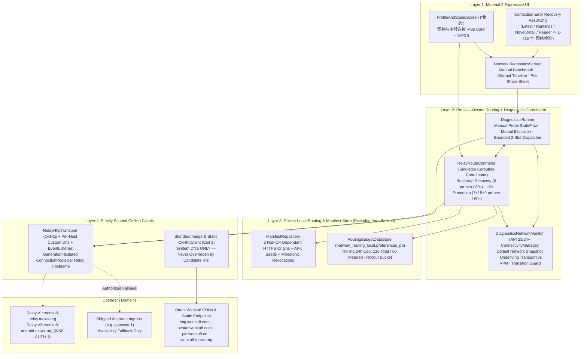

# 11 · Network Diagnostics (`网络检测`) & Automatic Connection Optimization (`自动优化连接`) — `v2.0` M3 Expressive Specification

**Status:** Architectural & UI/UX Specification (`v2.0` Native)  
**Target SDK / Baseline:** `minSdk = 23` · Kotlin Coroutines · OkHttp `EventListener` · Preferences DataStore · Material 3 Expressive (`M3e`)  
**Companion Relay Spec:** `wenku8-relay/docs/network-connectivity-and-routing-design.md`

> [!NOTE]
> While an initial Java/XML diagnostic tool may ship independently in `v1.3x` for API 21+, **Wenku8 Android `v2.0` redesigns Network Diagnostics and `"自动优化连接"` natively from the ground up** for `minSdk = 23`, Kotlin Coroutines, a single unified OkHttp transport (`RelayHttpTransport`), and **Material 3 Expressive (`M3e`)** components—eliminating legacy `HttpURLConnection` dual-stack overhead and API 21–22 `NetworkInfo` workarounds while preserving every statistical, security, and privacy invariant of the relay routing design.

---

## 1. Problem Context & Design Principles

Production relay telemetry shows that ~53.9% of mainland China (`CN`) requests enter Cloudflare via European data centers (`AMS`/`LHR`) and ~44.0% via North American West Coast (`SEA`/`SJC`/`LAX`), while Worker execution is placed near Taipei (`Relay hit p50 = 6 ms`, `CN transport RTT p50 = 228–254 ms`). Aggregate server RTT cannot tell whether an alternate Cloudflare anycast ingress IP or IPv6 route improves complete end-to-end latency on a specific user's carrier, region, and time of day.

`v2.0` addresses this with two tightly coupled capabilities:
1. **Zero-Config Automatic Connection Optimization (`自动优化连接`, Default ON)**: Silently screens curated Cloudflare ingress candidates and fallback endpoints when foreground relay I/O is idle (or immediately during blocked-route bootstrap recovery), promoting a candidate **only** when counterbalanced measurements prove it is both reliable and meaningfully faster on the current network.
2. **Transparent User-Initiated Network Diagnostics (`网络检测`)**: Lets any user benchmark reachability and latency to the configured relay in 15–30 seconds, understand current automatic routing state without developer tools, and share a privacy-redacted JSON/text report (`wenku8-network-report-v1`).

---

## 2. `v2.0` Native Networking & Routing Architecture (`minSdk = 23`)



### 2.1 Five Core Architectural Guarantees in `v2.0`

1. **Unified OkHttp Transport with Native `EventListener` Telemetry**:
   - Because `v2.0` retires `HttpURLConnection` in favor of OkHttp (`minSdk = 23`), both ordinary relay traffic and diagnostic probes share the exact same TLS/HTTP2 stack (`RelayHttpTransport`).
   - Every diagnostic attempt attaches an `OkHttp EventListener` that records exact timestamps for `dnsStart/End`, `connectStart/End`, `secureConnectStart/End`, negotiated `Protocol` (`HTTP/2` vs `HTTP/1.1`), `connectionAcquired` (**proving true socket reuse** rather than guessing "cold/warm"), `responseHeadersEnd`, and `callEnd`/`callFailed`.
   - Diagnostic probes (`POST /__diagnostics/latency`) execute on a **cookie-less, credential-free call profile** (`CookieJar.NO_COOKIES`), guaranteeing `PHPSESSID` and `WK8-AUTH-1` attestation headers are never attached to probe traffic and `LightUserSession` is never mutated.
2. **Strict Hostname Isolation (Protecting Image CDNs & Dual Relay v1/v2)**:
   - Wenku8 fetches API/chapters from `https://wenku8-relay.mewx.org/` (v1) and `https://wenku8-android.mewx.org/` (v2), notices/updates from `https://wenku8.mewx.org/`, covers from `https://img.wenku8.com/`, avatars from `https://avatar.wenku8.com/`, and illustrations from `http://pic.wenku8.cn/`.
   - `RelayHttpTransport`'s custom `Dns` resolver overrides resolution **only** when `hostname` exactly matches an authorized relay hostname; URL host, TLS SNI, certificate hostname verification, and HTTP `:authority` remain untouched.
   - Coil 3's image `OkHttpClient` uses a completely separate default `Dns.SYSTEM` client so candidate-IP experiments never touch `img.wenku8.com` or `pic.wenku8.cn`.
   - Route leases are keyed **per relay hostname** (`Map<RelayHostname, RouteLease>`) so a candidate validated for `wenku8-relay.mewx.org` is independently validated before overriding `wenku8-android.mewx.org`.
3. **Bounded 2-Slot Probe Executor (Immune to Stalled OS DNS)**:
   - Native Android `InetAddress.getAllByName()` cannot be interrupted mid-call. Both `DiagnosticsRunner` and `RelayRouteController` submit probe calls through a process-singleton bounded executor with **at most 2 occupied call slots** and zero unbounded queue.
   - A slot is released only in `finally` after blocking socket/DNS I/O genuinely exits. If a user cancels and restarts while 1 slot is still stuck in DNS, the 2nd slot serves the new run; if both slots are occupied, admission is refused immediately with a clear UI notice (`"上次检测仍在结束，请稍后重试"`).
4. **Controlled Fallback vs. Operation Replay Safety**:
   - `OkHttpClient.Builder.retryOnConnectionFailure(false)` disables opaque library retries in favor of explicit call-site idempotency rules:
     - **Failure proven before any HTTP request bytes were sent** (DNS / TCP connect / TLS handshake failure): 1 automatic fallback attempt via default/alternate route within the shared total call deadline (`10s` POST, `15s` chapter/volume download), immediately quarantining the failed candidate for 30 minutes.
     - **Timeout or stream reset after request bytes may have been sent**: Replay at most once **only** for explicitly tagged `IdempotentRead` operations (`novellist`, `bookinfo`, `do=meta`, `do=list`, `do=text`, `review&do=list`). Mutations (`login`, `do=sign`, `bookcase&do=add|del`, `review&do=post|reply`) are **never** replayed on ambiguous completion.
     - **HTTP `4xx` / `5xx` / `429`**: Never treated as an IP block; `Retry-After` is honored without rotating candidate IPs.
5. **Device-Local Persistence Excluded from `.wk8backup.zip`**:
   - Rolling 24-hour probe budgets (`<= 120` total automatic probes/24h, `<= 60` on metered networks), accepted manifest `revision`/`issuedAt` high-water marks (preventing stale mirrors or APK seeds from undoing revocations), and the installation's random `rolloutPermille` bucket are persisted in `network_routing_local.preferences_pb`—explicitly **excluded** from `.wk8backup.zip` archives and Android Auto Backup (`data_extraction_rules.xml`).

---

## 3. Automatic Connection Optimization (`自动优化连接`) Lifecycle & UX

### 3.1 Background State Machine Summary
- **Startup / New Network**: Ordinary requests start immediately on system DNS (zero startup delay). In parallel, `ManifestRepository` refreshes `wenku8-ip-candidates-v1` (if `> 15 min` old) from two independent non-Cloudflare-dependent origins. If the very first relay TLS handshake stalls `> 1s` or fails, **Bootstrap Availability Recovery** (`<= 6` probes / `20s`, testing cached/seed candidates and optional shipped `gateway-1`) starts immediately without waiting for idle, granting a **10-minute provisional lease** on first verified `POST /__diagnostics/latency` response.
- **Idle Performance Optimization**: Only after foreground relay I/O has been idle for `5s` (+ `5–15s` jitter), not in Battery Saver or Data Saver, and at least `30 min` since the last full cycle:
  1. **Screening (`<= 7` probes)**: 1 probe each for system DNS + up to 6 manifest candidates (mixed IPv4/IPv6).
  2. **Counterbalanced Confirmation (`15` probes)**: Top 1 challenger vs. system DNS (and incumbent if different), 5 fresh-pool samples per arm in counterbalanced order. Requires `5/5` successes and median full-response improvement of **both `>= 20%` and `>= 30 ms`**.
  3. **Connection-Reuse Guard (`9` probes)**: `3`-request burst per arm on isolated pools; requires `3/3` challenger successes and post-setup median within `max(20 ms, 10%)` of control with observed socket reuse.
  4. **Atomic Promotion**: Publishes a new `RouteGeneration` (with its own fresh `ConnectionPool`, retiring idle sockets on the old pool) for up to **6 hours** (capped by manifest `expiresAt`). Any foreground user request immediately preempts idle probing!

### 3.2 Entry Point 1: `ProfileAndStudioScreen` (`03 / 我的` Tab)

Placed directly above *Storage & Database Backup* in `ProfileAndStudioScreen`, replacing the legacy yellow `relay_warning` banner from `v1.x`:

```text
🌐 网络与中转连接
+-------------------------------------------------------------------+
| 自动优化连接                                              [ ON  ] |
| 已优化当前网络连接 · 优选线路 cf-v4-02 (中位数降低 34% · 14:12)   |
| 自动选择更快的文库中转线路，不修改系统网络，不自动上传诊断数据    |
| ----------------------------------------------------------------- |
| [ 🩺 网络检测与诊断 › ]                        [ ↺ 恢复默认重测 ] |
+-------------------------------------------------------------------+
```

#### Seven Truthful UI Status States (Zero "Network Scores" or City Claims)

| Controller State | Primary Subtitle Shown | Secondary Detail / Action |
| :--- | :--- | :--- |
| **`DefaultHealthy`** | `自动优化连接：开启 · 使用默认连接` | Default DNS route is healthy; no candidate beat it by `>= 20%` & `>= 30 ms`. |
| **`ComparingIdle`** | `自动优化连接：开启 · 正在比较连接` | Static text (no spinning/wavy animation during background idle checks). |
| **`OptimizedLatency`** | `已优化当前网络连接 (线路 {candidateId})` | Shows `响应中位数降低 {pct}% ({delta} ms) · {time} 对比 5 次`—never claims all chapter/image loads improve by `{pct}%`. |
| **`RecoveredAvailability`** | `已切换可用中转线路 (线路 {id})` | Activated via 10-min bootstrap recovery after default route failed; **never** claims a percentage speedup. |
| **`RestoredDefault`** | `已恢复默认连接` | Shown after network/VPN switch, lease expiry, or candidate quarantine. |
| **`DisabledByUser`** | `自动优化连接：关闭 · 使用默认连接` | Turning the M3e `Switch` off immediately revokes overrides and retires candidate pools. |
| **`UnavailableStub`** | `此版本未配置中转检测服务` | Shown on public `api-stub` builds (`BASE_URL == "Unknown"`). Switch & Start disabled cleanly; zero JNI/crash paths. |

### 3.3 Entry Point 2: Contextual 1-Tap Error Recovery (`[ 🩺 网络检测 ]`)

Whenever a user encounters a relay timeout or connection error on **`LatestScreen` (`最新`)**, **`RankingsScreen` (`排行`)**, **`NovelDetailScreen`**, **`BookshelfSync`**, or **`UnifiedReaderScreen`**, the M3 Expressive inline error card pairs `[ 重试 ]` with a secondary tonal `AssistChip`:

```text
+-------------------------------------------------------------------+
| ⚠️ 无法连接文库中转服务 (连接超时)                                |
| 若您处于移动数据或晚高峰网络，可尝试检测当前中转连接状态。        |
|                                                                   |
|        [ ↻ 立即重试 ]              [ 🩺 网络检测 ]                |
+-------------------------------------------------------------------+
```

---

## 4. `NetworkDiagnosticsScreen` M3 Expressive Specification

### 4.1 Wireframe & State Hierarchy

```text
+-------------------------------------------------------------------+
| [←]  网络检测                                       [📋] [📤 分享] |
+-------------------------------------------------------------------+
| 📡 当前网络与优化状态 (Filled Card: surfaceContainerLow)           |
| 底层传输    Wi-Fi (未计费)        VPN 状态    未检测到             |
| 测试服务    当前文库中转服务      自动优化    已开启 (cf-v4-02)    |
| [ ↺ 重置为默认连接并重新评估 ]                     [ 开关: ON ]   |
+-------------------------------------------------------------------+
| 🩺 中转连接快速检测 (Filled Card: surfaceContainer)                |
|                                                                   |
| --- [ State 1: Idle / Ready ] ----------------------------------- |
| 测量当前手机到文库中转服务的连通性与响应延迟（10 次请求，约 20 秒）|
| 仅发送固定诊断包，不携带登录凭证，不读取账号与书架内容。          |
| +---------------------------------------------------------------+ |
| |                       ▶ 开始快速检测                          | |
| +---------------------------------------------------------------+ |
|                                                                   |
| --- [ State 2: Running (Window FLAG_KEEP_SCREEN_ON Active) ] ---- |
| 正在检测中转连接 · 已完成 4 / 10 次                   已用时 8 秒 |
| ~~~~~~~~~~~~~~~~●----------------------------------------------   | <- Determinate Wavy (Flat in E-Ink!)
| 成功 4 次  ·  失败 0 次                                           |
| +---------------------------------------------------------------+ |
| |                       ■ 停止检测 (保留已完成结果)             | |
| +---------------------------------------------------------------+ |
|                                                                   |
| --- [ State 3: Completed / Partial / Failed ] ------------------- |
| ✅ 检测完成  ·  Wi-Fi  ·  14:20                                   |
| +-------------------------------+ +-----------------------------+ |
| | 成功 / 尝试次数               | | 完整响应中位数              | |
| | 9 / 10 次 (1 次超时)          | | 184 ms                      | |
| +-------------------------------+ +-----------------------------+ |
| +-------------------------------+ +-----------------------------+ |
| | 响应头到达中位数              | | 最快 / 最慢                 | |
| | 142 ms                        | | 156 ms / 490 ms             | |
| +-------------------------------+ +-----------------------------+ |
| ℹ️ 此结果仅反映当前网络到中转服务的连接延迟，不含源站处理、       |
|    章节加载及封面/插图直连 CDN (img.wenku8.com / pic.wenku8.cn)。 |
|                                                                   |
| [ 📋 复制摘要 ]          [ 📤 分享报告 ]          [ ↻ 重新检测 ]  |
+-------------------------------------------------------------------+
| ▼ 查看每次请求详情 (10 条样本 · 首请求与后续请求独立标注)         |
|   #01 [首请求]      268 ms (响应头 210 ms · 连接握手 152 ms)      |
|                     HTTP/2 · IPv6 · 入境节点 LAX                  |
|   #02 [连接已复用]  179 ms (响应头 138 ms)                        |
|                     HTTP/2 · IPv6 · 入境节点 LAX                  |
|   #06 [失败]        —  · 读取超时 (read_timeout · 已用 5002 ms)   |
+-------------------------------------------------------------------+
| ▶ 高级对比实验 (折叠面板：IPv4 vs IPv6 · HTTP/1.1 vs H2 · 实际接口)|
+-------------------------------------------------------------------+
```

### 4.2 Strict UX, Statistical & Lifecycle Guardrails

1. **Failure-First Honesty & `"—"` Null Formatting**:
   - Failure count (`9 / 10 次`) is always the top-left primary stat card so a low-latency route with 30% packet loss can never masquerade as healthy.
   - When 0 samples succeed, latency cards always display **`"—"`**—never `0 ms`.
   - Attempt `#01` is separated from `#02..#10`; `#02+` displays `[连接已复用]` **only** when `EventListener.connectionAcquired` observed an existing pooled socket.
   - `ingressColo` is labeled **`入境节点`** (Cloudflare edge entry), never Worker execution location.
2. **Underlying Network vs. VPN Separation (`API 23+`)**:
   - Using `ConnectivityManager.getActiveNetwork()` + `getNetworkCapabilities()`, underlying transport (`Wi-Fi`, `移动网络`, `以太网`, `Wi-Fi + 移动网络`, or `未知` if masked by VPN) is displayed separately from `VPN: 已检测到 / 未检测到`. Carrier names are never guessed from ASN, and `READ_PHONE_STATE` / location permissions are never requested.
   - If the active default network or VPN attachment changes mid-run, the run stops immediately, marks the in-flight attempt `network_changed`, preserves completed samples (`部分完成 · 因网络切换中止`), and prompts `[ 在当前网络重新检测 ]`—never mixing Wi-Fi and cellular samples.
3. **Screen-On Flag, Rotation Persistence & Background Stop**:
   - `NetworkDiagnosticsViewModel` retains active run and completed `DiagnosticsReport` across screen rotation and foldable unfold/fold transitions.
   - While a **manual** run is active and visible, a Compose `DisposableEffect` applies `WindowManager.LayoutParams.FLAG_KEEP_SCREEN_ON` so 15s screen timeouts do not abort the benchmark, clearing it immediately on completion, stop, error, or screen exit.
   - Observing `Lifecycle.Event.ON_STOP` when `!activity.isChangingConfigurations` cancels an active run if the user backgrounds the app, presses Back, or locks the screen (while allowing Android's Share Sheet chooser after completion without wiping the report).
4. **First-Class E-Ink Mode (`isEinkModeEnabled == true`)**:
   - Swaps `LinearWavyProgressIndicator` to a static flat `LinearProgressIndicator`, replaces spring accordions with `SnapSpec(0)` instant toggles, adds `1.dp` `#111111` crisp card outlines, and ensures every status is conveyed via text + icon without relying on color.
5. **Collapsible Advanced Comparison Lab**:
   - Runs **one axis at a time** (capped at `<= 60` attempts / `120s`):
     - `IPv4 vs IPv6` (interleaved sequential fresh-pool samples; missing eligible address recorded as `不可用`, never `0 ms`).
     - `HTTP/1.1 vs HTTP/2` (counterbalanced `A×3, B×3, B×3, A×3` bursts on isolated pools).
     - `实际只读接口抽样` (small public read-only Wenku8 API call gated behind an explicit capability interface; `api-stub` cleanly displays `"此版本不支持实际接口检测"`).

---

## 5. Privacy-First Pre-Share Disclosure Sheet (`wenku8-network-report-v1`)

Tapping **`[ 📤 分享报告 ]`** opens an M3 Expressive `ModalBottomSheet` **before** launching Android's system share chooser:

```text
+-------------------------------------------------------------------+
|                        ─── (Drag Handle)                          |
| 分享网络诊断报告 (wenku8-network-report-v1)                       |
|                                                                   |
| 📋 报告将包含以下网络诊断摘要：                                   |
| • 应用版本、Android API 等级与测试时间戳                          |
| • 网络类型 (Wi-Fi / 移动网络)、是否计费及 VPN 状态                |
| • Cloudflare 识别国家/地区：CN  ·  自治系统：AS4134               |
|   (注：ASN 可能对应宽带运营商或代理/VPN 服务商，未必代表手机卡归属)|
| • 10 次探测耗时、HTTP 协议、IPv4/v6 族及优选线路代号 (如 cf-v4-02)|
|                                                                   |
| 🔒 严格排除以下隐私信息：                                         |
| 绝不包含您的真实公网/局域网 IP、Wi-Fi 名称 (SSID)、设备序列号、   |
| 登录 Cookie/Token、书架列表或任何阅读记录。                       |
|                                                                   |
| +---------------------------------------------------------------+ |
| | 备注（选填，如“上海电信千兆 晚高峰”，将随报告一并分享）       | |
| +---------------------------------------------------------------+ |
|                                                                   |
| [ 仅复制纯文本摘要 ]                  [ 确认导出并分享 JSON 报告 ] |
+-------------------------------------------------------------------+
```

- **Safe `FileProvider` Export**: Writes `wenku8-network-report-<timestamp>.json` into app-private `cache/diagnostics/` (purging files older than 24h on next diagnostics open) and shares via `ACTION_SEND` (`application/json`) + `ClipData.newRawUri` + `FLAG_GRANT_READ_URI_PERMISSION` (read-only).
- **Strict Null-Safe JSON Serialization**: Uses Kotlin `kotlinx.serialization` (or explicit `JSONObject.NULL` guards) with shared JVM + Android instrumentation round-trip fixtures so missing optional fields (`ingressColo`, `country`, `asn`, `transportRttMs`) serialize as JSON `null`—never `"null"` strings or `0`.
