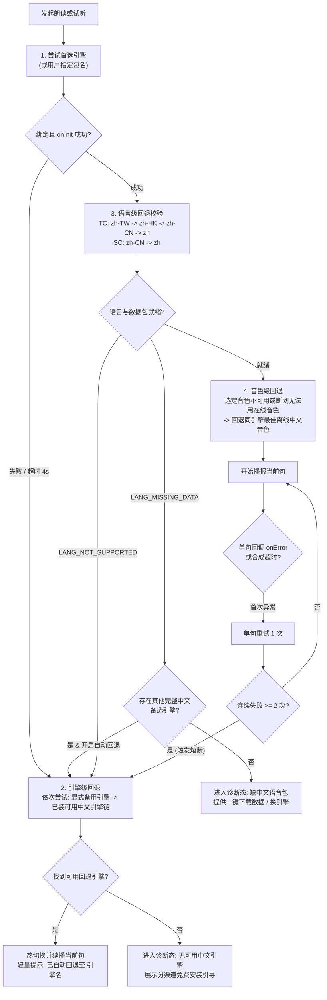
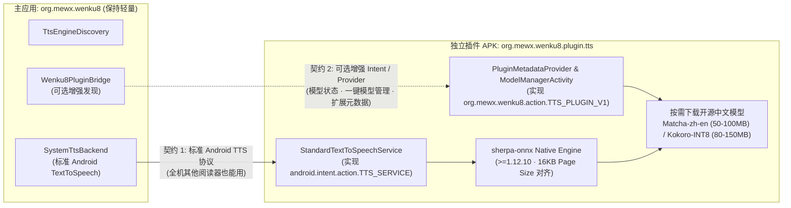

# Enhanced TTS (`语音朗读`) Architecture & UX Design Specification (`v2.0`)

**Status:** Approved Design Specification (`v2.0`)  
**Tracking Issue:** [#201 — v2.0 加入更多TTS自定义的功能](https://github.com/MewX/light-novel-library_Wenku8_Android/issues/201)  
**Target SDK / Baseline:** `minSdk = 24` · `targetSdk = 37` · Kotlin Coroutines · Preferences DataStore · Material 3 Expressive (`M3e`)  
**Supporting Research:** [`ecosystem-research.md`](./ecosystem-research.md)

> [!NOTE]
> **目标**：先以轻量快速迭代（Phase 1）彻底解决国产机型上 TTS「普遍不可用（含安装 Google `Speech Recognition & Synthesis` 后仍报错）」的线上痛点，达到全机型稳定可用；并建立一套**只接入免费/开源方案、高扩展性、零包体膨胀**的多阶段演进架构。

---

## 1. 现状根因诊断（为什么国产机普遍不可用）

排查当前 `LightNovelLibrary/app-v2` 实现后，国产机型反复出现 `"系统语音朗读引擎不可用，请检查系统 TTS 设置"` 主要由以下 5 个问题叠加导致：

1. **【P0】缺失 Android 11+ `<queries>` 软件包可见性声明**
   * `LightNovelLibrary/build.gradle` 中 `targetSdkVersion = 37`，但 `LightNovelLibrary/app-v2/src/main/AndroidManifest.xml` 中完全没有声明 `android.intent.action.TTS_SERVICE` 的 `<queries>`。
   * 在 Android 11+（API 30+）下，`TextToSpeech` 内部通过 `PackageManager.queryIntentServices()` 查询并绑定外部 TTS 服务会被 Package Visibility 机制直接拦截。即便用户安装了 Google `Speech Recognition & Synthesis`、国产系统引擎，或 `SherpaTTS` / `MultiTTS` / `tts-server-android`，都会直接触发 `onInit(TextToSpeech.ERROR)`。
2. **【P0】`TextToSpeech` 构造器闭包竞态 (`createdTts == null`)**
   * `ReaderSearchAndTts.kt` 中存在 `var createdTts: TextToSpeech? = null; createdTts = TextToSpeech(...) { val engine = createdTts ... }` 闭包写法；在同步回调路径或多线程可见性延迟下，`createdTts` 可能仍为 `null`，导致初始化被误判失败。
3. **【P0】仅绑系统全局默认引擎，无引擎枚举与自动回退**
   * 当前只调用双参构造 `TextToSpeech(appContext, listener)`，强依赖系统全局默认引擎（`Settings.Secure.TTS_DEFAULT_SYNTH`）。国产 ROM 出厂常缺失或精简默认引擎（或默认为无中文的 `com.svox.pico`）；且**安装 Google TTS 后系统不会自动切换默认引擎**，导致明明装了可用引擎仍无法朗读。
4. **【P1】未严格校验语言数据包状态**
   * `setLanguage()` 返回 `LANG_MISSING_DATA` / `LANG_NOT_SUPPORTED` 后仅兜底试了一次 `Locale.CHINESE` 且忽略返回值便直接上报初始化成功。导致大陆网络环境下 Google 中文语音包未下载成功，或繁中（`zh-TW`）在仅内置简中数据的国产引擎上出现「初始化成功但静默无声 / 朗读中断」。
5. **【P1】缺少独立设置、音频焦点与可观测诊断**
   * 缺少独立 TTS 设置页、引擎与音色选择、实时试听预览、`AudioFocus`（来电/其他媒体打断处理）、定时关闭以及系统设置安全跳转。

---

## 2. 核心设计原则与产品边界

1. **严格坚持「免费 / 开源引擎」原则**
   * **不内置**任何需要开发者兜底付费的商业云 TTS SDK 或按设备激活计费的商业离线 SDK。
   * **不内置**逆向非官方微软 Edge TTS 接口（规避 `Sec-MS-GEC` 动态防刷签名频繁 `403` 失效及 Google Play Store 政策下架红线）。
   * 未来 Phase 2 扩展的在线/局域网音源同样只面向**零成本免费路径**（自建开源语音服务、官方永久免费额度层 BYOK、社区开源声明式 HTTP 模板）。
2. **不劫持系统全局默认设置**
   * App 内通过三参构造 `TextToSpeech(context, listener, enginePackage)` 独立指定首选引擎与音色，无需强迫用户去系统设置修改全机默认 TTS。
3. **主包轻量化 & 双渠道严格合规**
   * 主应用 `org.mewx.wenku8` 不直接内置数十 MB 的端侧神经网络推理库（`.so`）与模型权重；离线 AI 语音通过**兼容开源系统 TTS 引擎**以及**未来独立的官方伴侣插件 APK** 实现。
   * `playstore` 渠道严格遵守 Google Play 政策，绝不提供侧载 APK 链接；所有引导均指向 Google Play 官方商店页面或系统原生 Intent。
4. **轻量止血优先，接口提前对齐**
   * **Phase 1 保持轻量快速发版止血**（不引入 Media3 前台后台服务，快速解决国产机不可用并上线独立 TTS 设置/预览/回退/分渠道引导）；
   * 同时提前统一后端抽象接口与 DataStore Schema，为 Phase 2（后台播控 + 免费在线/自建语音）和 Phase 3（轻小说双音色 + 官方离线插件）铺路。

---

## 3. 全新「语音朗读 (TTS)」独立设置大类与交互设计

遵循 `app-v2` 现有的 Material 3 Expressive（`M3e`）分组钻取设计体系，新增独立的 TTS 设置大类。

### 3.1 双入口信息架构
* **入口一（主设置页）**：挂载于 `Tab 4 · 我的` → **`偏好与阅读`** 分组第 3 项（`ProfileSettingsSection.TTS_SETTINGS`），与现有的 `外观、语言与启动页`、`阅读器默认排版与交互` 并列：
  * **标题**：`语音朗读 (TTS) 与引擎`
  * **动态副标题**：
    * 正常态：`Google 语音 · 中文(简体) · 1.0x`
    * 降级态：`已自动回退至 讯飞语音 · 1.0x`
    * 异常态（Warning/Error 语义色高亮）：`未检测到可用中文引擎 · 点击配置`
* **入口二（阅读器内一键直达）**：
  * `ReaderTtsFloatingBar` 新增设置按钮，支持快速调出参数或一键跳转至完整 TTS 设置页；
  * 当朗读异常或无可用引擎时，悬浮条直接提供 **「修复 / 切换引擎」** 主操作按钮。

### 3.2 TTS 设置子页 (`TtsSettingsSubscreen`) 布局规范

与 `ReaderTypographySettingsBody`（顶部实时排版预览盒 + 下方 M3e 分段设置组）保持一致的视觉层级：

1. **顶部卡片：引擎状态与实时试听预览 (`TtsStatusAndPreviewCard`)**
   * **状态头**：展示当前生效引擎名 + 类型徽章（`系统自带` / `官方免费` / `开源离线` / `开源扩展` / `官方插件`）+ 当前音色 + 健康指示点。若当前处于回退态，明确展示「首选引擎暂不可用，已由备用引擎接管」。
   * **实时试听预览（Voice Preview）**：
     * 内置轻小说风格试听范文（随应用 `SC` / `TC` 语言自动切换，涵盖旁白、引号对白与标点停顿）：
       * 简中：`清晨的微风掠过窗台，少年合上手中的轻小说，轻轻叹了口气：“今天的冒险，也终于要开始了吗？”`
       * 繁中：`清晨的微風掠過窗台，少年合上手中的輕小說，輕輕嘆了口氣：「今天的冒險，也終於要開始了嗎？」`
     * **支持自定义试听文本**（可展开编辑并支持「恢复默认范文」），方便用户实测多音字、外来语人名和中英混读效果。
     * **「试听 / 停止」主按钮**：拖动语速、音调或切换音色后可即时试听；若正在试听中调整参数，自动平滑重播以便直观对比。
2. **条件置顶卡片：分渠道免费方案引导 (`TtsChannelOnboardingCard`)**
   * 当检测不到任何可用中文引擎时自动置顶展开；引擎正常可用时收起为底部「获取更多免费语音引擎」折叠/入口行。
3. **分组一：引擎、音色与回退策略 (`TtsEngineAndVoiceSection`)**
   * **首选引擎**：列出所有已发现的 Android TTS 引擎，标注友好名称、类别徽章、中文支持检测状态，点击即切并即时校验。
   * **音色选择 (`Voice Picker`)**：
     * 按当前语言（`zh-CN` / `zh-TW` / `zh-HK`）过滤并置顶，提供「仅显示离线音色」筛选 Chip；
     * 将晦涩的系统 `Voice.name`（如 `cmn-cn-x-ccc-local`）格式化为人类可读展示名（地区 + 离线/在线标签 + 编号/质量等级）；
     * **每条音色行右侧提供独立「试听」图标按钮**，选音色一步到位。
   * **失效自动回退（Fallback）**：
     * 开关：`音源失效时自动回退`（**默认开启**）；
     * `首选备用引擎`：默认 `自动按优先级轮询`，也支持手动指定具体备用引擎。
4. **分组二：播控参数与默认偏好 (`TtsPlaybackPrefsSection`)**
   * **默认语速**：滑块 `0.5x – 2.5x` + 快捷档位 Chip（`0.75x / 1.0x / 1.25x / 1.5x / 2.0x`），针对国产厂商引擎对极端语速的兼容问题做安全钳制。
   * **音调调节**：滑块 `0.5x – 2.0x` + 一键重置 `1.0x`。
   * **默认定时关闭**：`关闭 / 15 分钟 / 30 分钟 / 60 分钟 / 读完本章停止`。
   * **音频焦点管理**：来电、语音消息或其他媒体播放时自动暂停。
5. **分组三：系统工具与排错指引 (`TtsSystemToolsSection`)**
   * **下载 / 检查当前引擎语音包**：针对选定引擎触发 `TextToSpeech.Engine.ACTION_INSTALL_TTS_DATA`。
   * **打开系统文字转语音设置**：采用四级安全 Intent 降级跳转。
   * **国产机防断播提示**：按 `Build.MANUFACTURER` 为小米 / 华为 / 荣耀 / OPPO / vivo 提供简明电池策略设置指引。

---

## 4. TTS 音源失效回退（Fallback）与熔断状态机

为保证任何单点引擎或音色故障都不会导致用户「彻底没声音或反复报错卡死」，设计四级确定性回退状态机：



### 回退关键约束
* **自动轮询优先级**（未手动指定备用引擎时）：
  1. 用户显式指定的备用引擎（若有）；
  2. 系统当前默认引擎（若尚未尝试）；
  3. 已安装的官方插件 / 高质量开源与官方免费引擎（`org.mewx.wenku8.plugin.tts`、`com.google.android.tts`、VoxSherpa、`org.woheller69.ttsengine`、`com.github.jing332.tts_server_android`、`org.nobody.multitts`）；
  4. 国产 OEM 系统自带引擎（小米、华为、荣耀、三星、OPPO、vivo、讯飞等）；
  5. 其他声明 `TTS_SERVICE` 的非 `com.svox.pico` 引擎。
* **防循环与熔断冷却**：单次会话内维护已失败 `enginePackage` 集合，避免引擎间死循环横跳；单引擎连续失败 2 句即触发熔断热切，并从**当前句（`activeUtteranceIndex`）无缝续播**，不丢进度。
* **离线感知音色回退**：无网络时若用户选中了 `isNetworkConnectionRequired == true` 的音色，立即回退至同引擎最高质量本地离线中文音色。
* **非打断式透明通知**：发生自动回退时通过轻量 Snackbar / 状态条提示用户已切换至哪个引擎，并提供一键查看/修改入口。

---

## 5. 无 TTS 服务时的分渠道官方 / 免费引导策略

依托 `BuildConfig.DISTRIBUTION_CHANNEL`（`playstore` vs `default`），按渠道提供**全部免费且贴合当地网络环境的可用出路**：

### 5.1 精准诊断态分类
| 诊断状态 | 典型原因 | 首选一键修复动作 |
| :--- | :--- | :--- |
| `NO_ENGINE_INSTALLED` | 设备无 TTS 引擎或仅有不支持中文的 Pico TTS | 展示分渠道免费安装引导 |
| `MISSING_CHINESE_DATA` | 引擎已装（如刚装 Google TTS），但缺少中文离线数据包 | 触发 `ACTION_INSTALL_TTS_DATA` 或切其他可用引擎 |
| `ENGINE_BIND_FAILED` | 引擎被系统冻结、省电拦截或刚被卸载 | 一键重试 / 四级安全跳转系统 TTS 设置 / 切备用引擎 |
| `PLAYBACK_INTERRUPTED` | 朗读中途全部候选引擎异常中断 | 点击续播 / 打开 TTS 设置诊断 |

### 5.2 `playstore` 渠道（100% 遵守 Google Play 政策）
* **主推官方免费引擎**：**Speech Recognition & Synthesis (`com.google.android.tts`)**
  * 一键跳转 `market://details?id=com.google.android.tts`（若无 Play 客户端则降级 HTTPS 链接 `https://play.google.com/store/apps/details?id=com.google.android.tts`）；
  * 安装完成后回到 App 自动重新扫描并直接绑定 `com.google.android.tts`（无需用户改系统全局默认）；若缺中文包，直接提供一键「下载中文语音包（`ACTION_INSTALL_TTS_DATA`）」。
* **Play 商店开源离线备选**：
  * 提示可选 Play 商店已上架的免费开源离线引擎（如 **VoxSherpa**，以及未来独立上架的 **Wenku8 官方离线语音插件**）。
* **系统设置四级安全跳转**（解决国产 ROM 调用 `TTS_SETTINGS` 崩溃问题）：
  1. `com.android.settings.TTS_SETTINGS`
  2. `android.settings.ACCESSIBILITY_SETTINGS`
  3. `android.settings.LOCALE_SETTINGS`
  4. `android.settings.SETTINGS` + 提示用户在设置顶部搜索「文字转语音 / TTS」。

### 5.3 `default` 渠道（国内直装 / GitHub / 无 GMS 友好）
不强绑定国内难以拉取语音包的 Google TTS，而是按可用性分层引导至**免费 / 开源方案**：
1. **本机自带免费引擎优先**：若探测到小米 / 华为 / 荣耀 / OPPO / vivo / 三星 / 讯飞引擎但未就绪，按设备品牌给出精确启用路径与四级安全跳转。
2. **开源纯离线 AI 免费引擎（主推，零流量、免 GMS）**：
   * **SherpaTTS**（`org.woheller69.ttsengine`，开源免费，F-Droid / GitHub Releases）
   * **VoxSherpa**（开源免费，GitHub Releases，支持 Kokoro / Piper 离线中文）
   * （Phase 3 就绪后置顶）**Wenku8 官方离线语音插件**（GitHub Releases）
3. **社区热门开源免费扩展引擎**：
   * **tts-server-android**（`com.github.jing332.tts_server_android`，GitHub 开源）
   * **MultiTTS**（`org.nobody.multitts`，支持离线语音包）
4. **折叠区（已有 GMS 环境用户）**：补充 Google Speech Recognition & Synthesis 的配置提示，并注明需确保网络可拉取中文语音包。

---

## 6. 开源/热门项目支持与独立官方插件前瞻架构

### 6.1 热门开源与系统引擎「一等公民」识别 (`KnownTtsEngineCatalog`)
在主 App 内置轻量的静态识别目录（零三方依赖），用于提供人性化名称、分类徽章、兼容参数保护及排错提示：

| 引擎包名 | 展示名称 | 徽章 | 兼容 / 增强策略 |
| :--- | :--- | :--- | :--- |
| `org.mewx.wenku8.plugin.tts` | Wenku8 离线 AI 语音插件 | `官方插件` | 优先识别增强契约、直达插件模型管理 |
| `com.google.android.tts` | Google 语音识别与合成 | `官方免费` | 一键 `ACTION_INSTALL_TTS_DATA`、中文音色友好命名 |
| `org.woheller69.ttsengine` | SherpaTTS（离线神经网络） | `开源离线` | 标注纯离线高隐私，提示在插件内下载中文模型 |
| `com.github.jing332.tts_server_android` | TTS Server | `开源扩展` | 提示关闭电池优化防杀后台，适当放宽首句等待超时 |
| `org.nobody.multitts` | MultiTTS | `离线多音色` | 提示关闭电池优化，原生音色直通 |
| `com.xiaomi.mibrain.speech` / `com.miui.voiceassist` | 小米小爱语音引擎 | `系统自带` | 语速安全区间保护，提示语音唤醒冲突排查 |
| `com.huawei.*` / `com.honor.*` | 华为 / 荣耀语音引擎 | `系统自带` | 繁中优先回退 `zh-CN`，四级安全设置跳转 |
| `com.iflytek.speechsuite` | 讯飞语音引擎 | `第三方引擎` | 繁中降级 `zh-CN` |
| `com.samsung.SMT` | 三星文字转语音 | `系统自带` | 正常识别标注 |
| `com.svox.pico` | Pico TTS（不支持中文） | `不支持中文` | 自动排在自动回退链末尾并灰显提示 |

### 6.2 未来独立官方离线 AI 插件 APK (`org.mewx.wenku8.plugin.tts`) 双契约设计

为在不膨胀主 APK 体积（避免增加 15–50 MB 原生 `.so`）、且完全遵守 Play Store 二进制合规规则的前提下，提供开箱即用的高质量离线 AI 中文朗读，设计独立伴侣插件架构：



* **契约 1（标准 Android `TextToSpeechService`）**：插件装好即作为系统标准 TTS 服务运行，全生态通用，零强耦合。
* **契约 2（开放增强发现协议 `org.mewx.wenku8.action.TTS_PLUGIN_V1`）**：
  * 主 App 在 `<queries>` 中声明该 Action；检测到插件后可在 Wenku8 的 TTS 设置页中直接显示模型安装状态、音色风格元数据，并提供一键拉起插件 `ModelManagerActivity` 管理 `.onnx` 模型；
  * 协议保持开放文档化，社区开源插件亦可实现同一契约获得原生级整合体验。
* **底层与分发策略**：
  * 推理框架：`k2-fsa/sherpa-onnx`（`>= 1.12.10`，原生支持 Android 15+ **16 KB Page Size** 对齐）；
  * 开源中文模型：`matcha-icefall-zh-en`（轻量、低端机 CPU 流畅，RTF < 0.2）与 `kokoro-int8-multi-lang-v1_1`（INT8 量化、多音色、高自然度）；
  * 分发路径：`default` 渠道走 GitHub Releases 独立插件 APK；`playstore` 渠道未来可独立上架免费伴侣应用（结合 **Play Asset Delivery** 按需下发模型）或采用 **Play Feature Delivery**。

---

## 7. 面向 Phase 2 的统一抽象与配置 Schema（提前规划，Phase 1 不实现）

### 7.1 Manifest 声明（Phase 1 必加）
在 `LightNovelLibrary/app-v2/src/main/AndroidManifest.xml` 增加：
```xml
<queries>
    <!-- 必须：Android 11+ (targetSdk >= 30) 发现与绑定系统及开源第三方 TTS 引擎 -->
    <intent>
        <action android:name="android.intent.action.TTS_SERVICE" />
    </intent>
    <!-- 校验与触发引擎语言包下载 -->
    <intent>
        <action android:name="android.speech.tts.engine.CHECK_TTS_DATA" />
    </intent>
    <intent>
        <action android:name="android.speech.tts.engine.INSTALL_TTS_DATA" />
    </intent>
    <!-- 预留：发现未来 Wenku8 官方或社区兼容增强 TTS 插件 -->
    <intent>
        <action android:name="org.mewx.wenku8.action.TTS_PLUGIN_V1" />
    </intent>
</queries>
```

### 7.2 统一多后端抽象
* `TtsBackendType` 枚举预留：`SYSTEM`（Phase 1）、`FREE_REMOTE_OR_SELF_HOSTED`（Phase 2）、`PLUGIN_STREAM`（Phase 3）。
* `SystemTtsBackend` 直连 Android `TextToSpeech`；未来 Phase 2/3 的音频流型后端统一实现 `AudioSynthesizerBackend` → 复用 **Look-ahead 预合成队列（提前合成后 2 句）+ Disk LRU Cache + Media3 `ExoPlayer`**（消除句间网络停顿、回退零重复合成、自带无变调变速）。

### 7.3 Phase 2 规划的免费远程 / 自建语音接入与后台播控（暂不实现）
* **仅限免费/开源远程路径**：
  1. **自建开源 OpenAI 兼容端点（`POST /v1/audio/speech`）**：一键兼容用户本地 PC / NAS / 自建容器部署的 **Kokoro-FastAPI**、**GPT-SoVITS**、**CosyVoice**、**IndexTTS**、**F5-TTS**、**Piper HTTP**；
  2. **官方永久免费层 BYOK**：例如 **Microsoft Azure Speech F0**（每月 50 万 Neural 字符永久免费，密钥使用 Android Keystore 加密存储、不随诊断/备份明文导出）；
  3. **Legado 兼容声明式 HTTP 模板（安全子集）**：支持 `GET/POST`、Headers、`{{speakText}}` / `{{speakSpeed}}` / `{{voice}}` 模板替换与 JSON 导入导出，**不引入任意 JS `eval` 执行**。
* **Media3 `MediaSessionService` 前台后台播控**：锁屏控制、通知栏媒体卡片、蓝牙耳机/车机线控、句级高亮与防抢屏跟滚（「回到朗读位置」）、轻小说装饰符清洗与多音字/人名发音替换词典。

### 7.4 `Wenku8UserPreferences` DataStore Schema 规划
在 `UserPreferencesRepository.kt` 中预留向后兼容的持久化配置字段（均带安全默认值，不破坏现有迁移与 `.wk8backup.zip` 存档兼容性）：
```kotlin
val ttsBackendType: TtsBackendType = TtsBackendType.SYSTEM,
val ttsPreferredEnginePackage: String = "",        // "" = 自动选择最佳可用中文引擎
val ttsFallbackEnginePackage: String = "",         // "" = 自动按优先级轮询
val ttsAutoFallbackEnabled: Boolean = true,
val ttsPreferredVoiceName: String = "",            // "" = 按当前 SC/TC 语言自动选最佳离线音色
val ttsSpeechRate: Float = 1.0f,                   // 0.5f..2.5f
val ttsPitch: Float = 1.0f,                        // 0.5f..2.0f
val ttsDefaultSleepTimerMinutes: Int = 0,          // 0=关闭, -1=读完本章, >0=分钟数
val ttsFollowReadingPage: Boolean = true,
val ttsPauseOnAudioFocusLoss: Boolean = true,
```

---

## 8. 分阶段落地路线图与验收 Checklist

### Phase 1：轻量快速止血 + 独立 TTS 设置大类（已完成）
- [x] **P0 根因修复**：`AndroidManifest.xml` 补齐 `<queries>`；修复 `createdTts` 闭包竞态；重写 `setLanguage` 严格校验与 SC/TC 降级链。
- [x] **引擎发现与多级自动回退**：实现 `TtsEngineDiscovery`、`KnownTtsEngineCatalog`、App 内三参指定引擎绑定，以及「引擎 → 语言 → 音色 → 播放期连续失败熔断」自动回退状态机。
- [x] **独立设置大类与实时预览**：在 `Tab 4 · 我的` → `偏好与阅读` 下新增 `ProfileSettingsSection.TTS_SETTINGS`（阅读器悬浮条与报错态一键直达），内置轻小说 SC/TC 范文 + 自定义文本试听、引擎/音色列表与行内试听、语速/音调/定时关闭/音频焦点配置，并持久化至 DataStore（含 `.wk8backup.zip` 便携偏好同步）。
- [x] **分渠道官方/免费安装引导**：实现 `TtsChannelOnboardingCard`（`playstore` 引导 Google Speech Recognition & Synthesis + 下载中文包；`default` 引导本机引擎 + SherpaTTS / VoxSherpa / tts-server-android）及四级安全跳转系统设置。
- [x] **基础听书能力与测试**：补齐 `AudioManager` 音频焦点处理、定时关闭（含「读完本章」）、以及 `defaultDebug` & `playstoreDebug` 全量 Robolectric 单元测试与 320dp 窄屏 / E-Ink 适配验证。

### Phase 2：专业后台听书体验 + 免费自建/开源远程语音（规划就绪，后续排期）
- [ ] 引入 Media3 `MediaSessionService` + `ExoPlayer`：锁屏、通知栏卡片、蓝牙耳机线控。
- [ ] 句级高亮跟随 + 手动翻页防抢屏（「回到朗读位置」胶囊）+ 长按段落起读。
- [ ] 轻小说文本清洗管线 + 多音字/外来语人名发音替换词典。
- [ ] 免费远程/自建语音后端（自建开源 OpenAI 兼容 `/v1/audio/speech` + Azure F0 免费额度模板 + Legado 兼容声明式 HTTP 模板）+ Look-ahead 预合成缓存。

### Phase 3：轻小说专属差异化 + 官方独立离线 AI 插件（远期规划）
- [ ] 日轻「旁白 / 对话」引号解析与双音色分流朗读。
- [ ] 独立开源伴侣插件 `org.mewx.wenku8.plugin.tts`（`sherpa-onnx` + `matcha-icefall-zh-en` / `kokoro-int8-multi-lang-v1_1` + 双契约发现协议）。
